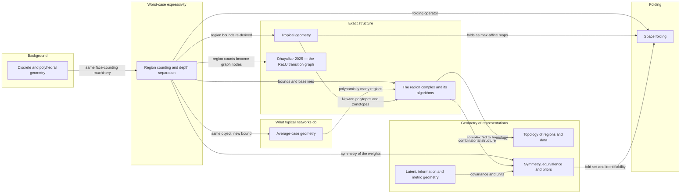

# Comparison

This collection is not one literature but two that share a vocabulary. One is the *geometry of the
function a ReLU network computes*: its input space carries a polyhedral complex of linear regions,
the network is piecewise affine on that complex, and the central questions are how many regions an
architecture can produce, how to enumerate them exactly, and how to describe them
combinatorially — by hyperplane arrangements and their counts
[@pascanuNumberResponseRegions2013, Thm. 1; @NIPS2014_fa6f2a46, Thm. 5], by a polyhedral complex and
its sign sequences [@masdenAlgorithmicDeterminationCombinatorial2022, Thm. 20], by a max-affine
spline operator [@balestrieroSplineTheoryDeep2018, Thm. 1], or by a tropical rational function and
its Newton polytope [@zhangTropicalGeometryDeep, Thm. 5.2]. The other is the *geometry of the space
the network represents data in*: latent manifolds with pulled-back metrics
[@arvanitidisGeometricallyEnrichedLatent2020, Eq. 3; @arvanitidisPullingBackInformation2022,
Prop. 3.2], statistical manifolds with a Fisher–Rao metric and dual connections
[@nielsenElementaryIntroductionInformation2020, §3.9], Finslerian latent distances
[@pouplinIdentifyingLatentDistances2023, Def. 2.5], persistent homology of a network's own
decomposition [@liuReLUNeuralNetworks2023, Eq. 13], and the symmetry/covariance programme of
geometric deep learning [@bronsteinGeometricDeepLearning, §3.5;
@villarFullyCovariantMachine2023, §5].

Within the first family the collection has a clear centre of gravity and a clear fault line. The
centre is the counting of linear regions as a proxy for expressivity: it runs from the response
regions of rectifier MLPs [@pascanuNumberResponseRegions2013, §1] through the depth-separation
constructions [@NIPS2014_fa6f2a46, Cor. 6], the tighter dimensional bookkeeping
[@serraBoundingCountingLinear2018, Thm. 1], the all-weights upper bound
[@raghuExpressivePowerDeep2017, Thm. 1] and the general continuous-piecewise-linear bound
[@goujonNumberRegionsPiecewise2023, Cor. 1], to depth lower bounds for rational weights that do not
use region counts at all [@averkovEXPRESSIVENESSRATIONALRELU2025, Thm. 2]. The fault line is that
these are *worst-case* statements about an architecture, while the same collection contains
*average-case* statements about parameters: with random weights the expected number of regions along a
line is proportional to the number of neurons and not to depth
[@haninComplexityLinearRegions2019, Thm. 1], and the expected density of activation regions is
bounded by $(T\#\text{neurons})^{n_{\mathrm{in}}}/n_{\mathrm{in}}!$ up to the constant $T$, with no depth dependence at all,
a bound that survives training [@haninDeepReLUNetworks2019, Thm. 5]. Taken together, the collection
says that depth buys *possible* complexity that gradient descent demonstrably does not buy in this
measure.

The third thread is computational and it is where the papers most directly compete: five exact
methods compute the same polyhedral object by different routes — edge subdivision from the
1-skeleton [@berzinsPolyhedralComplexExtraction2023, §4], region subdivision with back-projection
on a 2-D slice [@humayunSplineCamExactVisualization2024, §2.2], marching over reachable cells for
verification [@vincentReachablePolyhedralMarching2021, §IV], sign-sequence duality with a cubical
complex [@masdenAlgorithmicDeterminationCombinatorial2022, Thm. 20], and a mixed-integer encoding
counted with an LP-based one-tree search [@serraBoundingCountingLinear2018, §5]. Around them sit
statistical summaries of the same object — sampling the affine maps of regions and clustering them
[@sattelbergLocallyLinearAttributes2023, §2.4], measuring how a straight input segment bends in
Hamming activation space [@lewandowskiSpaceFoldsReLU2024, Eq. 4], or feeding the region labels to
persistent homology [@liuReLUNeuralNetworks2023, §4.2].

A more recent entry in the same spirit stops computing the complex at all and treats the adjacency
itself as the object: sampling activation patterns on a grid and joining patterns at Hamming
distance one yields the *ReLU transition graph*, whose node count, degree distribution, diameter
and region-volume entropy are then read as structural statistics
[@dhayalkarDiscreteFunctionalGeometry2025, Def. 3, §5.1]. It is a cheap summary rather than a new
geometry — it inherits the sampling artefacts the paper itself reports at its largest
configuration [@dhayalkarDiscreteFunctionalGeometry2025, §5.3.1], and its counting component
restates the arrangement count of the first thread
[@dhayalkarDiscreteFunctionalGeometry2025, §4.1].

Where the field is heading, on the evidence of this collection: away from region counts and toward
*invariants and equivalences*. Region counts are ambiguous under parameter symmetries and do not
distinguish architectures with identical accuracy [@humayunSplineCamExactVisualization2024, §1], so
the more recent entries study what is invariant — which parametrisations give the same function
[@phuongFunctionalVsParametric2019, Thm. 1; @grigsbyHiddenSymmetriesReLU, Thm. 4.1], which inputs
are identified by the network [@lewandowskiExploitingSpaceFolding2026, Def. 3], which topological
features of the decomposition are stable [@chazalIntroductionTopologicalData2021, Thm. 7], and
which quantities a symmetry group forces to be covariant [@villarFullyCovariantMachine2023, §5].

## Concept map

Forty-one papers is past the point where one node per paper is readable, so the map below draws each
line of work as a single node and lists its members underneath, except the 2025 transition-graph
entry, which is a single paper and is drawn as one node of its own. Edges follow `builds_on` in the
summaries: an arrow $a \rightarrow b$ means $b$ builds on $a$.

**Members.** *Worst-case expressivity* [@pascanuNumberResponseRegions2013;
@NIPS2014_fa6f2a46; @raghuExpressivePowerDeep2017; @serraBoundingCountingLinear2018;
@goujonNumberRegionsPiecewise2023; @averkovEXPRESSIVENESSRATIONALRELU2025;
@brandenburgDecompositionPolyhedraPiecewise2024; @gagneuxHowImproveExpressivity2025].

*Average-case geometry* [@haninComplexityLinearRegions2019; @haninDeepReLUNetworks2019].

*The region complex and its algorithms* [@carlssonPREIMAGERECTIFIERNETWORK2017;
@balestrieroSplineTheoryDeep2018; @masdenAlgorithmicDeterminationCombinatorial2022;
@berzinsPolyhedralComplexExtraction2023; @vincentReachablePolyhedralMarching2021;
@humayunSplineCamExactVisualization2024; @sattelbergLocallyLinearAttributes2023;
@liuIntegratingGeometriesReLU2023a].

*The ReLU transition graph* [@dhayalkarDiscreteFunctionalGeometry2025].

*Tropical geometry* [@zhangTropicalGeometryDeep; @alfarraDecisionBoundariesNeural2023].

*Space folding* [@keupOrigamiDimensionsHow2022; @lewandowskiSpaceFoldsReLU2024;
@lewandowskiExploitingSpaceFolding2026].

*Topology of regions and data* [@chazalIntroductionTopologicalData2021; @liuReLUNeuralNetworks2023;
@berzinsGeometryInformedNeuralNetworks2024].

*Latent, information and metric geometry* [@nielsenElementaryIntroductionInformation2020;
@combeExploringInformationGeometry2025; @arvanitidisGeometricallyEnrichedLatent2020;
@arvanitidisPullingBackInformation2022; @pouplinIdentifyingLatentDistances2023;
@halversonMetricFlowsNeural2024; @meilaManifoldLearningWhat2023;
@fuLatentTopologyInduction2022].

*Symmetry, equivalence and priors* [@bronsteinGeometricDeepLearning2017;
@bronsteinGeometricDeepLearning; @villarFullyCovariantMachine2023; @grigsbyHiddenSymmetriesReLU;
@phuongFunctionalVsParametric2019].

*Background* [@pakLecturesDiscretePolyhedral].

### The counting lineage in detail

Two separate traditions are buried in the `builds_on` graph, which is why the edges below stay
within one cluster: the counting of regions, and the geometry of the parametrisation. The counting
cluster is small enough to draw paper by paper, and it is the line the textbook follows from
Chapter 1 to Chapter 3. `b --> a` means $a$ builds on $b$.

```mermaid
flowchart LR
    Z["Zaslavsky 1975 — face count<br/>outside the collection"] --> P["pascanuNumberResponseRegions2013"]
    P --> M["NIPS2014_fa6f2a46"]
    M --> RA["raghuExpressivePowerDeep2017"]
    P --> RA
    M --> SE["serraBoundingCountingLinear2018"]
    P --> SE
    RA --> SE
    M --> HC["haninComplexityLinearRegions2019"]
    RA --> HC
    SE --> HC
    M --> HD["haninDeepReLUNetworks2019"]
    RA --> HD
    HC --> HD
    M --> GZ["goujonNumberRegionsPiecewise2023"]
    SE --> GZ
    HC --> GZ
    HD --> GZ
    M --> ZH["zhangTropicalGeometryDeep"]
    RA --> ZH
    ZH --> BR["brandenburgDecompositionPolyhedraPiecewise2024"]
    HD --> GA["gagneuxHowImproveExpressivity2025"]
    HD --> MA["masdenAlgorithmicDeterminationCombinatorial2022"]
    MA --> LI["liuIntegratingGeometriesReLU2023a"]
    RA -.->|same question, not a dependency| AV["averkovEXPRESSIVENESSRATIONALRELU2025"]
    click P "../papers/pascanuNumberResponseRegions2013/"
    click M "../papers/NIPS2014_fa6f2a46/"
    click RA "../papers/raghuExpressivePowerDeep2017/"
    click SE "../papers/serraBoundingCountingLinear2018/"
    click HC "../papers/haninComplexityLinearRegions2019/"
    click HD "../papers/haninDeepReLUNetworks2019/"
    click GZ "../papers/goujonNumberRegionsPiecewise2023/"
    click ZH "../papers/zhangTropicalGeometryDeep/"
    click BR "../papers/brandenburgDecompositionPolyhedraPiecewise2024/"
    click GA "../papers/gagneuxHowImproveExpressivity2025/"
    click MA "../papers/masdenAlgorithmicDeterminationCombinatorial2022/"
    click LI "../papers/liuIntegratingGeometriesReLU2023a/"
    click AV "../papers/averkovEXPRESSIVENESSRATIONALRELU2025/"
```

That dotted arrow is the one edge that departs from the `builds_on` convention:
[@averkovEXPRESSIVENESSRATIONALRELU2025] declares no dependencies and cites
[@raghuExpressivePowerDeep2017] only as context, but it asks the same question, how deep must a
network be, with a modular-volume obstruction instead
of a region count, and it is the only entry here that bounds depth for the weight precision that
floating-point hardware actually uses [@averkovEXPRESSIVENESSRATIONALRELU2025, §1, Thm. 2].
[@zhangTropicalGeometryDeep]'s own region bound is explicitly *not* an improvement on
[@raghuExpressivePowerDeep2017] and is more restrictive [@zhangTropicalGeometryDeep, §6.3], so the
edge is one of method, not of strength.

## Timeline

```mermaid
timeline
    title The collection in time
    2010 : Pak's lectures on discrete and polyhedral geometry
    2013 : Pascanu et al. count response regions and separate deep from shallow
    2014 : Montufar et al. sharpen the deep lower bound and add maxout
    2017 : Raghu et al. measure trajectories and count patterns for all weights
    2017 : Bronstein et al. name geometric deep learning
    2017 : Carlsson et al. invert a layer and describe preimages
    2018 : Zhang et al. identify ReLU networks with tropical rational maps
    2018 : Serra et al. bound regions by image dimension and count them exactly
    2018 : Balestriero and Baraniuk read deep networks as max-affine splines
    2019 : Hanin and Rolnick bound the expected region count along a line
    2019 : Hanin and Rolnick show typical networks have surprisingly few activation patterns
    2019 : Phuong and Lampert determine ReLU symmetries for nested widths
    2020 : Nielsen assembles the dualistic structure of information geometry
    2020 : Arvanitidis et al. pull an ambient metric back into a latent space
    2021 : Chazal and Michel survey topological data analysis and its stability
    2021 : Vincent and Schwager march over reachable cells for verification
    2021 : Bronstein et al. recast deep learning as a symmetry blueprint
    2022 : Arvanitidis et al. replace the ambient metric by Fisher-Rao
    2022 : Masden recovers the full face poset from vertex sign sequences
    2022 : Keup and Helias explain linear separability by folding space
    2022 : Fu and Lapata induce the latent topology of a frozen language model
    2023 : Goujon et al. bound regions of any continuous piecewise-linear network
    2023 : Alfarra et al. read decision boundaries as a tropical polytope
    2023 : Liu et al. feed region labels to persistent homology
    2023 : Berzins extracts the complex by edge subdivision on a GPU
    2023 : Villar et al. separate passive from active symmetry
    2023 : Meila and Zhang survey manifold learning and its distortion
    2023 : Pouplin et al. derive a Finslerian latent metric
    2023 : Sattelberg et al. cluster the affine maps of regions
    2023 : Grigsby et al. find architectures with no hidden symmetries
    2023 : Liu et al. package the polyhedral decomposition into a toolbox
    2024 : Humayun et al. compute the exact partition of a 2D slice
    2024 : Lewandowski et al. quantify folding in activation space
    2024 : Berzins et al. generate shapes without data under geometric constraints
    2024 : Halverson and Ruehle train a Riemannian metric and study its flow
    2025 : Brandenburg et al. decompose piecewise-linear functions into convex parts
    2025 : Averkov et al. bound the depth of rational ReLU networks
    2025 : Combe et al. read statistical manifolds as Frobenius manifolds
    2025 : Gagneux et al. improve convex ReLU networks beyond ICNNs
    2025 : Dhayalkar reads region adjacency as a ReLU transition graph
    2026 : Lewandowski et al. generalise folding to monotonic activations
```

## Reading paths

**Theory first, regions last.** Start with the counting thread in order — response regions
[@pascanuNumberResponseRegions2013], depth separation [@NIPS2014_fa6f2a46], tight bounds
[@serraBoundingCountingLinear2018], all-weights upper bounds
[@raghuExpressivePowerDeep2017] — then read the two papers that reverse its message
[@haninComplexityLinearRegions2019; @haninDeepReLUNetworks2019], the general
continuous-piecewise-linear bound [@goujonNumberRegionsPiecewise2023], and finally the two
non-counting obstructions to depth [@averkovEXPRESSIVENESSRATIONALRELU2025;
@brandenburgDecompositionPolyhedraPiecewise2024]. This is the order of the textbook's first three
chapters and it makes the worst-case/average-case contrast impossible to miss.

**Practitioner: compute the geometry of a model you have.** Begin with the dictionary that makes a
trained network a geometric object [@balestrieroSplineTheoryDeep2018], then pick a tool by input
dimension and budget: a 2-D slice exactly [@humayunSplineCamExactVisualization2024], the whole
complex by edge subdivision [@berzinsPolyhedralComplexExtraction2023], the full face poset from
vertices [@masdenAlgorithmicDeterminationCombinatorial2022], or reachable cells only, for a
verification question [@vincentReachablePolyhedralMarching2021]. Finish with the two ways to
summarise what you sketched: cluster the region affine maps
[@sattelbergLocallyLinearAttributes2023], or measure folding along paths between class means
[@lewandowskiSpaceFoldsReLU2024; @lewandowskiExploitingSpaceFolding2026].
The cheapest summary is also the crudest: sample activation patterns on a grid and read the
transitions between them as a graph [@dhayalkarDiscreteFunctionalGeometry2025, §5.1], which needs no
geometry library but reports its own sampling artefact — a disconnected graph at the largest
configuration — as a property of the graph
[@dhayalkarDiscreteFunctionalGeometry2025, §5.3.1].

**Geometry of representations.** The manifold premise first [@meilaManifoldLearningWhat2023], then
the two latent-metric constructions in the order they were written
[@arvanitidisGeometricallyEnrichedLatent2020; @arvanitidisPullingBackInformation2022], followed by
their Finslerian competitor [@pouplinIdentifyingLatentDistances2023]. Put the information-geometric
background [@nielsenElementaryIntroductionInformation2020; @combeExploringInformationGeometry2025]
alongside the second of these, and the learned-metric experiment
[@halversonMetricFlowsNeural2024] at the end, as the case where the metric itself is the trained
object. Read [@fuLatentTopologyInduction2022] here as the one entry that studies the connectivity of
a representation manifold rather than its metric.

**Invariants, not coordinates.** A path for a reader interested in what is *canonical*: why raw
parameters cannot be interpreted [@humayunSplineCamExactVisualization2024, §1], the two symmetry
theorems that between them cover the two width regimes
[@phuongFunctionalVsParametric2019, Thm. 1; @grigsbyHiddenSymmetriesReLU, Thm. 4.1], equivalence
classes of inputs under folding [@lewandowskiExploitingSpaceFolding2026, Def. 3], and the
symmetry-first design programme they sit against
[@bronsteinGeometricDeepLearning2017; @bronsteinGeometricDeepLearning, §3.5;
@villarFullyCovariantMachine2023].

**Geometry with guarantees.** For a reader who wants statements that survive perturbation: the
stability theorems of topological data analysis
[@chazalIntroductionTopologicalData2021, Thm. 7, Thm. 9], their use on a network's own
decomposition [@liuReLUNeuralNetworks2023], the exact topological determination of a decision
boundary [@masdenAlgorithmicDeterminationCombinatorial2022, §4.2], exact reachability for safety
[@vincentReachablePolyhedralMarching2021, §V], and a data-free constrained design task where a
differentiable topological loss is the objective [@berzinsGeometryInformedNeuralNetworks2024, §4.1].
