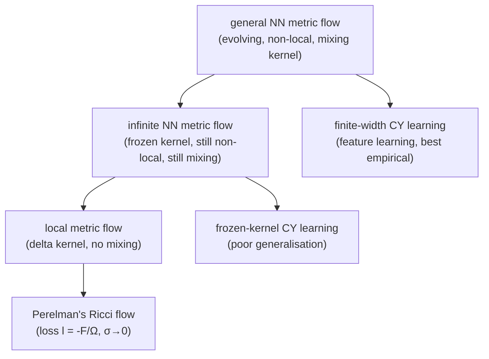

# Metric flows with neural networks

!!! abstract "In this chapter"
    - A Riemannian metric $g$ can itself be the output of a network $g_\theta$, so training the network is a *flow in the space of metrics*.
    - That flow is governed by a *metric neural tangent kernel* $\Theta_{ijkl}(x,x')$ which is in general non-local, mixes metric components, and evolves in time.
    - In the infinite-width limit the kernel freezes; adding independent per-component networks and a Gaussian-suppressed architecture forces the flow to be *local*, after which Perelman's gradient-flow formulation of Ricci flow is one particular choice of loss.
    - The flow is discretised by backward Euler and learned numerically; frozen kernels generalise poorly, while a successful finite network has a visibly evolving metric-NTK.
    - Prerequisites: [Riemannian and Finsler geometry of latent spaces](latent-geometry.md), [The region complex of a ReLU network](relu-network-geometry.md).

Every chapter so far has taken the network to be a function and studied the geometry of *its* output. This chapter turns the question around: what happens when the object the network represents is itself a geometry? A Riemannian manifold $X$ is given in local coordinates by a field $g_{ij}(x)$ of positive-definite matrices [@halversonMetricFlowsNeural2024, §2.1, p. 5], and a field of matrices is exactly the kind of object a network can output. If the network produces $g_{ij}(x)$ and we train it by gradient descent, then the metric is not a fixed stage on which learning happens — it moves. The sequence of updates is a curve in the (infinite-dimensional) space of metrics, a *metric flow*, and the questions of this chapter are which flows can arise this way and what the flow does to the geometry it moves.

The motivation is concrete and comes from string geometry. No nontrivial compact Calabi–Yau (CY) metric is known in closed form: the theorems of Calabi and Yau guarantee that a Ricci-flat Kähler metric exists in each Kähler class when the topological criteria hold, but Yau's proof is non-constructive [@halversonMetricFlowsNeural2024, §1, p. 3]. The classical constructive route, Donaldson's algorithm, is a sequence of approximations that converge towards the metric, and a sequence becomes a flow when the step size is taken infinitesimal [@halversonMetricFlowsNeural2024, §1, p. 3]. Recently networks have taken over as the state of the art for approximating these metrics, and the authors motivate the theory with a striking ratio: "thirty minutes on a modern laptop gives an approximate Calabi–Yau metric on par with those that would take a decade to compute with Donaldson's algorithm" [@halversonMetricFlowsNeural2024, §1, p. 3]. A network training run is then precisely a metric flow with infinitesimal update, and the natural question is how that flow relates to the flows of differential geometry for which Calabi–Yau metrics are fixed points — above all Ricci flow [@halversonMetricFlowsNeural2024, §1, p. 3].

The chapter follows [@halversonMetricFlowsNeural2024] closely. Section "Metrics as networks" derives the general flow; "The metric neural tangent kernel" isolates the object that governs it; "Infinite-width metric flows" and "Local metric flows" add the two simplifications that make the flow tractable; "Ricci flow as a neural network metric flow" locates Perelman's gradient-flow formulation of Ricci flow inside the neural-network family; and the last two sections describe what the flow preserves and how it is learned numerically. I keep the shared [notation](../notation.md): the metric components are represented by networks, so the symbol $g_{ij}(x;\theta)$ plays the role of the network output and $\theta$ collects the parameters, while the ReLU-network conventions $f_\theta$, $a^{(l)}$ and the region complex $\mathcal{P}(f)$ from earlier chapters are not needed here. A note on terminology: [@halversonMetricFlowsNeural2024] writes $g_\theta$ for the network that outputs the metric and $\Phi$ elsewhere for a flow; the notation table records this.

## Metrics as networks, and training as a flow

Let $X$ be a Riemannian manifold with metric $g=(g_{ij})$ in local coordinates $x^i$, and let the components $g_{ij}(x)$ be computed by a deep network with parameters $\theta^I$, $I=1,\dots,N$ [@halversonMetricFlowsNeural2024, §2.1, p. 5]. Throughout the paper lower-case Latin indices label coordinates of $X$ and capital Latin indices label network parameters, and Einstein summation over repeated indices is implied unless stated otherwise [@halversonMetricFlowsNeural2024, §2.1, p. 5].

Since $g$ is a function of $\theta$ and nothing else, the metric changes only when the parameters do, and the chain rule gives the flow

$$
\frac{dg_{ij}(x)}{dt} = \frac{\partial g_{ij}(x)}{\partial\theta^I}\,\frac{d\theta^I}{dt}. \qquad \text{(Eq. 2.1)}
$$

Training the network means choosing a nonzero $d\theta^I/dt$, so training *is* a metric flow [@halversonMetricFlowsNeural2024, §2.1, p. 5]. The paper restricts to gradient descent, $d\theta^I/dt = -\partial L[g]/\partial\theta^I$, for a scalar loss functional $L$ that depends on the metric [@halversonMetricFlowsNeural2024, §2.1, pp. 5–6, Eq. 2.2]. The loss is either a finite batch sum $L[g]=\sum_{x'\in B} l(x')$ or a continuous integral $L[g]=\int_X d\mu(x')\,l(x')$ against a chosen measure on $X$ [@halversonMetricFlowsNeural2024, §2.1, p. 6, Eqs. 2.3–2.4]. The measure is typically the volume form of a fixed reference metric $\tilde g$, so that there is a background geometry against which the moving metric is measured [@halversonMetricFlowsNeural2024, §2.1, p. 6].

Writing the loss as a batch sum and applying the chain rule once more, one factor of $\partial g/\partial\theta$ stays outside the sum and the other pulls inside. The result is the general metric flow

$$
\frac{dg_{ij}(x)}{dt} = -\sum_{x'\in B} \Theta_{ijkl}(x,x')\,\frac{\delta l(x')}{\delta g_{kl}(x')} \qquad \text{(Eq. 2.5, p. 6)}
$$

for the discrete case, and

$$
\frac{dg_{ij}(x)}{dt} = -\int_X d\mu(x')\,\Theta_{ijkl}(x,x')\,\frac{\delta l(x')}{\delta g_{kl}(x')} \qquad \text{(Eq. 2.8, p. 6)}
$$

for the continuous one. The distinction matters: the discrete sum updates the metric only at the batch points, while the integral smears the update over all of $X$ — a difference that returns as a genuine pathology when locality is imposed later [@halversonMetricFlowsNeural2024, §2.3, p. 9].

## The metric neural tangent kernel

The distinguished object appearing in both flow equations is

$$
\Theta_{ijkl}(x,x') := \frac{\partial g_{ij}(x)}{\partial\theta^I}\,\frac{\partial g_{kl}(x')}{\partial\theta^I}, \qquad \text{(Eq. 2.7, p. 6)}
$$

the *metric neural tangent kernel* (metric-NTK), symmetric in the first and the last pair of indices [@halversonMetricFlowsNeural2024, §2.1, p. 6]. It is the ordinary neural tangent kernel of the collection, but with one copy of the Jacobian at the external point $x$ and one at the integrated point $x'$.

The authors stress that $\Theta_{ijkl}$ is *not* a four-tensor on $X$: the $(ij)$ indices transform under diffeomorphisms acting at $x$, the $(kl)$ indices under diffeomorphisms acting at $x'$, and invariance of the metric update under the latter requires an invariant measure in the integral [@halversonMetricFlowsNeural2024, §2.1, p. 7]. This is the technical reason the flow is awkward, and it is worth separating from the three structural features the paper lists [@halversonMetricFlowsNeural2024, §2.1, p. 7]:

- **Evolving kernel.** Gradient descent updates the parameters and therefore the metric-NTK, so both $\Theta$ and $\delta l/\delta g$ are time-dependent.
- **Non-locality.** $\Theta$ acts as a smearing function: it updates the metric at $x$ from the loss' behaviour at points $y$ that may be arbitrarily far from $x$.
- **Component mixing.** Any $(k,l)$ component of the metric can update a fixed $(i,j)$ component, through the contraction of $\Theta_{ijkl}$ with $\delta l/\delta g_{kl}$.

In the continuous case the flow is thus an integral-differential equation that is difficult to solve or even analyse [@halversonMetricFlowsNeural2024, §2.1, p. 7]. The rest of the theory consists in identifying limits in which these three features disappear, one by one.

!!! note "Background"
    A *flow* in the space of Riemannian metrics is a one-parameter family $g(t)$ of metrics obeying a first-order equation $dg_{ij}/dt=-u_{ij}$ for some symmetric tensor $u$. Ricci flow, $\partial_t g_{ij}=-2R_{ij}$, is the canonical example: Hamilton introduced it and Perelman used it to resolve the three-dimensional Poincaré conjecture [@halversonMetricFlowsNeural2024, §2.4, p. 14]. A flow is a *gradient flow* when $u_{ij}=\delta F/\delta g_{ij}$ for a scalar functional $F$, so that $F$ is non-increasing along the flow; gradients here are variational derivatives in the metric. The neural-network flows of this chapter are gradient flows by construction, because the parameter update is gradient descent on a scalar loss [@halversonMetricFlowsNeural2024, §2.4, p. 14].

## Infinite-width metric flows

The first simplification is the large-width limit. For an appropriately chosen and normalised architecture, the metric-NTK becomes, by the law of large numbers, an expectation over the parameter distribution,

$$
\lim_{N\to\infty}\Theta_{ijkl}(x,x') = \E_\theta\!\left[\alpha_{ijkl}(x,x')\right] =: \bar\Theta_{ijkl}(x,x'), \qquad \text{(Eq. 2.9, p. 7)}
$$

which is deterministic and depends only on the architecture and the parameter distribution, not on the particular initialisation [@halversonMetricFlowsNeural2024, §2.2, p. 7]. The second simplification is linearisation in the parameters: Taylor-expanding $g$ about the initial parameters $\theta_0$ and truncating at linear order gives a model whose metric-NTK is $\Theta$ evaluated at initialisation [@halversonMetricFlowsNeural2024, §2.2, p. 7, Eqs. 2.10–2.11]. That kernel still does not depend on $t$ even though $\Theta$ does, and its $N\to\infty$ limit is both $t$- and $\theta$-independent — the *frozen* NTK, written with a bar [@halversonMetricFlowsNeural2024, §2.2, p. 7].

The justification for taking this truncation seriously is the *lazy-learning* result: deep networks in the $N\to\infty$ limit evolve as linear models under gradient descent, so the frozen kernel governs the dynamics to controllable accuracy [@halversonMetricFlowsNeural2024, §2.2, p. 8]. Substituting $\bar\Theta$ into the general flow gives

$$
\frac{dg_{ij}(x)}{dt} = -\sum_{x'\in B}\bar\Theta_{ijkl}(x,x')\,\frac{\delta l(x')}{\delta g_{kl}(x')}, \qquad \text{(Eq. 2.12, p. 8)}
$$

and likewise for the integral form, with the only change that the deterministic, time-independent $\bar\Theta$ replaces the stochastic, time-dependent $\Theta$ [@halversonMetricFlowsNeural2024, §2.2, p. 8]. The paper calls this an *infinite neural network metric flow*. The kernel is frozen, but the flow is still non-local and still mixes components [@halversonMetricFlowsNeural2024, §2.2, p. 8].

The apparent paradox — one cannot put an infinite network on a computer — is resolved by a change of description. In the large-$N$ limit the same dynamics is available as kernel regression on function space rather than parameter-space descent; for mean-squared-error loss the dynamics can be solved exactly, with computable mean and covariance across initialisations [@halversonMetricFlowsNeural2024, §2.2, pp. 8–9]. The authors describe this as a duality frame: the same system, described differently, becomes calculable [@halversonMetricFlowsNeural2024, §2.2, pp. 8–9].

## Local metric flows

The second simplification removes non-locality and component mixing. A frozen metric-NTK is called *local* when it collapses onto the diagonal,

$$
\bar\Theta_{ijkl}(x,x') = \delta(x-x')\,\delta_{ik}\delta_{jl}\,\bar\Omega(x) \qquad \text{(Eq. 2.13, p. 9)}
$$

for a deterministic function $\bar\Omega(x)$, in which case the flow becomes the local gradient flow

$$
\frac{dg_{ij}(x)}{dt} = -\bar\Omega(x)\,\frac{\delta l(x)}{\delta g_{ij}(x)}. \qquad \text{(Eq. 2.14, p. 9)}
$$

Here $\delta(x-x')$ is the Dirac delta with respect to the chosen measure and $\delta_{ik}\delta_{jl}$ is a Kronecker delta [@halversonMetricFlowsNeural2024, §2.3, p. 9]. The paper immediately flags a pathology: enforcing Kronecker deltas in the discrete case means only the batch points are ever updated, so no point outside the training set learns anything [@halversonMetricFlowsNeural2024, §2.3, p. 9]. A non-local kernel is therefore essential for the metric to update anywhere, and the local case is meaningful only for continuous flows [@halversonMetricFlowsNeural2024, §2.3, p. 9].

Component mixing is removed architecturally. If each independent component $g_{ij}(x)$ is a separate network with its own parameters $\theta^{ij}$, the parameter set partitions as $\theta=\bigcup_{i,j}\theta^{ij}$ and the metric-NTK factorises as $\bar\Theta_{ijkl}(x,x')=\delta_{ik}\delta_{jl}\bar\Theta(x,x')$ once the per-component networks share an architecture [@halversonMetricFlowsNeural2024, §2.3.1, pp. 10–11, Eqs. 2.19–2.23]. Locality is harder: one needs an architecture whose component kernel is $\bar\Theta(x,x')=\delta(x-x')\bar\Omega(x)$ [@halversonMetricFlowsNeural2024, §2.3.1, p. 11, Eq. 2.24].

Two ingredients deliver it [@halversonMetricFlowsNeural2024, §2.3.1, pp. 11–12]. The first is a Gaussian-suppressed kernel. If a network $\phi_\sigma$ has frozen NTK

$$
\bar\Theta_\sigma(x,x') = \frac{1}{(2\pi\sigma^2)^{d/2}}\exp\!\left(-\frac{1}{2\sigma^2}|x-x'|^2\right)\bar\alpha(x,x') \qquad \text{(Eq. 2.27, p. 11)}
$$

for some deterministic $\bar\alpha$, then the normalised Gaussian becomes the $d$-dimensional delta function $\delta_{\mathbb{R}^d}$ as $\sigma\to0$ [@halversonMetricFlowsNeural2024, §2.3.1, pp. 11–12]. The paper is explicit that this semi-locality is an *assumption*, not a general consequence, made to push towards local flows [@halversonMetricFlowsNeural2024, §2.3.1, p. 12].

The second ingredient is a rescaling trick. Multiplying a network function by a deterministic $h(x)$ leaves the parameters unchanged and multiplies its NTK by $h(x)h(x')$,

$$
\Theta_{\tilde\phi}(x,x') = h(x)h(x')\,\Theta_\phi(x,x'), \qquad \text{(Eq. 2.16, p. 9)}
$$

so with the choice $h=\tilde g^{-1/4}$ one cancels the metric determinant in the volume measure, converting the flat delta function into the delta function with respect to the Riemannian volume form [@halversonMetricFlowsNeural2024, §2.3.1, pp. 11–12, Eqs. 2.15–2.18, 2.25–2.28]. The resulting kernel satisfies $\lim_{\sigma\to0}\bar\Theta_\sigma(x,x')=\delta(x-x')\bar\Omega(x)$, i.e. the locality condition (2.13), with the parameter $\sigma$ measuring the amount of non-locality remaining [@halversonMetricFlowsNeural2024, §2.3.1, p. 12, Eq. 2.29]. At finite $\sigma$ the flow is a controlled non-local generalisation in which nearby points influence the update at $x$ [@halversonMetricFlowsNeural2024, §2.3.1, p. 12, Eq. 2.30].

A concrete architecture realising Eq. (2.27) is a cosine-activation network,

$$
\phi(x) = \frac{A}{\sqrt N}\sum_{i=1}^N a_i\cos\!\Big(\sum_{j=1}^d w_{ij}x^j + b_i\Big), \qquad \text{(Eq. 2.32, p. 13)}
$$

with $a\sim\mathcal{N}(0,\sigma_a^2)$, $w\sim\mathcal{N}(0,\sigma_w^2/d)$ and $b\sim U(-\pi,\pi)$, in which only the final-layer coefficients $a_i$ are trained [@halversonMetricFlowsNeural2024, §2.3.2, p. 13]. Its $N\to\infty$ NTK is a Gaussian,

$$
\bar\Theta(x,x') = \frac{A^2}{2}\exp\!\left(-\frac{1}{2}\frac{\sigma_w^2}{d}|x-x'|^2\right), \qquad \text{(Eq. 2.35, p. 13)}
$$

which after fixing the normalisation $A$ is a normalised Gaussian of width $\sigma=\sqrt d/\sigma_w$, so the limit $\sigma_w\to\infty$ gives $\sigma\to0$ and a local metric flow [@halversonMetricFlowsNeural2024, §2.3.2, pp. 13–14, Eqs. 2.36–2.37]. The authors note that this is a modification, via NTK parameterisation, of an architecture known to have a Gaussian NNGP kernel, and that the Gauss-net architecture of an earlier paper has a Gaussian NNGP kernel that can be repurposed similarly [@halversonMetricFlowsNeural2024, §2.3.2, p. 14].

!!! tip "What to reach for"
    The order of the assumptions is a useful mnemonic. *Infinite width* freezes the kernel; *separate per-component networks* kill component mixing; *Gaussian suppression plus the $h(x)$ rescaling* buys locality. None is forced by the problem, and each is a choice one makes about the architecture and the loss [@halversonMetricFlowsNeural2024, §2.3, pp. 9–14].

## Ricci flow as a neural network metric flow

With a local metric flow in hand, one can ask which classical flows are expressible in it. Many well-studied metric flows are local in the sense that they take the form $dg_{ij}/dt = -u_{ij}(x)$ for a rank-two symmetric tensor $u_{ij}$ built from local data, and Ricci flow,

$$
\frac{dg_{ij}(x)}{dt} = -2R_{ij}(x), \qquad \text{(Eq. 2.39, p. 14)}
$$

is the leading example, with $R_{ij}$ the Ricci tensor [@halversonMetricFlowsNeural2024, §2.4, p. 14]. Such a flow need not be a gradient flow, but Perelman showed that Ricci flow *is* one after a time-dependent diffeomorphism: with the Perelman functional

$$
F[\phi,g] = \int_X \left(R + |\nabla\phi|^2\right)e^{-\phi}\,dV, \qquad \text{(Eq. 2.41, p. 15)}
$$

and a scalar dilaton $\phi$, one has

$$
\frac{dg_{ij}}{dt} = \frac{\delta F[\phi,g]}{\delta g_{ij}(x)} = -2\left[R_{ij} + \nabla_i\nabla_j\phi\right], \qquad \text{(Eq. 2.40, p. 14)}
$$

which equals Eq. (2.39) up to that diffeomorphism [@halversonMetricFlowsNeural2024, §2.4, pp. 14–15]. Since a local metric flow is a local gradient flow, and $l(x)=-F[\phi,g]/\bar\Omega(x)$ is a legal choice of loss, Perelman's formulation of Ricci flow is realised as a neural network metric flow [@halversonMetricFlowsNeural2024, §2.4, p. 15, Eq. 2.42]. Backing off the $\sigma\to0$ limit replaces the delta function by a Gaussian and yields a parametrically non-local generalisation of Ricci flow, controlled by $\sigma$ [@halversonMetricFlowsNeural2024, §2.4, p. 15]. The same construction works for any local metric flow that is a gradient flow, by a suitable choice of loss [@halversonMetricFlowsNeural2024, §2.4, p. 15].

The paper's conclusion about this realisation is as important as the realisation itself. The assumptions that lead to Perelman's flow — infinite width, locality, elimination of component mixing — are "both ad hoc and strong" and "very non-generic in the space of neural network metric flows" [@halversonMetricFlowsNeural2024, §1, p. 4]. The authors frame this as the point rather than a defect: the analytic tractability that made Ricci flow a proof tool is exactly the specificity that makes it a poor tool for *learning* a Calabi–Yau metric [@halversonMetricFlowsNeural2024, §4, p. 25].

## Kähler flows and what the flow preserves

For Calabi–Yau applications the relevant metrics carry extra structure, and the flow must respect it. On a compact Kähler manifold the metric is the second derivative of a real Kähler potential, $g_{a\bar b}=\partial_a\partial_{\bar b}K$, subject to positive-definiteness [@halversonMetricFlowsNeural2024, App. B, p. 28, Eq. B.1], and the associated Kähler form is $J=\frac{i}{2}g_{a\bar b}\,dz^a\wedge d\bar z^{\bar b}$ [@halversonMetricFlowsNeural2024, App. B, p. 28, Eq. B.2]. The Ricci tensor then takes the particularly simple form $R_{a\bar b}=-\partial_a\partial_{\bar b}\ln g$ with $g=\det(g_{a\bar b})$, and Hamilton's Ricci flow becomes

$$
\frac{dg_{a\bar b}}{dt} = \partial_a\partial_{\bar b}\ln g. \qquad \text{(Eq. B.4, p. 29)}
$$

This is the decisive structural point: the metric update for the Kähler–Ricci flow is both $\partial$- and $\bar\partial$-exact, and therefore the *Kähler class is fixed* along the flow [@halversonMetricFlowsNeural2024, App. B, p. 29]. That is what the flow preserves in this setting — it moves the metric within a fixed cohomology class rather than changing the class.

Because the class is fixed, the whole flow can be written on the level of a Kähler-potential correction $\varphi$, with $g_{a\bar b}(t)=g_{0,a\bar b}+\frac{i}{2\pi}\partial_a\partial_{\bar b}\varphi(t)$ for a reference metric $g_{0}$ in the chosen class [@halversonMetricFlowsNeural2024, App. B, p. 29, Eqs. B.5–B.6]. The problem of finding a Ricci-flat metric then becomes a parabolic Monge–Ampère-type equation in $\varphi$ — the equation Yau used to prove Calabi's conjecture [@halversonMetricFlowsNeural2024, App. B, p. 29]. Several energy functionals play the role of $F$ here: the Mabuchi energy functional, the $J$-functional and the Calabi functional, with the Calabi functional being the square of the derivative of the $J$-functional [@halversonMetricFlowsNeural2024, App. B, pp. 29–30]. The Calabi functional $E_{\text{Calabi}}=\int_X R^2 J^n$ drives a flow ending on constant-scalar-curvature metrics, which for a Calabi–Yau manifold are exactly the Ricci-flat ones because the vanishing of the first Chern class forces $R_{a\bar b}=0$ [@halversonMetricFlowsNeural2024, App. B, pp. 29–30, Eqs. B.7–B.9].

The construction also covers the ultra-local functionals $E_{\text{ultra}}=\int_X F(\eta)\,\mu_{\text{CY}}$ for any differentiable, convex $F$ bounded below, whose variation forces $F'(\eta)$ to be constant [@halversonMetricFlowsNeural2024, App. B, p. 30, Eqs. B.12–B.13]. Here $\eta = J^n/(\kappa|\Omega|^2)$ measures the deviation of the metric from Ricci-flatness, with $\Omega$ the nowhere-vanishing holomorphic top form and $\kappa$ a normalisation constant [@halversonMetricFlowsNeural2024, App. B, p. 30, Eqs. B.10–B.11]. The corresponding *sigma loss* is

$$
\sigma := |1-\eta|, \qquad \eta = \frac{J^n}{\kappa|\Omega|^2}, \qquad \text{(Eq. B.11, p. 30)}
$$

which vanishes exactly on a Calabi–Yau metric (where $\eta=1$) and is the loss used in all the numerical experiments [@halversonMetricFlowsNeural2024, App. B, p. 30]. With the choice $F(\eta)=(\eta-1)^2$ the gradient flow is $d\varphi/dt=-2(\eta-1)$, a simple ultra-local flow that ends on the Calabi–Yau metric [@halversonMetricFlowsNeural2024, App. B, p. 32, Eqs. B.14, B.21]; the two-derivative functional $\int \mu_{\text{CY}}\,g^{a\bar b}\partial_a\eta\,\partial_{\bar b}\eta$ instead reproduces the Einstein–Hilbert action up to a factor, and is identically zero on a Calabi–Yau metric [@halversonMetricFlowsNeural2024, App. B, pp. 30–31, Eqs. B.15–B.17]. The paper notes two symbol clashes that a reader of the appendix must keep apart: the Kähler-potential correction $\varphi$ is not the dilaton $\phi$, the holomorphic top form $\Omega$ is unrelated to the $\bar\Omega$ of the metric-NTK, and the loss $\sigma$ is unrelated to any Gaussian width [@halversonMetricFlowsNeural2024, App. B, p. 29].

## Discretisation and numerical Calabi–Yau metric learning

The continuous flow is realised in practice by a first-order backward-Euler step,

$$
g^{(n+1)}_{ij}(x) = g^{(n)}_{ij}(x) - \Delta t\sum_{x'\in B}\Theta_{ijkl}(x,x')\,\frac{\delta\ell(x')}{\delta g^{(n)}_{kl}}, \qquad \text{(Eq. 3.5, p. 19)}
$$

with the step size $\Delta t$ treated as a hyperparameter [@halversonMetricFlowsNeural2024, §3.2, p. 19]. This is exactly the discretised version of Eq. (2.8); feature learning corresponds to the kernel $\Theta$ carrying a time index, as in the original Eq. (2.5).

The benchmark is the Fermat Quintic, the Calabi–Yau threefold $z_0^5+z_1^5+z_2^5+z_3^5+z_4^5=0$ inside $\mathbb{P}^4$ [@halversonMetricFlowsNeural2024, §3, p. 15, Eq. 3.1]. The baseline is a simple finite network — three layers, 64 nodes, ReLU activation, trained for around 50 epochs on 100k points — which gains a factor of 10–100 in overall validation loss [@halversonMetricFlowsNeural2024, §3, p. 15]. The kernel experiments use three kernels: the infinite-width ReLU NTK (via the `neural-tangents` package), a Gaussian kernel

$$
\Theta_{ijkl}(x,x') = \delta_{ik}\delta_{jl}\,e^{-d(x,x')/2\sigma}, \qquad \text{(Eq. 3.6, p. 20)}
$$

with $d(x,x')$ the shortest geodesic distance in the ambient Fubini–Study metric and $\sigma$ a hyperparameter, and a "Delta" nearest-neighbour kernel that copies the correction from the closest training point [@halversonMetricFlowsNeural2024, §3.2, pp. 19–20]. Hyperparameters are tuned by Bayesian optimisation, and crucially each optimisation run uses fresh points, because otherwise the optimiser tunes to a particular point set and performs poorly on new data [@halversonMetricFlowsNeural2024, §3.2, p. 19]. (The text layer of Eq. (3.6) is ambiguous between $e^{-d/2\sigma}$ and $e^{-d^2/2\sigma^2}$; the summary flags this.)

Two practical difficulties force a clustering step. The full discrete NTK is a $3\times3\times3\times3\times N_{\text{pts}}'\times N_{\text{pts}}'$ tensor — almost a trillion entries for 100,000 points — which exceeds academic hardware [@halversonMetricFlowsNeural2024, §3.1, p. 16]. And there is no canonical distance on feature space, though here the features are points on a Calabi–Yau manifold, so the shortest geodesic distance in the ambient Fubini–Study metric is a cheap, if imperfect, proxy for the unavailable Ricci-flat distance [@halversonMetricFlowsNeural2024, §3.1, pp. 16–17]. The authors cluster mini-batches by that distance with agglomerative clustering and merge clusters across batches by minimum mean distance, aiming for clusters of order 5000 points so that the $3\times3\times3\times3\times5000\times5000$ NTK fits in memory [@halversonMetricFlowsNeural2024, §3.1, p. 17, Eq. 3.3].

The results are the empirical core of the paper. Kernel methods fit the training set very well but generalise poorly: "we failed to achieve a gain of more than a factor of $\sim 5$ in the test loss" [@halversonMetricFlowsNeural2024, §3.2, p. 20]. At zero geodesic distance to a training point — using the training set as the test set — the Gaussian and Delta kernels reach a factor of about $10^6$ and the ReLU kernel about $5$; as the geodesic distance grows the gain falls, reaching about $1$ at distance $1$ [@halversonMetricFlowsNeural2024, §3.2, pp. 21–22]. Because the mean geodesic distance between points is about $0.3$ at $10^3$ points and $0.1$ at $10^5$ points, the expected gain at realistic test distances is about $5$, regardless of the training-set size — a prediction confirmed by direct experiment [@halversonMetricFlowsNeural2024, §3.2, p. 22]. The mean distance fits $\mu = 0.968\times N_{\text{pts}}^{-0.184}$, close to the exponent $-1/d\approx-0.167$ expected for a point sample on a six-real-dimensional manifold [@halversonMetricFlowsNeural2024, §3.2, p. 22, Eq. 3.7]. Extrapolating, a factor of $100$ would need $10^{12}$ points (Gaussian kernel) or $10^8$ points (Delta kernel), and the $10^6$ train-set gain would need about $10^{35}$ points — while the finite network reaches factor-$100$ accuracy from $10^5$ points [@halversonMetricFlowsNeural2024, §3.2, p. 22].

The clustering itself is only a partial success. The silhouette scores are $0.016$ for batched clustering, $-0.011$ for full clustering and $-0.032$ for the Euclidean Birch baseline, all near zero, and the authors state plainly that the batched algorithm "is not perfect and depends on the random order of mini batches and clusters" [@halversonMetricFlowsNeural2024, §3.1, pp. 17–18]. There are further numerical hazards: metrics computed in different affine patches are expressed in different coordinate systems, so the paper over-samples and uses rejection sampling to keep a consistent frame [@halversonMetricFlowsNeural2024, §3.1, pp. 18–19]; and because $\arccos(1-\epsilon)\simeq\sqrt{2\epsilon}$ for small $\epsilon$, numerically identical points acquire a distance of order $10^{-3}$, which must be thresholded to zero to avoid amplifying noise through the exponentially suppressing kernel [@halversonMetricFlowsNeural2024, §3.1, p. 19, Eq. 3.4].

## Feature learning and the frozen kernel

Why do fixed kernels fail where finite networks succeed? The paper's answer is *feature learning*, and it makes the answer checkable. A frozen NTK is fixed by the architecture and the initialisation before training begins and never changes, so the way results at training points are combined into a prediction at a test point is set in advance; a finite network, by contrast, adapts its internal representation to the data [@halversonMetricFlowsNeural2024, §3.2, p. 23]. The authors add a geometric reason: the Calabi–Yau metric is unique in a fixed Kähler class, so a kernel that predicts the metric at $x'$ from nearby metric data must be a very special function — and in the one case where the metric is known in closed form, the two-torus analogue of the Fermat Cubic, the correct combination is given by inverse Weierstrass $\wp$-functions, certainly not by a Gaussian or a ReLU NTK [@halversonMetricFlowsNeural2024, §3.2, p. 23].

To test the mechanism directly, the paper tracks the empirical metric-NTK of a *finite* network that learns well: the `cymetic` multiplicative model with three hidden layers of 128 neurons, gelu activation, trained for 50 epochs [@halversonMetricFlowsNeural2024, §3.3, p. 24]. The Hermitian metric's $d^2=9$ independent components are combined into multi-indices $I,J$, giving a $9\times9\times10\times10$ NTK over 10 fixed train and 10 fixed test points, and the eigenvalues of the $10\times10$ blocks are tracked per epoch [@halversonMetricFlowsNeural2024, §3.3, p. 24]. The spectrum shifts clearly between epoch 0 and epoch 50, and the Wasserstein distance between the current and initial spectra grows steadily — direct evidence that the metric-NTK evolves during training, i.e. that features are being learned [@halversonMetricFlowsNeural2024, §3.3, p. 24, Fig. 4].

The paper is careful to frame the inference as an attribution rather than a controlled causal test: the finite network is not retrained with its kernel frozen at initialisation, so the evidence that feature learning *causes* the better performance is correlational, and the comparison is not perfectly matched — the finite baseline uses 100k points while the kernel runs use about 1000–2500 [@halversonMetricFlowsNeural2024, §3.2, p. 20, Tab. 1]. The paper also notes that an earlier direct numerical study with Ricci flow performs worse than finite networks beyond the torus, consistent with the picture [@halversonMetricFlowsNeural2024, §4, p. 26].

!!! question "Open question"
    The general neural network metric flow sits in a vast space. Which metric flows in that space are useful — for Calabi–Yau metrics, for other geometric learning tasks — and can the frozen-kernel corner ever compete when the target metric is unique in its class? [@halversonMetricFlowsNeural2024, §4, p. 26]. The paper's own answer is negative for the kernels tested, but it leaves open the characterisation of the "special" kernels that would work, describing it as a question about a distinguished subclass of learned kernels [@halversonMetricFlowsNeural2024, §3.2, p. 23].

## Summary

- Representing a metric by a network turns gradient-descent training into a flow $dg_{ij}/dt = \partial g_{ij}/\partial\theta^I\,d\theta^I/dt$ in the space of metrics, governed by the metric-NTK $\Theta_{ijkl}(x,x')$ [@halversonMetricFlowsNeural2024, §2.1, p. 6, Eqs. 2.1, 2.7].
- The general flow is hard for three independent reasons — the kernel evolves, it is non-local, and it mixes metric components — and each is removed by a separate assumption [@halversonMetricFlowsNeural2024, §2.1, p. 7].
- Infinite width freezes the kernel by a law-of-large-numbers expectation and yields an infinite neural network metric flow, still non-local and mixing, but solvable as kernel regression [@halversonMetricFlowsNeural2024, §2.2, pp. 7–9].
- Separate per-component networks remove mixing; a Gaussian-suppressed kernel whose width $\sigma\to0$ plus the rescaling trick $h(x)h(x')$ on the NTK produce locality, giving a local gradient flow $dg_{ij}/dt=-\bar\Omega(x)\,\delta l/\delta g_{ij}$ [@halversonMetricFlowsNeural2024, §2.3, pp. 9–12].
- With the loss $l=-F[\phi,g]/\bar\Omega(x)$, Perelman's gradient-flow formulation of Ricci flow is one local neural network metric flow, but its assumptions are strong and non-generic [@halversonMetricFlowsNeural2024, §2.4, pp. 14–15].
- Kähler–Ricci flow has a $\partial\bar\partial$-exact metric update, so it preserves the Kähler class; the associated sigma loss $\sigma=|1-\eta|$, $\eta=J^n/(\kappa|\Omega|^2)$, vanishes on a Calabi–Yau metric [@halversonMetricFlowsNeural2024, App. B, pp. 29–30].
- Discretised by backward Euler (Eq. 3.5), frozen kernels generalise poorly — a factor $\sim5$ in test loss at realistic distances, needing $10^{12}$ or more points for factor 100 — while a successful finite network's metric-NTK measurably evolves [@halversonMetricFlowsNeural2024, §3.2, p. 22; §3.3, p. 24].

## Further reading

- [@halversonMetricFlowsNeural2024]: read §2.1 for the metric-NTK and the three complications, §2.3 for the architecture that buys locality, §2.4 for the Ricci-flow realisation, and App. B for the Kähler flows and the sigma loss; §3 is the numerical study.
- [Riemannian and Finsler geometry of latent spaces](latent-geometry.md): the pullback metric $G(z)=J_\phi(z)^\top G(\phi(z))J_\phi(z)$ is the Riemannian geometry a decoder induces, the fixed-background counterpart of the moving metrics here.
- [Information geometry](information-geometry.md): the Fisher–Rao metric and its flows give another setting where a metric, not a function, is the object being learned.

## Exercises

**Exercise 1** ★ (check). The metric-NTK is defined as $\Theta_{ijkl}(x,x') = \partial g_{ij}(x)/\partial\theta^I\,\partial g_{kl}(x')/\partial\theta^I$. Explain why [@halversonMetricFlowsNeural2024] insists that $\Theta_{ijkl}$ is not a tensor on $X$, and which index pair transforms at which point.

??? success "Solution"
    Because the two Jacobian factors are evaluated at two *different* points: the $(ij)$ indices transform under diffeomorphisms of the external point $x$, while the $(kl)$ indices transform under diffeomorphisms of the integrated point $x'$ [@halversonMetricFlowsNeural2024, §2.1, p. 7]. An ordinary four-tensor has all its indices at one point. This split is also why invariance of the update under $x'$-diffeomorphisms requires an invariant measure in the integral form Eq. (2.8) [@halversonMetricFlowsNeural2024, §2.1, p. 7].

**Exercise 2** ★ (check). Which of the three structural complications of the general metric flow is *not* removed in the infinite-width limit, and what does that limit remove?

??? success "Solution"
    The infinite-width limit removes the *evolving kernel*: the metric-NTK becomes the deterministic, $t$- and $\theta$-independent frozen kernel $\bar\Theta$ of Eq. (2.9)–(2.11) [@halversonMetricFlowsNeural2024, §2.2, pp. 7–8]. Non-locality and component mixing survive: the paper states that the frozen flow "still exhibits non-locality and component mixing, but no longer has an evolving kernel" [@halversonMetricFlowsNeural2024, §2.2, p. 8]. Locality and the absence of mixing must be imposed separately through architecture [@halversonMetricFlowsNeural2024, §2.3, p. 9].

**Exercise 3** ★★ (derive). Starting from $dg_{ij}(x)/dt = \partial g_{ij}(x)/\partial\theta^I\,d\theta^I/dt$ and gradient descent $d\theta^I/dt = -\partial L[g]/\partial\theta^I$ with batch loss $L=\sum_{x'\in B}l(x')$, derive the flow Eq. (2.5).

??? success "Solution"
    The chain rule on the loss gives $\partial L/\partial\theta^I = \sum_{x'\in B}\big(\partial l(x')/\partial g_{kl}(x')\big)\,\partial g_{kl}(x')/\partial\theta^I$, since $l$ depends on $\theta$ only through the metric [@halversonMetricFlowsNeural2024, §2.1, p. 6]. Substituting into the parameter update and then into the flow equation,
    $$\frac{dg_{ij}(x)}{dt} = -\frac{\partial g_{ij}(x)}{\partial\theta^I}\sum_{x'\in B}\frac{\partial g_{kl}(x')}{\partial\theta^I}\frac{\delta l(x')}{\delta g_{kl}(x')} = -\sum_{x'\in B}\Theta_{ijkl}(x,x')\frac{\delta l(x')}{\delta g_{kl}(x')},$$
    using the definition of the metric-NTK in Eq. (2.7) [@halversonMetricFlowsNeural2024, §2.1, p. 6]. The continuous version replaces the sum by $\int_X d\mu(x')$ [@halversonMetricFlowsNeural2024, §2.1, p. 6].

**Exercise 4** ★★ (derive). Show that multiplying a network function by a deterministic $h(x)$ multiplies its NTK by $h(x)h(x')$, and explain how choosing $h=\tilde g^{-1/4}$ combines with a Gaussian kernel to produce a local flow.

??? success "Solution"
    If $\tilde\phi(x)=h(x)\phi(x)$, then $\partial\tilde\phi(x)/\partial\theta^I = h(x)\,\partial\phi(x)/\partial\theta^I$ because $h$ carries no parameters, so
    $$\Theta_{\tilde\phi}(x,x')=\frac{\partial\tilde\phi(x)}{\partial\theta^I}\frac{\partial\tilde\phi(x')}{\partial\theta^I}=h(x)h(x')\,\Theta_\phi(x,x'),$$
    which is Eq. (2.16) [@halversonMetricFlowsNeural2024, §2.3.1, p. 9]. For a Gaussian kernel Eq. (2.27), the delta function $\delta(x-x')$ imposes $x=x'$, so the two factors become $h(x)^2$; with $h=\tilde g^{-1/4}$ this contributes $\tilde g(x)^{-1/2}$, which combines with the $\sqrt{\tilde g}$ factor relating the flat delta $\delta_{\mathbb{R}^d}$ to the Riemannian one to give the delta function with respect to the volume measure and hence a local flow [@halversonMetricFlowsNeural2024, §2.3.1, pp. 11–12, Eqs. 2.25–2.29].

**Exercise 5** ★★ (compare). The paper argues that Perelman's Ricci flow is a *non-generic corner* of the space of neural network metric flows. List the assumptions needed to reach it, and say which empirical result the paper uses to argue that leaving them behind helps.

??? success "Solution"
    The assumptions are: (i) infinite width, which freezes the kernel; (ii) each metric component a separate identically-architected network, which removes component mixing; (iii) a Gaussian-suppressed kernel and the $h$-rescaling, which induce locality; and (iv) the specific loss $l=-F[\phi,g]/\bar\Omega(x)$ [@halversonMetricFlowsNeural2024, §2.4, p. 15]. The paper calls them "both ad hoc and strong" and "very non-generic" [@halversonMetricFlowsNeural2024, §1, p. 4]. The empirical argument is that frozen-kernel methods — the regime that realises the tractable flow — fail to gain more than a factor $\sim5$ in test loss on the Fermat Quintic, whereas a simple finite network with none of these assumptions gains 10–100 [@halversonMetricFlowsNeural2024, §3, p. 15; §3.2, p. 20].

**Exercise 6** ★★ (check). State what the Kähler–Ricci flow preserves and prove it from the flow equation. What does the sigma loss measure?

??? success "Solution"
    The Kähler–Ricci flow reads $dg_{a\bar b}/dt=\partial_a\partial_{\bar b}\ln g$, whose right-hand side is $\partial$- and $\bar\partial$-exact, so the cohomology class of the Kähler form — the Kähler class — is fixed along the flow [@halversonMetricFlowsNeural2024, App. B, p. 29, Eq. B.4]. The sigma loss is $\sigma=|1-\eta|$ with $\eta=J^n/(\kappa|\Omega|^2)$; it measures the failure of the Kähler form's top power $J^n$ to be proportional to $|\Omega|^2$, i.e. the deviation from Ricci-flatness, and vanishes exactly on a Calabi–Yau metric [@halversonMetricFlowsNeural2024, App. B, p. 30, Eqs. B.10–B.11].

**Exercise 7** ★★★ (critique). The paper claims the success of finite networks is due to feature learning and supports it with a metric-NTK that evolves during training. What is the strongest objection to this inference, and what experiment would settle it?

??? success "Solution"
    The evidence is correlational: the paper tracks the evolving metric-NTK of a successful finite network, but never retrains the *same* finite network with its kernel frozen at initialisation, so evolution and good performance are observed together rather than causally linked [@halversonMetricFlowsNeural2024, §3.3, p. 24; §3.2, p. 20]. The comparison is also not matched — the finite baseline uses 100k points while the kernel runs use about 1000–2500 (Tab. 1) [@halversonMetricFlowsNeural2024, §3.2, p. 20]. The decisive experiment would freeze the metric-NTK at initialisation inside a finite-width network (a linearised/lazy version of the same architecture) and compare its test-loss gain to the full network on the same point set; a large gap would isolate feature learning as the cause.

**Exercise 8** ★★ (design). You want a metric flow that is local yet still updates off the training set. Why does naive locality fail for a discrete batch, and what does the paper propose instead?

??? success "Solution"
    Enforcing the Kronecker delta $\delta_{x,x'}$ in the discrete frozen kernel Eq. (2.13) means each update is driven only by the loss at that same point, so points outside the training set receive no update at all — a local discrete flow learns nothing off-batch [@halversonMetricFlowsNeural2024, §2.3, p. 9]. A non-local kernel is therefore essential for generalisation in the discrete case, and the local flow is only well-defined for continuous flows [@halversonMetricFlowsNeural2024, §2.3, p. 9]. The practical compromise is the finite-$\sigma$ Gaussian kernel Eq. (3.6), which lets nearby points influence the update at $x$ with a controllable suppression scale $\sigma$; the local limit is recovered as $\sigma\to0$ [@halversonMetricFlowsNeural2024, §2.3.1, p. 12; §3.2, p. 20]. Note the paper's warning that such kernels are sensitive to hyperparameters and easily produce exploding gradients or non-positive-definite updates [@halversonMetricFlowsNeural2024, §3.2, p. 20].
