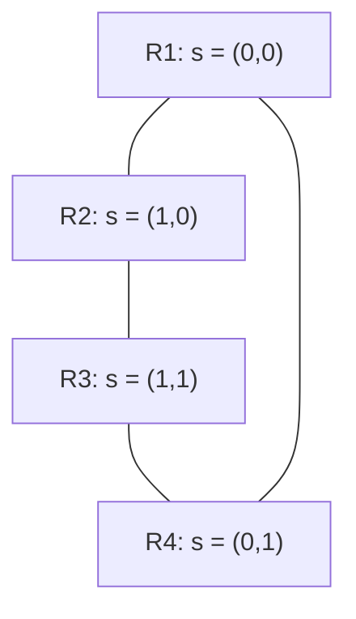

# The region complex of a ReLU network

!!! abstract "In this chapter"
    - A ReLU network is a continuous piecewise-affine (CPWA) map, and its input space carries a decomposition into convex polyhedral *linear regions*, each with one affine map.
    - Every region is labelled by an *activation pattern*; the pattern is a combinatorial coordinate, but it does not determine the complex.
    - Region boundaries are *bent hyperplanes*: piecewise-linear sets that change direction only where they cross a boundary laid down by an earlier layer.
    - The regions and their shared faces form a polyhedral complex, and its *dual graph* (adjacency by shared facets) can be built from the pattern alone.
    - Three algorithms extract the complex exactly, trading stability, dimensionality and hardware; local affine maps give a second geometry that survives even when two networks' complexes differ.
    - Prerequisites: [Polyhedra, arrangements and piecewise-linear maps](polyhedral-foundations.md).

A feedforward ReLU network is, first of all, a function: you feed in $x\in\R^{n_0}$ and read off $f(x)\in\R^{n_L}$. But the way the function is built — a composition of affine maps sandwiched with the elementwise ReLU $\sigma(t)=\max(0,t)$ — forces it to be piecewise affine. Each ReLU can only switch a unit on or off, so the input space is cut into pieces on which no unit switches, and there the whole network collapses to a single affine map [@serraBoundingCountingLinear2018, §2, p. 2]. This chapter is about that decomposition: what the pieces are, how they are labelled, how their boundaries behave, and how the pieces fit together into a complex whose structure we can compute.

Throughout I use the shared [notation](../notation.md): $L$ is the depth, $n_l$ the width of layer $l$, $W^{(l)}$ and $b^{(l)}$ its weights and biases, $z^{(l)}=W^{(l)}a^{(l-1)}+b^{(l)}$ the pre-activation, $a^{(l)}=\sigma(z^{(l)})$ the activation with $a^{(0)}=x$, and $\mathbf{s}(x)$ the activation pattern of a point. Where a paper writes its own symbols ($F_i$ of [@liuIntegratingGeometriesReLU2023a, §2], $h^l$ of [@masdenAlgorithmicDeterminationCombinatorial2022, §2], $s(x)$ of the same, the binary $\tilde x$ of [@sattelbergLocallyLinearAttributes2023, §2]) I translate into this notation and say so.

## Linear regions: the decomposition of input space

A network with $L$ layers and a linear output layer computes

$$
f(x)=W^{(L+1)}\,a^{(L)}(x)+b^{(L+1)},\qquad
a^{(l)}(x)=\sigma\!\left(W^{(l)}a^{(l-1)}(x)+b^{(l)}\right),
$$

with $a^{(0)}=x$ [@serraBoundingCountingLinear2018, §2, p. 2]. Fix a bit $s_{i,j}(x)=1$ if the pre-activation of unit $j$ in layer $i$ is positive and $0$ otherwise; each unit is then either active (identity) or inactive (zero), and if we replace every active ReLU by the identity and zero both the weight row and the bias of every inactive unit, what remains is a single affine map. That is the operative fact: *the network is affine wherever no unit changes sign*.

!!! note "Background"
    A *polyhedron* is a set cut out by finitely many affine inequalities, and a *polyhedral complex* is a finite family of polyhedra closed under taking faces and intersecting in common faces. A *hyperplane arrangement* is a finite set of hyperplanes; it induces a polyhedral complex whose top-dimensional cells are the regions it cuts out. The region count of an arrangement of $m$ hyperplanes in $\R^d$, at most $\sum_{j=0}^{d}\binom{m}{j}$ and attained in general position, is due to Zaslavsky; the counting chapter uses it.

Following [@serraBoundingCountingLinear2018, Def. 1, §2, p. 2], form the *activation set* $S^l\subseteq\{1,\dots,n_l\}$ of the units active in layer $l$, and let $S=(S^1,\dots,S^L)$ be the *activation pattern*. Its **linear region** is the set of inputs that realise a given pattern. There is a second, geometric definition in the literature — a linear region is a maximal connected subset of the input space on which $f$ is affine [@NIPS2014_fa6f2a46, §2.1, p. 3] — and the two agree except in degenerate cases; Serra et al. note that their bounds hold for either [@serraBoundingCountingLinear2018, §2, p. 2, footnote 1]. The regions are convex polyhedra and they partition the input space, giving the *polyhedral decomposition* of the network [@berzinsPolyhedralComplexExtraction2023, §3.1, p. 3; @sattelbergLocallyLinearAttributes2023, §2.1, p. 2].

### The affine map of one region

Write the decomposition in the compact form of [@sattelbergLocallyLinearAttributes2023, Eq. 1, §2.1, p. 2], with $f:\R^{d}\to\R^{o}$,

$$
f(x)=
\begin{cases}
W_1x+b_1, & \text{if } A_1x\le c_1,\\
\ \vdots\\
W_mx+b_m, & \text{if } A_mx\le c_m,
\end{cases}
$$

so that piece $i$ is supported on the convex polytope $A_ix\le c_i$ and carries the affine map $(W_i,b_i)$. The matrix $W_i$ is exactly the Jacobian of the network on region $i$, and its $j$-th row is the gradient of output $j$ [@sattelbergLocallyLinearAttributes2023, §2.1, p. 4].

There is a closed construction of $(W_i,b_i)$ that never forms the polytope. Fold the weights through the active units of the earlier layers: with the sign vector $s'_{i,j}=1$ if $s_{i,j}=0$ and $-1$ if $s_{i,j}=1$, define recursively

$$
\hat W_j=W_j\,\mathrm{diag}(s_{j-1})\,\hat W_{j-1},\qquad
\hat b_j=W_j\,\mathrm{diag}(s_{j-1})\,\hat b_{j-1}+b_j,
$$

for $2\le j\le L$, seeded by $\hat W_1=W_1$, $\hat b_1=b_1$ [@liuIntegratingGeometriesReLU2023a, §2.2, p. 3]. Then on the whole region carrying the pattern $s_L$ the network equals the single affine map

$$
G(x)=W^{(L+1)}\,\mathrm{diag}(s_L)\,\hat W_L\,x+W^{(L+1)}\,\mathrm{diag}(s_L)\,\hat b_L+b^{(L+1)}
$$

[@liuIntegratingGeometriesReLU2023a, §2.2, p. 3]. The region itself is the intersection $Ax\le c$ of half-spaces, with $A_i=\mathrm{diag}(s'_i)\hat W_i$ and $c_i=\mathrm{diag}(s'_i)(-\hat b_i)$ stacked over layers [@liuIntegratingGeometriesReLU2023a, Eq. 5, §2.2, p. 3]. So a pattern does double duty: it selects the affine map *and* defines the polyhedron on which that map is valid.

**A three-region example.** The two-input XOR network of [@sattelbergLocallyLinearAttributes2023, Eq. 2, §2.2, p. 4],

$$
f(x,y)=\begin{bmatrix}2&-4\end{bmatrix}
\max\!\left\{\begin{bmatrix}1&1\\1&1\end{bmatrix}\begin{bmatrix}x\\y\end{bmatrix}+\begin{bmatrix}1\\0\end{bmatrix},\ \begin{bmatrix}0\\0\end{bmatrix}\right\}-1,
$$

produces three regions [@sattelbergLocallyLinearAttributes2023, Eq. 3, §2.2, p. 4]:

$$
f(x,y)=
\begin{cases}
-2x-2y+1, & 0\le x+y,\\
2x+2y+1, & -1\le x+y\le 0,\\
-1, & x+y\le -1.
\end{cases}
$$

The "fourth" activation pattern — lower unit on, upper off — would give $-4x-4y-1$, but it is valid only on the empty set $0\le x+y\le -1$, so no input realises it; this unreachable polytope is a first explanation of why the region count sits below $2^{\#\text{ReLUs}}$ [@sattelbergLocallyLinearAttributes2023, §2.2, p. 4]. Exactly which patterns are reachable is the subject of [Counting linear regions](counting-regions.md); here we take the realised decomposition as given.

## Activation patterns as labels

The combinatorial label of a region is its activation pattern. For unit $j$ in hidden layer $i$ the bit is

$$
s_{i,j}(x)=
\begin{cases}
1 & w_{i,j}F_{i-1}(x)+b_{i,j}>0,\\
0 & w_{i,j}F_{i-1}(x)+b_{i,j}\le 0,
\end{cases}
$$

the paper's version of $\mathbf{1}[z_{i,j}>0]$ [@liuIntegratingGeometriesReLU2023a, Eq. 3, p. 3]. Stacking the layers gives the *binary vector* $s(x)=[s_1(x)^\top\cdots s_L(x)^\top]^\top\in\{0,1\}^h$, where $h=\sum_{i=1}^{L}h_i$ is the total number of hidden units [@liuIntegratingGeometriesReLU2023a, Eq. 4, p. 3]. Every point of one polyhedron has the same binary vector, so the pattern is a name for the polyhedron [@liuIntegratingGeometriesReLU2023a, §2.2, p. 3].

Two warnings attached to the pattern will matter twice more below. First, degenerate cases aside, two patterns on adjacent regions can carry the *same* affine map; the pattern-based and geometric definitions of a region then disagree [@serraBoundingCountingLinear2018, §2, p. 2, footnote 1]. Second, in practice far fewer patterns are realised than the $2^h$ a priori count. [@haninDeepReLUNetworks2019, §2.1, p. 3] defines an *activation region* as the set of inputs on which every pre-activation is on the correct side of its bias, and shows the number of realised activation regions is far below the naive count; the enumeration experiments of [@liuReLUNeuralNetworks2023, §3.2, p. 5] find, for instance, 25 polyhedra $[-1,1]^2$ for a $2\text{-}3\text{-}3\text{-}3$ network — a small fraction of $2^h$.

Most importantly, the pattern is *not* a complete invariant of the complex. Masden constructs two networks $F_1,F_2:\R^2\to\R^4\to\R$ that realise exactly the same set of activation-pattern strings on the interiors of their top-dimensional cells, yet whose polyhedral complexes $C(F_1)$ and $C(F_2)$ are not combinatorially equivalent, and whose decision boundaries are not even homotopy equivalent — one is bounded, the other unbounded [@masdenAlgorithmicDeterminationCombinatorial2022, Thm. 15, §1, p. 1; Fig. 7]. Knowing which patterns occur tells you the *cells*, but not how they meet. Recovering the adjacency requires more than the binary vector, and finding that "more" is the subject of the rest of the chapter.

## Bent hyperplanes: where regions meet

In a single layer, the boundary between an active and an inactive unit is a hyperplane in the input space, and the region structure is that of a hyperplane arrangement [@NIPS2014_fa6f2a46, §2.2, p. 3; @serraBoundingCountingLinear2018, §3.1, p. 4]. Composition destroys this. The $i$-th neuron of layer $l$ switches where its pre-activation vanishes; pulled back to the input space, that set is

$$
\phi_i^{(l)}=\left\{x\in\R^{n_0}:\ \bigl\langle W_i^{(l)},a^{(l-1)}(x)\bigr\rangle+b_i^{(l)}=0\right\},
$$

the *bent hyperplane* of that unit — Berzins calls it the *folded hyperplane* $H_i^{(l)}$, the zero-level set of the pre-activation seen from the input [@berzinsPolyhedralComplexExtraction2023, §3.4, p. 4]. Hanin and Rolnick name the same objects $H_z(\theta)=\{x:z(x;\theta)=b_z\}$ and observe that the activation regions are precisely the connected components left after all bent hyperplanes are removed [@haninDeepReLUNetworks2019, §2.1, p. 3]. Masden's equivalent object is the zero set $F_{ij}^{-1}(0)$ of the $(i,j)$-th *node map*, the activation of that neuron pulled back to the input space [@masdenAlgorithmicDeterminationCombinatorial2022, §3.1, p. 3].

The shape of a bent hyperplane is constrained, and the constraint is what makes the whole complex tractable. A neuron of a later layer is a hyperplane in the *output space of the previous layer*; pushed back through the earlier layers it becomes a piecewise-linear set whose direction changes only where it crosses a bent hyperplane of an earlier layer. Sattelberg et al. call this the iterated-perceptron picture: first-layer boundaries are straight lines in the input plane, every later boundary is locally linear, and it can only "break" at a boundary laid down before it [@sattelbergLocallyLinearAttributes2023, §2.3, pp. 5–6; Fig. 5]. Raghu et al. had already drawn the same conclusion from their linear-region analysis [@raghuExpressivePowerDeep2017, Thm. 2, §2.1, p. 3]. In one dimension the picture reduces to the "bent lines" of [@serraBoundingCountingLinear2018, §2, p. 3], where a bent hyperplane may even be disconnected.

These pieces are exactly the lower-dimensional cells of the decomposition. Masden proves that for a generic, supertransversal network the number of zeros in a cell's sign sequence equals its codimension: a $k$-cell carries $n_0-k$ zeros, one for each bent hyperplane it lies on [@masdenAlgorithmicDeterminationCombinatorial2022, Lemma 16, §3.2, p. 4]. So the $(n_0-1)$-skeleton is the union of the bent hyperplanes, the vertices are the points where sufficiently many of them meet, and the regions are the top-dimensional cells these lower cells bound.

## The region complex and its dual graph

Collect the regions and all their faces into one object. The cells of the decomposition — regions, edges, vertices and everything between — form a polyhedral complex $\mathcal{P}(f)$, the *canonical polyhedral complex* of the network, which encodes its decomposition of input space and determines structures such as the decision boundary [@brandenburgDecompositionPolyhedraPiecewise2024; @masdenAlgorithmicDeterminationCombinatorial2022, §1, p. 1]. That the family really is a complex — closed under faces and intersecting in common faces — is the standard definition recalled by [@berzinsPolyhedralComplexExtraction2023, §3.1, p. 3].

**The dual graph.** The crudest summary of $\mathcal{P}(f)$ is which regions touch. Two polyhedra are neighbours if they share a facet, and the decisive combinatorial fact is that they do so *if and only if their binary vectors differ in exactly one active bit* [@liuReLUNeuralNetworks2023, §2.3, p. 4]. Flip an active bit of a pattern and you step to the neighbouring region across that facet; the graph of single-active-bit flips is the dual graph of the decomposition [@liuIntegratingGeometriesReLU2023a, §2.2, p. 3]. This dual graph is bipartite [@liuReLUNeuralNetworks2023, App. B, pp. 11–12].

The figure sketches the dual graph of a favourable two-dimensional arrangement: the four regions form a cycle, and each edge is a shared facet across which one active bit flips [@liuReLUNeuralNetworks2023, §2.3, p. 4]. In general the dual graph is not this small or this regular.

Hamming distance $d_H$ between binary vectors is a coarse distance on this graph: it counts differing bits and therefore *approximates* — it does not equal — the minimum number of region boundaries separating two points [@liuIntegratingGeometriesReLU2023a, §3.1, p. 5]. The gap is real and one-sided: walking the straight Euclidean segment between two points, the number of regions actually crossed is at least the Hamming distance, and the underestimate grows as the distance does. On MNIST the bisection walk of [@liuIntegratingGeometriesReLU2023a, §3.2, p. 5, Algorithm 2] reports, for one nearest-neighbour pair, a Hamming distance of 320 against 351 polyhedra crossed [@liuIntegratingGeometriesReLU2023a, §4.2.1.2, Tab. 5, p. 9]. The *activation-pattern complex* — the abstract complex whose cells are patterns, with adjacen…

**The full face poset.** To recover the complex rather than its graph, Masden labels *every* cell, not just the regions. The sign sequence of a cell $C$ is $s_{ij}(C)=\mathrm{sgn}(F_{ij}(C))\in\{-1,0,1\}^N$, with $N$ the number of intermediate neurons and a zero exactly where $C$ lies on the bent hyperplane $F_{ij}^{-1}(0)$ [@masdenAlgorithmicDeterminationCombinatorial2022, Def. 13, §3.2, p. 4]. This map $s$ is well defined and injective on cells [@masdenAlgorithmicDeterminationCombinatorial2022, Thm. 14, §3.2, p. 4], and its image is the *sign-sequence cubical complex* $S(F)$, a pure $n_0$-dimensional subcomplex of the hypercube $[-1,1]^N$ geometrically dual to $\mathcal{P}(f)$: a $k$-cell of $S(F)$ corresponds to a codimension-$k$ cell of the complex, and the face posets of the two are opposite [@masdenAlgorithmicDeterminationCombinatorial2022, Thm. 20, §3.2, p. 4]. Sign sequences also carry a multiplication compatible with faces,

$$
\bigl(S(C)\cdot S(D)\bigr)_{ij}=
\begin{cases}
S(C)_{ij}, & S(C)_{ij}\neq 0,\\
S(D)_{ij}, & \text{otherwise},
\end{cases}
$$

which makes them a semigroup and yields purely algebraic face tests: $C\le D$ iff $S(C)\cdot S(D)=S(D)$ [@masdenAlgorithmicDeterminationCombinatorial2022, Lemma 18 and Lemma 19, §3.3, p. 5]. Because the cubical complex is pure, the sign sequences of the *vertices* alone determine every face relation, hence the entire face poset of $\mathcal{P}(f)$ [@masdenAlgorithmicDeterminationCombinatorial2022, Corollary, §3.2, p. 4]. This is the sense in which the vertex-level data — plus the signs of the network away from the bent hyperplanes — is a complete combinatorial description of the region complex.

## Extracting the complex: three exact routes

Three papers in the collection compute $\mathcal{P}(f)$ exactly, and they differ in which stratum they work from and what they optimise for.

**From the vertices, combinatorially** (Masden). The algorithm builds the complex layer by layer [@masdenAlgorithmicDeterminationCombinatorial2022, §4.1, p. 6]. The vertices of the first layer's arrangement are the solutions of $\{W_\alpha x=b_\alpha\}$ for $|\alpha|=n_0$, and a solution has a zero sign exactly for the selected units [@masdenAlgorithmicDeterminationCombinatorial2022, Lemma 22, §4.1, p. 6]. To pass from layer $k-1$ to $k$, one solves for intersections of new bent hyperplanes with faces carried up from earlier layers and keeps a solution only when it agrees with the region on every uncrossed node map [@masdenAlgorithmicDeterminationCombinatorial2022, Lemma 23, §4.1, p. 6]. Whether an entry of a vertex's sign sequence is zero is then decided *combinatorially*, from which hyperplanes were intersected, rather than by testing a near-zero number — which is why the method is numerically stable, unlike intersecting top-dimensional regions pairwise [@masdenAlgorithmicDeterminationCombinatorial2022, §1, p. 1]. Its cost is polynomial in the number of intermediate neurons but exponential in the input dimension, so in practice only low-dimensional slices can be studied; restricting the mod-two coboundary of $S(F)$ to cells whose last sign is zero yields a cochain complex computing the topology of the decision boundary, with Betti numbers obtained from standard chain-complex software [@masdenAlgorithmicDeterminationCombinatorial2022, §4.2, p. 7]. This is, as of its writing, the first publicly available code for the full cellular poset of a ReLU network [@masdenAlgorithmicDeterminationCombinatorial2022, §2, p. 3].

**From the edges, on a GPU** (Berzins). Region subdivision — refine neuron by neuron, layer by layer — recomputes each new vertex on all $2^{D-1}$ regions that share the edge it lies on, and re-tests the same redundant inequality on each, where $D=n_0$ is the input dimension [@berzinsPolyhedralComplexExtraction2023, §2.1, p. 3; §4, p. 5]. Berzins instead subdivides the 1-skeleton. Each iteration keeps a vertex set $V$ and edge set $E$; evaluating the network at the vertices and taking the sign-vector of the current folded hyperplane identifies the *splitting edges* whose endpoints differ in sign; a new vertex is placed by linear interpolation along each splitting edge, and *intersecting edges* are added by recovering the splitting 2-faces via perturbation of sign-vectors [@berzinsPolyhedralComplexExtraction2023, §4, p. 5; Fig. 3]. Perturbation — flipping one zero of a sign-vector at a time — reconstructs the whole intersection-poset, including the regions, from the 1-skeleton [@berzinsPolyhedralComplexExtraction2023, §4.1, p. 5]. Because sign-vectors are inherited along the subdivision, the bookkeeping is plain tensor arithmetic and the method runs on a GPU: runtime and memory grow log-linearly in the number of vertices, and on two-dimensional inputs it is on average about $20\times$ faster than the region-subdivision baseline SplineCam [@berzinsPolyhedralComplexExtraction2023, §5.1.2, p. 7; @humayunSplineCamExactVisualization2024]. It becomes impractical for $D>8$ because the complex itself grows exponentially [@berzinsPolyhedralComplexExtraction2023, §1, p. 2].

**From a seed region, by flipping bits** (Liu et al.). Traversal-and-pruning starts from a random input, records its binary vector, and repeatedly picks a vector not yet expanded, finds its *active bits* by a redundancy linear program — maximise $a_i^\top x$ over the other constraints; if the optimum does not reach $c_i$, inequality $i$ is redundant and its bit is not active [@liuIntegratingGeometriesReLU2023a, Eq. 6, §2.2, p. 3] — and flips each active bit to reach a neighbour. When every stored vector is expanded, the set of patterns is closed [@liuIntegratingGeometriesReLU2023a, §2.4, p. 4, Algorithm 1]. The method is a bounded-region variant of reachable polyhedral marching [@vincentReachablePolyhedralMarching2021], and it outputs, per region, the binary vector, the minimal half-space model and the active-bit set — everything needed for a dual graph, but not the lower-dimensional face poset. Its completeness argument is only sketched, and the unbounded-space case is asserted rather than proved [@liuIntegratingGeometriesReLU2023a, §2.4, p. 4].

Taken together, the three methods expose the trade-off: Masden's vertex enumeration gives the richest structure (the full face poset, the decision-boundary topology) at the cost of exponential dependence on $n_0$; Berzins's edge subdivision is the fastest and most parallel but wants low $D$; Liu's traversal is cheapest per region and gives the dual graph directly but only the top-dimensional cells. All three inherit an assumption of a generic arrangement, and Masden shows the excluded set is of measure zero, so genericity is not a practical restriction [@masdenAlgorithmicDeterminationCombinatorial2022, Lemma 12, §3.1, p. 3].

## Local linear maps and when two networks share a structure

The region complex is one geometry of a network; the affine maps attached to its regions form a second, and it behaves differently.

Treat each row of a region's weight matrix concatenated with its bias as a point in $\R^{d+1}$, a "dual" point for that output direction [@sattelbergLocallyLinearAttributes2023, §2.1, p. 4]. For the XOR example the region $-x-y$ induces the dual point $(-1,-1,0)$ [@sattelbergLocallyLinearAttributes2023, Eq. 4, §2.2, p. 4]. Stacking the sampled local maps of output $j$ into a matrix $C_j\in\R^{p\times(d+1)}$ turns "analysing the region structure" into a point-cloud problem [@sattelbergLocallyLinearAttributes2023, Eq. 7, §2.4, p. 8]. Clustering the rows with $k$-means and using each cluster centre as the linear map for its region measures how redundant a network's local behaviour is. On MNIST, a one-hidden-layer dense network (96.03% test accuracy) keeps 8679/10000 correct with a single cluster, i.e. it is close to a linear classifier, while Inception (99.08%) collapses to 974/10000 at $k=1$ but recovers to 9660 at $k=10$; ResNet (98.92%) is still at 9381 even with $k=10{,}000$, so this clustering does not simplify it [@sattelbergLocallyLinearAttributes2023, Tab. 1, §3.2, p. 15]. These are all on MNIST and must not be compared across the different architectures' original accuracies without noting that the reported cluster counts are $10\times$ the per-output counts [@sattelbergLocallyLinearAttributes2023, Tab. 1, §3.2, p. 15].

Similarity of *structure* between two networks is the harder question, and it has two distinct answers in the collection.

1. **Combinatorial equivalence.** Two parametrisations induce the same region structure when their complexes are isomorphic as posets. Masden's result rules out the naive test: equality of the set of activation patterns is insufficient, because two combinatorially inequivalent complexes can share it [@masdenAlgorithmicDeterminationCombinatorial2022, Thm. 15, §1, p. 1]. The correct certificate is equality of sign-sequence complexes $S(F)$ — equivalently, of the sign sequences of the vertices together with their face relations [@masdenAlgorithmicDeterminationCombinatorial2022, Corollary, §3.2, p. 4]. This is a *combinatorial* notion; it says nothing about the sizes of the pieces or the affine maps on them.

2. **Affine relatedness at the region level.** Independently trained networks need not share a complex, but their local maps may still be affinely related. [@sattelbergLocallyLinearAttributes2023, Eq. 8, §2.4.2, p. 8] fits, per output, a least-squares map $M_j$ minimising $\norm{C_{j,\text{net1}}M_j-C_{j,\text{net2}}}_2$ between two networks' sampled local weights. On MNIST the mapped networks stay close to their originals, and the relation is asymmetric — ResNet maps into Inception almost losslessly (9838/10000) while Inception maps into ResNet poorly (8868/10000), despite near-equal original accuracies [@sattelbergLocallyLinearAttributes2023, Tab. 2, §3.3, p. 16]. Because the bias is part of the mapped vector, the resulting function is no longer continuous and mapped regions need not join at their boundaries [@sattelbergLocallyLinearAttributes2023, §2.4.2, p. 9].

Neither notion is the same as *functional* equivalence. Two networks compute the same function exactly when their parameters differ by a permutation of hidden units and positive per-layer scalings of weights and biases — the parameter-space symmetries whose identification is the subject of [Symmetry and geometric deep learning](symmetry-and-gdl.md) [@phuongFunctionalVsParametric2019]. Combinatorial equivalence of the complex is strictly weaker: many different functions share a complex, as the redundancy results above show.

!!! question "Open question"
    Is combinatorial equivalence of the region complex *stable*? Masden's theory holds for generic, supertransversal networks, a full-measure set, but says nothing about how the face poset changes as parameters cross into the excluded set [@masdenAlgorithmicDeterminationCombinatorial2022, Lemma 12, §3.1, p. 3]. The obverse is the empirical claim of [@sattelbergLocallyLinearAttributes2023, §3.3, p. 16], that different trained networks with different complexes are nevertheless affinely related — a statement about the local maps that does not by itself imply the complexes agree. A quantitative link between the two notions is not established by any paper in the collection.

## Summary

- A ReLU network is affine on each cell of a polyhedral decomposition of its input space; the cells are the *linear regions* [@serraBoundingCountingLinear2018, §2, p. 2].
- A region is labelled by an activation pattern (binary vector), which simultaneously selects its affine map and defines its half-space model [@liuIntegratingGeometriesReLU2023a, §2.2, p. 3].
- The pattern is not a complete invariant: different complexes can share the same set of patterns, so adjacency needs the sign sequence of every cell [@masdenAlgorithmicDeterminationCombinatorial2022, Thm. 15 and Thm. 20].
- Region boundaries are bent hyperplanes, piecewise-linear sets that can change direction only at boundaries from earlier layers [@sattelbergLocallyLinearAttributes2023, §2.3, pp. 5–6].
- The region complex is a polyhedral complex; its dual graph has an edge per shared facet, and regions are adjacent exactly when their binary vectors differ in one active bit [@liuReLUNeuralNetworks2023, §2.3, p. 4].
- Hamming distance between patterns is a one-sided proxy for steps in the dual graph, not an equality [@liuIntegratingGeometriesReLU2023a, §3.1, p. 5].
- Three exact extraction methods work from vertices (Masden), edges (Berzins) or a seed region (Liu), trading full face poset against dimensionality and hardware [@berzinsPolyhedralComplexExtraction2023, §5.1.2, p. 7].
- The local affine maps form a second geometry in which networks can be clustered and related by affine maps even when their complexes differ [@sattelbergLocallyLinearAttributes2023, §2.4.1, p. 8].

## Further reading

- [@serraBoundingCountingLinear2018]: the definition of a linear region and the dimension-of-image technique; read §2–§3 for the setup this chapter uses and §5 for exact counting.
- [@masdenAlgorithmicDeterminationCombinatorial2022]: the sign-sequence cubical complex and the vertex algorithm; read §3.2–§4.2 for the duality and the decision-boundary complex.
- [@berzinsPolyhedralComplexExtraction2023]: edge subdivision and sign-vectors; read §3.3–§4 for the method and §5.1 for the GPU experiments.
- [@sattelbergLocallyLinearAttributes2023]: the iterated-perceptron picture and the dual-space analysis; read §2.1–§2.4 for the local linear maps and §3.2–§3.3 for the MNIST results.
- [@liuIntegratingGeometriesReLU2023a]: the binary vector, active bits and traversal-and-pruning; read §2 for the constructions and §3 for the Hamming and Chebyshev analyses.
- [@haninDeepReLUNetworks2019]: the definition of activation regions and bent hyperplanes, and the average-case count that follows from them.
- [@liuReLUNeuralNetworks2023]: the dual graph, the one-bit/facet correspondence, and what the Hamming metric does to persistent homology.

## Exercises

**Exercise 1** ★ (check). A point $x$ lies in the interior of a linear region; another point $y$ lies on a bent hyperplane but not on any other. Explain why $x$ has a whole neighbourhood with the same activation pattern, while $y$ does not, and say what the sign sequence of the cell containing $y$ looks like that the one containing $x$ does not.

??? success "Solution"
    On the region, every pre-activation is nonzero, and pre-activations are continuous
    functions of the input, so each stays on the same side of zero in a small ball
    around $x$: all bits of $\mathbf{s}$ are locally constant, and $x$'s pattern names
    a full-dimensional cell [@liuIntegratingGeometriesReLU2023a, Eq. 3, §2.2, p. 3].
    At $y$ one pre-activation is zero. In Masden's sign sequence that entry is a $0$,
    and a cell with one zero has codimension one, so $y$ lies on a bent hyperplane
    — a lower-dimensional cell, not the interior of a region
    [@masdenAlgorithmicDeterminationCombinatorial2022, Lemma 16, §3.2, p. 4]. The
    interior point's sign sequence has no zeros; $y$'s has (at least) one.

**Exercise 2** ★★ (derive). For the two-input XOR network of §1,
$f(x,y)=[2\ -4]\max\{[1\ 1;1\ 1][x;y]+[1;0],\ [0;0]\}-1$, compute the affine map and the
Jacobian on the region $0\le x+y$, and check that the Jacobian matches the region's
weight matrix $W_i$ in the sense of [@sattelbergLocallyLinearAttributes2023, §2.1, p. 4].

??? success "Solution"
    On $0\le x+y$ both ReLUs are active, so both inputs to the $\max$ equal their
    plain affine values: $[x+y+1,\ x+y]^\top$. Then
    $f=2(x+y+1)-4(x+y)-1=-2x-2y+1$. The gradient is $W_i=[-2\ -2]$, which is exactly
    the Jacobian of the network on this region; the value is $b_i=1$. This reproduces
    the first row of the case list in [@sattelbergLocallyLinearAttributes2023, Eq. 3,
    §2.2, p. 4], and confirms $W_i$ equals the Jacobian as stated in
    [@sattelbergLocallyLinearAttributes2023, §2.1, p. 4].

**Exercise 3** ★ (check). Why is the number of linear regions of a network with $h$ hidden ReLUs typically far below $2^h$, although there are $2^h$ possible activation patterns?

??? success "Solution"
    Two reasons. First, many patterns cut out an empty polytope: the XOR network's
    "fourth" case (lower unit on, upper off) is valid only on $0\le x+y\le-1$, which
    contains no point, so it is unreachable [@sattelbergLocallyLinearAttributes2023,
    §2.2, p. 4]. Second, even reachable patterns are few in practice — for a
    $2\text{-}3\text{-}3\text{-}3$ network on $[-1,1]^2$ only 25 polyhedra are realised
    [@liuReLUNeuralNetworks2023, §3.2, p. 5]. More generally the number of activation
    regions is far below the naive count at a random parameter draw
    [@haninDeepReLUNetworks2019, §3.1, p. 3].

**Exercise 4** ★★ (compare). Liu et al.'s binary-vector dual graph and Masden's sign-sequence cubical complex both encode the region structure. State precisely what each records, and give one question each can answer that the other cannot without extra work.

??? success "Solution"
    The binary vector records, per hidden unit, whether it is active; two regions are
    adjacent iff their vectors differ in exactly one *active* bit, which gives the
    dual graph of shared facets [@liuReLUNeuralNetworks2023, §2.3, p. 4;
    @liuIntegratingGeometriesReLU2023a, §2.2, p. 3]. It only names top-dimensional
    cells and their facet adjacency. The sign sequence $s_{ij}(C)=\mathrm{sgn}(F_{ij}(C))$
    has a $0$ where a cell lies on a bent hyperplane, so it labels *every* cell, and
    its image is a cubical complex dual to the polyhedral complex
    [@masdenAlgorithmicDeterminationCombinatorial2022, Def. 13 and Thm. 20, §3.2, p. 4].
    A question only Masden's object answers: the decision boundary's Betti numbers, via
    the restriction of the coboundary to cells whose last sign is zero
    [@masdenAlgorithmicDeterminationCombinatorial2022, §4.2, p. 7]. A question only the
    binary vector answers cheaply: enumerate the regions themselves by one-bit flips
    [@liuIntegratingGeometriesReLU2023a, §2.4, p. 4].

**Exercise 5** ★★ (derive). Starting from the folded weights $\hat W_j,\hat b_j$, show that the half-space model $A_ix\le c_i$ with $A_i=\mathrm{diag}(s'_i)\hat W_i$ and $c_i=\mathrm{diag}(s'_i)(-\hat b_i)$ reproduces the sign conditions of the pattern, and explain why the non-redundant rows of $A_i$ are exactly the active bits.

??? success "Solution"
    On the region, the layer-$i$ pre-activation equals $\hat W_i x+\hat b_i$ by the
    folding recursion, and the pattern requires it to be positive for active units
    ($s_{i,j}=1$) and non-positive for inactive ones ($s_{i,j}=0$)
    [@liuIntegratingGeometriesReLU2023a, §2.2, p. 3]. With $s'_{i,j}=-1$ for active and
    $+1$ for inactive, multiplying $\hat W_ix+\hat b_i$ by $s'_i$ flips each inequality
    into the single form $A_ix\le c_i$. A row is an *active bit* precisely when its
    inequality is not redundant; redundancy is decided by maximising $a_i^\top x$ over
    the remaining constraints and comparing with $c_i$
    [@liuIntegratingGeometriesReLU2023a, Eq. 6, §2.2, p. 3]. Hence the active bits index
    the facets of the polyhedron.

**Exercise 6** ★★★ (compare / design). You must (a) extract the exact region complex of a two-input network trained as an implicit shape, and (b) determine the Betti numbers of a three-input network's decision boundary. Which method from §5 do you use for each, and what does the other give up?

??? success "Solution"
    For (a), edge subdivision: on $D=2$ it is GPU-parallel and about $20\times$ faster
    than the region-subdivision baseline SplineCam, and it gives the vertex and edge
    positions needed to optimise a geometric loss on the complex
    [@berzinsPolyhedralComplexExtraction2023, §5.1.2, p. 7; §5.3, p. 8]. For (b),
    Masden's vertex/sign-sequence algorithm: only it yields the full face poset, whose
    restriction to cells with last sign zero is a cochain complex computing the
    decision-boundary Betti numbers, with the exponential-in-$n_0$ cost acceptable at
    $n_0=3$ [@masdenAlgorithmicDeterminationCombinatorial2022, §4.2, p. 7]. What each
    gives up: edge subdivision stops at the 1-skeleton plus perturbation, and trading
    it for Masden's full poset costs numerical stability of the fast tensor pipeline
    and GPU speed; Masden's method instead becomes impractical as $n_0$ grows
    [@masdenAlgorithmicDeterminationCombinatorial2022, §6, p. 10].

**Exercise 7** ★★ (critique). Masden's Theorem 15 shows the set of activation-pattern strings does not determine the complex. What exactly is lost by recording only which neurons are active, and what extra information repairs it?

??? success "Solution"
    Activation patterns record the sign of every node map on a top-dimensional cell but
    say nothing about *which bent hyperplanes a cell lies on*, i.e. about the
    lower-dimensional cells and how the regions meet. Masden exhibits $F_1,F_2:\R^2\to\R^4\to\R$
    with the same set of pattern strings on their region interiors but combinatorially
    inequivalent complexes and non-homotopy-equivalent decision boundaries, one bounded
    and one unbounded [@masdenAlgorithmicDeterminationCombinatorial2022, Thm. 15, §1, p. 1].
    The repair is to keep the zeros: the sign sequence $s_{ij}(C)=\mathrm{sgn}(F_{ij}(C))$,
    which is injective on cells and dual to the polyhedral complex, so the sign sequences
    of the vertices determine the full face poset
    [@masdenAlgorithmicDeterminationCombinatorial2022, Thm. 14 and Corollary, §3.2, p. 4].

**Exercise 8** ★★ (design). You have two networks trained on MNIST with different architectures and want to decide whether they induce "the same" region structure. Describe a concrete test using the tools of this chapter, and say precisely what it would and would not establish.

??? success "Solution"
    Two notions must be separated. For combinatorial equivalence, compute the sign
    sequence of each vertex of each complex and its face poset, then check whether the
    posets are isomorphic — the sign sequences of the vertices determine the whole face
    poset [@masdenAlgorithmicDeterminationCombinatorial2022, Corollary, §3.2, p. 4]; this
    is exact but expensive in the input dimension. For the weaker empirical question
    used in [@sattelbergLocallyLinearAttributes2023], sample inputs, take each point's
    binary vector and its local map (the Jacobian), and fit a least-squares map $M_j$
    between the two networks' local maps per output, reporting how much accuracy survives
    [@sattelbergLocallyLinearAttributes2023, Eq. 8, §2.4.2, p. 8]. It would establish
    that the two networks' *local affine maps* are affinely related; it would **not**
    establish equality of the complexes, since on MNIST even a successful mapping can
    pair regions belonging to different decompositions, and the mapped function is not
    even continuous [@sattelbergLocallyLinearAttributes2023, §2.4.2, p. 9].
