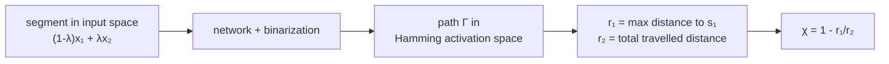

# Space folding and folding neurons

!!! abstract "In this chapter"
    - Read a hidden layer as an *identification* operator that folds its input space, not only as a
      partition into linear regions.
    - Separate folds that create linear separability — folding into directions the data does not
      occupy — from folds that do not.
    - Measure folding along a path with the space folding measure $\chi$ and its generalization to
      monotone activations.
    - Locate the neurons responsible for a fold.
    Prerequisites: [The region complex of a ReLU network](relu-network-geometry.md).

The previous chapter described a ReLU network as a partition of its input into linear
regions, each labelled by an activation pattern. That description is complete for the local
question — which affine map acts here — but it is silent about a global feature of the map:
many different regions are sent to the *same* piece of the image. A layer not only cuts
space into cells, it glues cells together, and the amount of gluing is what lets a deep
network reuse one computation in many places. This gluing is called **space folding**
[@NIPS2014_fa6f2a46, §2.4].

The idea has three stages, and this chapter follows them. It begins as a picture: a hidden
layer identifies input neighbourhoods, and a deep network folds its input space recursively
[@NIPS2014_fa6f2a46, §2.4]. It becomes a mechanism for classification: folding a data
manifold into directions it does not occupy is how a network manufactures linear
separability, and it is efficient in a way that folding within the occupied dimensions is
not [@keupOrigamiDimensionsHow2022, §3]. Finally it becomes a number: the space folding
measure tracks the distance between the activation pattern of a straight path and its start
in the discrete activation space, and reports how much that distance fails to grow
monotonically [@lewandowskiSpaceFoldsReLU2024, §5].

Folding is not the same as region counting. The [next chapter](counting-regions.md) counts
how many affine pieces a network can realize; folding measures how many of them are glued
to a common image. A network can have many regions and little folding, or few regions with
strong folding; the two are complementary descriptors of the same piecewise-linear map
[@NIPS2014_fa6f2a46, §2.1–2.4].

## Folding as identification

The precise notion is *identification*. A map $F:\R^{n_0}\to\R^{n_L}$ identifies two
neighbourhoods $S$ and $T$ of its input domain if it maps them to a common subset,
$F(S)=F(T)$ [@NIPS2014_fa6f2a46, Def. 1, §2.3]. The canonical example is the absolute
value, $g:\R^2\to\R^2$, $(x_1,x_2)\mapsto[\lvert x_1\rvert,\lvert x_2\rvert]^\top$, which
identifies the four quadrants of the plane: each quadrant is mapped onto the positive
quadrant [@NIPS2014_fa6f2a46, Example 2, §2.3]. A ReLU layer does the same thing for as
many half-space pairs as it has units, one reflection per unit.

For a deep network the identifications compose. Writing $F_l$ for the map from the input to
the activations of layer $l$ and $S_l$ for its image, let $P^l_R$ be the collection of
subsets of $S_{l-1}$ that layer $l$ maps onto a given neighbourhood $R\subseteq S_l$. Then
the number of distinct input neighbourhoods that reach $R$ satisfies the recursion of
[@NIPS2014_fa6f2a46, Eq. 2, §2.3]:

$$
N^l_R=\sum_{R'\in P^l_R} N^{l-1}_{R'}, \qquad N^0_R=1 ,
$$

Read as a tree, this counts how many
input regions are identified by the time the signal reaches layer $l$: each branch is one
preimage of the same activation. Because the last hidden layer sees only the folded image,
any function it computes is *replicated* in every input region that the earlier layers have
folded together [@NIPS2014_fa6f2a46, Lemma 3, §2.3]. That replication is the source of the
depth advantage: a modest number of units can produce an exponentially replicated
computation.

Montúfar et al. describe each hidden layer as a *folding operator* that recursively folds
the input space, starting with the first layer [@NIPS2014_fa6f2a46, §2.4]. The folds are
not restricted to coordinate axes and need not preserve lengths: their orientations and
shifts follow the weights, biases and activation used at each layer, so the identified input
regions can differ from one another in size and orientation [@NIPS2014_fa6f2a46, §2.4]. The
elementary unit of their construction shows the mechanism concretely: for a layer of $n$
rectifiers over $n_0$ inputs, split the units into $n_0$ groups of $p=\lfloor n/n_0\rfloor$
and add the $p$ rectifiers of a group with alternating signs,

$$
\tilde h_j(x)=[1,-1,1,\dots,(-1)^{p-1}]\,[h_1(x),\dots,h_p(x)]^\top,
\qquad h_r(x)=\max\{0,\,2wx-(r-1)\},
$$

where $w$ selects the $j$-th coordinate [@NIPS2014_fa6f2a46, Eq. 3, §3.1]. The function
$\tilde h_j$ has $p$ linear regions and identifies the strips in which the $j$-th coordinate
lies in $(0,1),(1,2),\dots,(p-1,p)$; applied to all coordinates it identifies $p^{n_0}$
hypercubes, on each of which the next layer acts identically [@NIPS2014_fa6f2a46, §3.1].
Feeding this into the counting recursion gives the deep rectifier lower bound and its
asymptotic form $\Omega((n/n_0)^{(L-1)n_0}n^{n_0})$ [@NIPS2014_fa6f2a46, Thm. 5 and Cor. 6,
§3.2].

!!! note "Background"
    The folding picture is useful because it separates two things that a region count
    conflates: *how many* cells a map has, and *how they are identified*. A piecewise-linear
    map can always be read as a partition; folding is an extra piece of structure — a
    quotient — and it is this quotient that the counting literature of Montúfar et al. uses
    to explain depth.

Folding and folds are not the same object. The **fold-set** of a piecewise-linear function
$f$, written $F_i$ for the fold-set of unit $i$, is the set of points where $f$ is not
differentiable: the union of all region boundaries [@phuongFunctionalVsParametric2019,
Def. A.8; @phuongFunctionalVsParametric2019, §2]. For a transparent ReLU network the
first-layer fold-set is a union of hyperplanes, and each deeper unit contributes a
*piecewise* hyperplane, so the fold-set itself is a piecewise-linear surface whose pieces
are inherited from lower layers [@phuongFunctionalVsParametric2019, §3]. The fold-set is the
locus where folding happens; the folding operator is the map that carries one side of the
locus onto the other.

## Folding into unoccupied dimensions, and separability

Not every fold helps a classifier. Keup and Helias make the distinction sharp
[@keupOrigamiDimensionsHow2022, §2]. An affine map cannot change linear separability,
because it maps lines to lines; its only role is to position the data for the
nonlinearity to act on [@keupOrigamiDimensionsHow2022, §2, p. 2]. The ReLU nonlinearity maps
every point on the negative side of a unit's hyperplane $z^{(l)}_i=0$ onto that hyperplane,
so a ReLU layer only modifies the *convex hull* of the representation — it can make flat
dents but cannot selectively reach a class that sits inside the hull of another
[@keupOrigamiDimensionsHow2022, §2, p. 3].

The way out is dimensionality. Real layers are typically wider than the intrinsic
dimensionality of the data, so at least in the first layer there are activation directions
that the data manifold does not explore. If a unit's normal vector has a component in such an
unoccupied direction, its hyperplane does not squash data points together: it displaces them
along an unused coordinate, which is nonlinear yet still injective
[@keupOrigamiDimensionsHow2022, §3, p. 4]. This is a fold into an unused dimension. Along the
folding edge, an interior region of the distribution is exposed to the embedding space, so a
linear readout from the next layer can separate parts that were previously inaccessible
[@keupOrigamiDimensionsHow2022, §3, p. 5]. The condition on the geometry is a strict one:
the angle between the unit's normal vector and the data subspace must be larger than zero
and smaller than orthogonal — an angle of exactly $\pi/2$ (normal parallel to the subspace)
folds nothing new, and a normal inside the subspace only squashes
[@keupOrigamiDimensionsHow2022, §3, p. 5].

The contrast with folding that does *not* create separability is the heart of the
distinction the chapter is about. Squashing in occupied directions — Keup and Helias call it
compressive folding — is information-losing: it projects points onto a hyperplane and can
only flatter the convex hull. They argue that such squashing can straighten at most one
angle of a piecewise-linear boundary per intersection of a hyperplane with the boundary, and
that every such angle must be smaller than $\pi/2$; accumulating angles along a fixed
direction is strictly bounded, so a half-circle can be approximated by successive tangential
squashes but a full circle cannot [@keupOrigamiDimensionsHow2022, App. B, p. 13].

!!! warning "Unverified bound"
    The numerical value of the accumulated-angle bound in Appendix B of
    [@keupOrigamiDimensionsHow2022] is not legible in the extracted text of the paper;
    only its qualitative form — a strict upper bound consistent with the half-circle
    discussion — is readable. We therefore state the bound qualitatively and quote no
    number.

The same paper contrasts folding with *shear*, the alternative mechanism that needs no extra
dimensions: it shaves slices off the outer shell one layer at a time, and because the depth
required grows at least linearly — worse than linearly in higher dimension, where the
accumulated mass must spiral around the sphere — it is far less efficient
[@keupOrigamiDimensionsHow2022, App. A, pp. 12–13]. Their scaling argument is clean: an
$N$-dimensional "egg" whose classes are its inner and outer parts is approximately solved by
one layer with $N+1$ neurons, whereas the shear route needs a depth that grows with
dimension [@keupOrigamiDimensionsHow2022, §3, p. 5]. In the toy two-dimensional case three
hidden neurons in a single layer solve the problem, with a linear readout reaching 100% on
the inner class and 96.8% on the outer one [@keupOrigamiDimensionsHow2022, Fig. 2c,d, §3].

The efficiency of folding compounds with depth. Each successive layer folds the already
folded object, so the number of exposed edges can grow exponentially in the total number of
folds, exactly as an origami figure is built by folding the evolving sheet rather than the
flat one [@keupOrigamiDimensionsHow2022, §3, p. 5]. Keup and Helias draw an analogy to the
fold-and-cut theorem — any shapes drawn on a flat sheet can be separated by a single
straight cut after suitable folding — and suggest it as a route to the universal
approximation property of ReLU networks, with the flat readout hyperplane playing the part
of the cut [@keupOrigamiDimensionsHow2022, §3, p. 5]. They present this as an enticing
possibility, not a result, and the link to universal approximation is left for future work
[@keupOrigamiDimensionsHow2022, §3, p. 5].

The paper is a perspective: its objects are pictures, and the authors say so explicitly,
aiming to build intuition rather than prove theorems [@keupOrigamiDimensionsHow2022, §1,
p. 2]. Its contribution is the vocabulary of folding in unoccupied dimensions and the
mechanism by which a fold manufactures separability; the quantitative treatment came later.

## Measuring folding along a path

The obstruction to measuring folding directly in input space is that the folds are invisible
there — one sees only the smooth piecewise-linear map. Lewandowski et al. move the
measurement to the **activation space**. Map every hidden activation through the
binarization $\pi(v_i)=1$ if $v_i>0$ and $0$ otherwise; the concatenation over all hidden
units is the activation pattern $\mathbf{s}(x)$ of the input, an element of the Hamming
hypercube $H_N=\{0,1\}^N$, whose dimension $N$ is the total number of hidden neurons
[@lewandowskiSpaceFoldsReLU2024, §3, p. 4]. A linear region is then a point of $H_N$, and the
natural distance between two regions is the Hamming distance

$$
d_H(u,v)=\lvert\{i: u_i\ne v_i\}\rvert ,
$$

which for binary vectors is the $L_1$ distance
[@lewandowskiSpaceFoldsReLU2024, §3, p. 4].

The bridge between the two spaces is a convexity equivalence. Call a subset of $H_N$ convex
if every shortest path between two of its points stays inside it
[@lewandowskiSpaceFoldsReLU2024, Def. 1, §4]. Then a union of activation regions is convex
in $\R^n$ if and only if the corresponding set of activation patterns is convex in the
Hamming space — for hyperplanes that cut the whole input space
[@lewandowskiSpaceFoldsReLU2024, Lemma 1, §4]. The proof sketches both directions: travelling
along a straight segment crosses hyperplanes one at a time, and each crossing flips exactly
one bit, so the segment induces a shortest Hamming path; conversely, if the pattern set is
Hamming-convex then the segment cannot leave the union
[@lewandowskiSpaceFoldsReLU2024, §4, pp. 5–6]. The lemma has an immediate consequence that
fixes the scope of the whole measure: because only the first hidden layer has hyperplanes
that cut the entire input space, space folding is observable only in networks with at least
two hidden layers [@lewandowskiSpaceFoldsReLU2024, §4, p. 6].

The measure itself is built from two range statistics of the walk. Sample a straight segment
between two inputs $x_1,x_2$ at the convex combinations $(1-\lambda_i)x_1+\lambda_i x_2$, map
each sample to its activation pattern, and let $\Gamma=(\mathbf{s}_1,\dots,\mathbf{s}_n)$ be
the resulting path [@lewandowskiSpaceFoldsReLU2024, §3 and §5]. Track the stepwise change

$$
\Delta_i=d_H(\mathbf{s}_{i+1},\mathbf{s}_1)-d_H(\mathbf{s}_i,\mathbf{s}_1)
$$

of the Hamming distance to the starting pattern
[@lewandowskiSpaceFoldsReLU2024, Eq. 1, §5]. In Euclidean space a straight walk increases
its distance from the start monotonically; in the activation space it need not. The two
range measures are the maximum distance to the start reached along the path, and the total
distance travelled on the hypercube,

$$
r_1(\Gamma)=\max_i d_H(\mathbf{s}_i,\mathbf{s}_1), \qquad
r_2(\Gamma)=\sum_{i=1}^{n-1} d_H(\mathbf{s}_i,\mathbf{s}_{i+1})
$$

[@lewandowskiSpaceFoldsReLU2024, Eqs. 2–3, §5]. Their ratio is the space flatness
$\phi(\Gamma)=r_1/r_2$, and the **space folding measure** is its complement,

$$
\chi(\Gamma)=1-\phi(\Gamma)
=1-\frac{\max_i d_H(\mathbf{s}_i,\mathbf{s}_1)}{\sum_{i=1}^{n-1}d_H(\mathbf{s}_i,\mathbf{s}_{i+1})}.
$$

A straight image path has $r_1=r_2$, hence $\chi=0$ and no folding; whenever the walk turns
back toward its start, $r_1$ falls short of the distance travelled and $\chi>0$
[@lewandowskiSpaceFoldsReLU2024, Eq. 4, §5]. The measure is bounded: $0\le\chi(\Gamma)\le1$
whenever the path crosses more than one region
[@lewandowskiSpaceFoldsReLU2024, Lemma 2, §5]. The upper bound follows from the triangle
inequality, applied to consecutive patterns and summed: $r_2\le 2(n-1)\max_i d_H(\mathbf{s}_i,\mathbf{s}_1)$,
so $\chi\le 1-1/(2(n-1))\le 1$ [@lewandowskiSpaceFoldsReLU2024, §5, p. 7].

A global version takes the supremum over paths, $\Phi_N=\sup_{\Gamma\in X}\chi(\Gamma)$
[@lewandowskiSpaceFoldsReLU2024, Eq. 5, §5]. The measure is computable by forward passes
alone: interpolating $n$ points costs $O(n)$, binarizing them costs $O(n\cdot C)$ for one
inference pass of cost $O(C)$, and the range statistics cost $O(n\cdot N)$, for a total of
$O(n\cdot(N+C))$ per pair and $O(n\cdot(N+C)\cdot\lvert C_1\rvert\lvert C_2\rvert)$ over two
classes [@lewandowskiSpaceFoldsReLU2024, Alg. 1 and Eq. 6, §5]. Since a segment can cross at
most $N$ regions, it suffices to take $n\le N$
[@lewandowskiSpaceFoldsReLU2024, §5, p. 8].

The experiments make the point that folding is a trained, depth-dependent property. On
**CantorNet**, a synthetic fractal classifier with an arbitrarily ragged decision surface,
a path that crosses three activation patterns has $\chi=0$ when computed from first-layer
activations only but $\chi=1/2$ once all layers are included; at recursion depth $k=2$ a
path between $(0,3/4)$ and $(1,3/4)$ reaches $\chi\approx0.7$
[@lewandowskiSpaceFoldsReLU2024, §6.1, pp. 9–10]. On **MNIST**, with a fixed budget of 60
hidden neurons spread over architectures from $2\times30$ to $10\times6$, the aggregated
median of the non-zero folding maxima across the 100 digit pairs correlates with depth at a
Pearson coefficient of 0.987 for the best-performing random seed
[@lewandowskiSpaceFoldsReLU2024, §6.1, p. 9]. Networks that failed to reach good validation
accuracy folded much less [@lewandowskiSpaceFoldsReLU2024, §6.1, pp. 9–10]. Scaling the
networks to $2\times300$ and $3\times200$ leaves the folding *values* roughly unchanged but
raises the fraction of paths that exhibit any folding from $0.35\pm0.1$ and $0.44\pm0.15$ to
$0.97\pm0.04$ and $0.99\pm0.02$ [@lewandowskiSpaceFoldsReLU2024, §6.1, p. 10].

!!! warning "What the correlation does and does not show"
    The depth–folding correlation of 0.987 is computed along a family of architectures at
    fixed neuron budget, for one lucky seed; depth and width trade off along that family,
    and poorly trained networks fold less, so the coefficient does not separate depth from
    training accuracy. The authors state the associated generalization claim as a
    hypothesis, not a result [@lewandowskiSpaceFoldsReLU2024, §7, p. 11].

## Folding beyond ReLU: equivalence classes

The original measure is tied to ReLU because it thresholds pre-activations at zero and reads
linear regions. The follow-up removes that restriction by replacing geometric regions with a
combinatorial object that any activation shares: two inputs are *equivalent* when they
produce the same activation pattern,

$$
x_1\sim_N x_2 \iff d_H(\mathbf{s}(x_1),\mathbf{s}(x_2))=0 ,
$$

and the measure is computed along a walk through these equivalence classes instead of
through linear regions [@lewandowskiExploitingSpaceFolding2026, Def. 2, p. 22835]. For a ReLU
network the class $[x]_N$ is exactly the linear region containing $x$
[@lewandowskiExploitingSpaceFolding2026, p. 22835]. For a monotone activation the two sets
$\sigma^{-1}((-\infty,0])$ and $\sigma^{-1}((0,\infty))$ are again connected, so the
construction applies verbatim to sigmoid, tanh and any other monotone activation; the
classes need not be polyhedral [@lewandowskiExploitingSpaceFolding2026, p. 22835]. Space
*folding* is then defined as $\chi(\Gamma)>0$ for a path spanned between two inputs, and the
same $\chi$ of the ReLU case — the range-measure ratio of Eq. (3) — extends unchanged
[@lewandowskiExploitingSpaceFolding2026, Def. 1 and Eq. 3, p. 22835]. Thresholding at zero
is the natural choice: an informal argument claims that $t=0$ maximises the information per
activation pattern, because the number of $t$-induced regions is non-increasing in $\lvert
t\rvert$ [@lewandowskiExploitingSpaceFolding2026, Prop. 1, p. 22835].

The generalization comes with a set of properties that make $\chi$ behave like a distance.
Lemma 1 establishes five [@lewandowskiExploitingSpaceFolding2026, Lemma 1, p. 22836]:

- **Stability.** Multiple steps inside one activation region do not change $\chi$.
- **Flatness condition.** $\chi(\Gamma)=0$ implies $d_H(\mathbf{s}_1,\mathbf{s}_i)$ is
  non-decreasing along the path; folding occurs precisely when this distance drops at least
  once.
- **Asymmetry.** $\chi(\Gamma)\ne\chi(-\Gamma)$ in general; for $\mathbf{s}_1=(000)$,
  $\mathbf{s}_2=(111)$, $\mathbf{s}_3=(001)$ one finds $r_1(\Gamma)=3$ but $r_1(-\Gamma)=2$.
- **Flatness invariance.** $\chi(\Gamma)=0$ if and only if $\chi(-\Gamma)=0$: flatness is
  direction-independent even though the value of $\chi$ is not.
- **Non-additivity.** Over concatenated paths $\chi$ is in general neither sub- nor
  super-additive.

The asymmetry is tamed by symmetrizing, which yields a pseudo-metric on inputs,

$$
d_\chi(x_1,x_2)=\frac{\chi(\Gamma(x_1,x_2))+\chi(\Gamma(x_2,x_1))}{2},
$$

with positivity, symmetry and the triangle inequality, failing to be a metric only because
$\chi=0$ does not force $x_1=x_2$
[@lewandowskiExploitingSpaceFolding2026, Prop. 2, Eq. 9, p. 22837]. The complement
$1-d_\chi$ is proposed as a similarity for clustering or retrieval
[@lewandowskiExploitingSpaceFolding2026, p. 22837]. Non-additivity is repackaged as the
**interaction coefficient**

$$
I(\Gamma_1,\Gamma_2)=\lvert\chi(\Gamma_1\oplus\Gamma_2)-\chi(\Gamma_1)-\chi(\Gamma_2)\rvert ,
$$

which measures how much folds cancel or amplify when two paths are joined; the authors read
a large interaction as a more ragged — less convex — decision boundary, and hence as greater
sensitivity to perturbation [@lewandowskiExploitingSpaceFolding2026, Eq. 7, p. 22836]. Two
population statistics complete the toolkit: the **sparsity** $S_N$, the fraction of probed
paths with $\chi=0$, and the **global folding** $\Phi_N$, the median of $\chi$ over the paths
that do fold [@lewandowskiExploitingSpaceFolding2026, Def. 4 and Eq. 10, p. 22837]. Both are
cheap summaries of a distribution of paths.

The experiments are deliberately small-scale, because $\chi$ is expensive. On MNIST,
$S_N\in(0.4,0.8)$ for the very smallest networks with $N=60$ total neurons, and it decreases
toward $0$ as the neuron count grows, so for large networks almost every probed path folds
[@lewandowskiExploitingSpaceFolding2026, p. 22837]. On CIFAR100, a plain ReLU MLP
($2\times256$) stopped at about 50% validation accuracy shows $\Phi_N$ rising monotonically
with validation accuracy over 100 epochs, with the random initialisation the lowest
[@lewandowskiExploitingSpaceFolding2026, §Experiments, p. 22838]. Dropout and batch
normalization move $\Phi_N$ only slightly [@lewandowskiExploitingSpaceFolding2026, p. 22838].
The interaction coefficient is probed between MNIST digits and their adversarial
perturbations: $I$ is consistently higher for unperturbed samples, and under a PGD attack its
lowest values occur between two perturbed samples
[@lewandowskiExploitingSpaceFolding2026, pp. 22838–22839].

!!! question "Open question"
    Whether folding *causes* good generalization remains open. The evidence is a monotone
    trend of $\Phi_N$ with validation accuracy for one network on CIFAR100, and a reversal
    of the intra-/inter-class folding order that is stated as a Remark and motivates a
    conjecture rather than being measured with error bars
    [@lewandowskiExploitingSpaceFolding2026, Remark 1 and Conjectures 2–3, pp. 22838].

## Which neurons are responsible for a fold?

The constructors and the measurers answer this from two sides, and the two answers agree on
the principle: a folding neuron is one whose hyperplane has a component outside the subspace
the data occupies, in a direction that changes sign across the fold.

On the constructive side, Montúfar et al. build the fold units explicitly: the unit that
folds coordinate $j$ is the alternating sum of the rectifiers $h_r(x)=\max\{0,2wx-(r-1)\}$
with $w$ the $j$-th coordinate selector [@NIPS2014_fa6f2a46, Eq. 3, §3.1]. Keup and Helias
give the geometric criterion: the angle between a unit's normal vector and the data subspace
must be strictly between $0$ and $\pi/2$ for the unit to create a fold, and a unit that
contributes to separability should in addition show a *bimodal* pre-activation tuning curve,
because the fold exposes the data at its kink so the unit responds differently to the inner
and outer classes [@keupOrigamiDimensionsHow2022, §3, p. 5; @keupOrigamiDimensionsHow2022,
§4, pp. 5–6]. Randomly initialised units in a wide layer have angles clustered near $\pi/2$,
so an intermediate angle is a signature of an optimised folding unit
[@keupOrigamiDimensionsHow2022, §4, p. 6].

On the measurement side, each step of the Hamming walk is a single bit flip, so the sequence
of flips along a straight segment *names* the units whose signs change — those units lie on
the fold crossed by the segment. Restricting the walk to a subset of layers isolates their
contribution: in CantorNet, using first-layer activations only gives $\chi=0$ while including
all layers gives $\chi=1/2$ for the same path, so the fold is produced by deeper units
[@lewandowskiSpaceFoldsReLU2024, §6.1, p. 9]. Since Lemma 1 bounds folding to networks with
at least two hidden layers, the responsible units are by construction in the layers after the
first [@lewandowskiSpaceFoldsReLU2024, §4, p. 6]. The preprocessing step of binarizing all
hidden activations means the same bookkeeping applies to any monotone activation
[@lewandowskiExploitingSpaceFolding2026, p. 22835].

Keup and Helias add two population-level observables for locating folding in trained
high-dimensional networks: incremental PCA of pre- and post-activations, which reveals how
many directions acquire non-zero variance as a fold opens up, and the Hartigan dip statistic
on class-resolved pre-activation tuning curves, whose shift toward higher values after
training is their test for bimodality [@keupOrigamiDimensionsHow2022, §4, pp. 5–7]. In a
three-layer network trained on the poker-hand task these tests fire together: representation
dimensionality rises strongly with folding, pre-activation tuning curves become bimodal with
the central peak present for some classes and absent for others, and silencing the ten
neurons with the largest dip causes a considerably larger accuracy loss than silencing ten
with a small dip [@keupOrigamiDimensionsHow2022, §4.1, Fig. 3, p. 7]. The same paper reports
a caveat: the angle observable does not by itself separate large- from small-dip neurons
[@keupOrigamiDimensionsHow2022, §4.1, Fig. 3d, p. 7].

## What folding does and does not explain

Taken together, these papers give a consistent two-part picture. Folding is *identification
of input neighbourhoods*, which is what lets a deep network reuse a computation; the
efficient way to fold is to use directions the data manifold does not occupy, which is what
manufactures linear separability; and the amount of folding is measurable in the discrete
activation space, where a straight path is expected to increase its Hamming distance to its
start and folding is the failure of that expectation [@lewandowskiSpaceFoldsReLU2024, §5;
@keupOrigamiDimensionsHow2022, §3].

Two boundaries of the account deserve stating. First, folding is not a causal explanation of
generalization. The empirical links — the depth–folding correlation on MNIST, the rise of
$\Phi_N$ with accuracy on CIFAR100 — are correlations on small data, and both papers mark
the stronger claims as hypotheses or conjectures
[@lewandowskiSpaceFoldsReLU2024, §7, p. 11; @lewandowskiExploitingSpaceFolding2026,
Conjectures 2–3, p. 22838]. Second, the measure is expensive and its sampling scheme is not
canonical: equally spaced interpolation is admitted to be suboptimal, $\Phi_N$ is defined but
never estimated in the ReLU paper, and the path statistics depend on the chosen endpoints
[@lewandowskiSpaceFoldsReLU2024, §5, p. 8; @lewandowskiSpaceFoldsReLU2024, Eq. 5, §5].

There is also a pleasing connection worth keeping in view: a fold identifies different
inputs, so folding is a mechanism for *learned invariance* — an image and its mirror mapped
to the same activation pattern — which is the same symmetry that equivariant architectures
build in by construction [@lewandowskiExploitingSpaceFolding2026, Related Work, p. 22834].
The contrast between learned folds and hard-wired equivariance is taken up in
[Symmetry and geometric deep learning](symmetry-and-gdl.md).

!!! tip "Practical guidance"
    To look for folding in your own network: probe straight segments between pairs of
    inputs, binarize every hidden activation, and compute $\chi$; a non-zero value means the
    segment's image turns back on itself. Restrict the walk to one layer at a time to see
    which layer's units caused the fold, and report $\chi$ together with the number of
    regions crossed, since the two are different quantities
    [@lewandowskiSpaceFoldsReLU2024, §5–§6].

## Summary

- A hidden layer is not only a partition of its input; it *identifies* neighbourhoods by
  mapping them to a common output, and a deep network folds its input recursively
  [@NIPS2014_fa6f2a46, §2.3–2.4].
- The elementary fold in Montúfar et al. is an alternating sum of rectifiers that identifies
  the input strips of one coordinate; iterating it identifies $p^{n_0}$ hypercubes and
  yields the exponential-in-depth lower bound [@NIPS2014_fa6f2a46, §3.1–3.2].
- A ReLU layer only reshapes the convex hull of a representation; folding a data manifold
  into directions it does not occupy is injective and exposes interior regions to a linear
  readout, while squashing within the occupied dimensions is not
  [@keupOrigamiDimensionsHow2022, §2–§3].
- The space folding measure $\chi=1-r_1/r_2$ compares the maximum Hamming distance to a
  path's start with the total Hamming distance travelled, and lies in $[0,1]$
  [@lewandowskiSpaceFoldsReLU2024, Eqs. 2–4; @lewandowskiSpaceFoldsReLU2024, Lemma 2].
- Convexity in input space and in Hamming activation space agree for full-space hyperplanes,
  so folding needs at least two hidden layers
  [@lewandowskiSpaceFoldsReLU2024, Lemma 1, §4].
- Replacing linear regions by equivalence classes of equal activation pattern makes $\chi$
  apply to any monotone activation, with stability, a flatness condition, asymmetry,
  flatness invariance and non-additivity
  [@lewandowskiExploitingSpaceFolding2026, Lemma 1, Def. 2].
- Symmetrizing $\chi$ gives a pseudo-metric $d_\chi$; the interaction coefficient and the
  sparsity and global-folding statistics turn $\chi$ into a usable diagnostic, with a
  preliminary link to adversarial geometry
  [@lewandowskiExploitingSpaceFolding2026, Props. 1–2, Def. 4].
- The neurons responsible for a fold are those with normals at an intermediate angle to the
  data subspace; they are found at the single-bit flips along a Hamming walk, and their
  signature is a bimodal pre-activation tuning curve
  [@keupOrigamiDimensionsHow2022, §4; @lewandowskiSpaceFoldsReLU2024, §6.1].

## Further reading

- [@NIPS2014_fa6f2a46]: §2.3–2.4 for the definition of identification and the folding
  picture, §3.1 for the elementary folding unit and §3.2 for the resulting depth bound.
- [@keupOrigamiDimensionsHow2022]: §2–§3 for folding into unoccupied dimensions and its
  efficiency, §4 for the observables that locate folding neurons, and Appendices A–B for the
  less efficient shear and compressive variants.
- [@lewandowskiSpaceFoldsReLU2024]: §4 for the convexity equivalence, §5 for the definition,
  the algorithm and its complexity, and §6.1 for the CantorNet and MNIST experiments.
- [@lewandowskiExploitingSpaceFolding2026]: the equivalence-class generalization, Lemma 1
  and Proposition 2 for the properties and the pseudo-metric, and the experiments for
  sparsity, training dynamics and the adversarial link.
- [@phuongFunctionalVsParametric2019]: §2 and §3 for fold-sets as piecewise-linear
  non-differentiability surfaces, the object that separates one linear region from the next.

## Exercises

**Exercise 1** ★ (check). A ReLU network has a single hidden layer of 500 units. Explain why the
space folding measure of any straight path through it must be zero, and why the same is not true
once a second hidden layer is added.

??? success "Solution"
    Convexity in input space and Hamming-convexity of the corresponding activation patterns are
    equivalent for hyperplanes that cut the entire input space
    [@lewandowskiSpaceFoldsReLU2024, Lemma 1, §4]. Only the first hidden layer's hyperplanes cut
    the whole input space; for deeper layers, neighbouring regions can differ in Hamming distance
    by more than one, so the equivalence fails
    [@lewandowskiSpaceFoldsReLU2024, §4, p. 6]. With one hidden layer a straight segment therefore
    maps to a shortest Hamming path along which the distance to the start never decreases, so
    $r_1=r_2$ and $\chi=0$ [@lewandowskiSpaceFoldsReLU2024, §5, p. 7]. With two or more hidden
    layers the walk can turn back on itself and $\chi>0$.

**Exercise 2** ★ (check). A path in the activation space visits the patterns
$\mathbf{s}_1=(000)$, $\mathbf{s}_2=(001)$, $\mathbf{s}_3=(011)$, $\mathbf{s}_4=(001)$. Compute
$\chi(\Gamma)$, and say which neuron caused the fold.

??? success "Solution"
    Distances to $\mathbf{s}_1$ are $0,1,2,1$, so $r_1(\Gamma)=2$
    [@lewandowskiSpaceFoldsReLU2024, Eq. 2, §5]. Consecutive distances are
    $d_H(\mathbf{s}_1,\mathbf{s}_2)=1$, $d_H(\mathbf{s}_2,\mathbf{s}_3)=1$,
    $d_H(\mathbf{s}_3,\mathbf{s}_4)=1$, so $r_2=3$
    [@lewandowskiSpaceFoldsReLU2024, Eq. 3, §5]. Hence $\chi=1-2/3=1/3$
    [@lewandowskiSpaceFoldsReLU2024, Eq. 4, §5]. The fold is caused by the unit whose bit flips
    from $0$ to $1$ and back — the second coordinate, which changes between $\mathbf{s}_2$ and
    $\mathbf{s}_3$ and again between $\mathbf{s}_3$ and $\mathbf{s}_4$: its sign change is the
    single-bit flip that the walk reverses [@lewandowskiSpaceFoldsReLU2024, §4, p. 5].

**Exercise 3** ★★ (derive). Starting from the triangle inequality for the Hamming distance,
show that $0\le\chi(\Gamma)\le1$ for any path that crosses more than one region.

??? success "Solution"
    *Lower bound.* For any $i$, $d_H(\mathbf{s}_i,\mathbf{s}_1)\le\sum_{j<i}d_H(\mathbf{s}_j,\mathbf{s}_{j+1})\le r_2$,
    so $r_1\le r_2$ and $\chi=1-r_1/r_2\ge0$. *Upper bound.* By the triangle inequality,
    $d_H(\mathbf{s}_i,\mathbf{s}_{i+1})\le d_H(\mathbf{s}_i,\mathbf{s}_1)+d_H(\mathbf{s}_1,\mathbf{s}_{i+1})\le2r_1$
    for each $i$. Summing over $i=1,\dots,n-1$ gives $r_2\le2(n-1)r_1$, hence
    $r_1/r_2\ge1/(2(n-1))$ and $\chi\le1-1/(2(n-1))\le1$
    [@lewandowskiSpaceFoldsReLU2024, Lemma 2 and proof, §5, p. 7]. This is the argument printed
    in the paper; note that it uses $r_2>0$, i.e. the path traverses more than one region.

**Exercise 4** ★★ (derive). Lemma 1 of [@lewandowskiSpaceFoldsReLU2024] says that a union of
activation regions is convex in $\R^n$ if and only if the set of corresponding patterns is convex
in the Hamming space. Explain the role of the two directions of the proof in making $\chi$ a
meaningful measure.

??? success "Solution"
    One direction converts a straight segment into a sequence of one-bit flips: as the segment
    crosses a hyperplane the sign of exactly one unit changes, so the segment induces a shortest
    Hamming path between the endpoint patterns [@lewandowskiSpaceFoldsReLU2024, §4, pp. 5–6]. The
    other direction says that if the pattern set is convex, the segment cannot leave the union.
    Together they imply that for a convex union the Hamming distance to the start increases
    monotonically along a straight segment, so any observed decrease — $\chi>0$ — is a genuine
    deviation from convexity, not an artefact of the discretization
    [@lewandowskiSpaceFoldsReLU2024, §5, p. 7]. Without the first direction a decrease in
    $d_H(\mathbf{s}_i,\mathbf{s}_1)$ would not correspond to any geometric feat of the map.

**Exercise 5** ★★ (compare).
[@lewandowskiSpaceFoldsReLU2024] and [@lewandowskiExploitingSpaceFolding2026] use the same
$r_1,r_2,\chi$. What does the later paper give up, and what does it gain, by replacing linear
regions with equivalence classes of equal activation pattern?

??? success "Solution"
    It gives up the interpretation of equivalence classes as polyhedral linear regions: for a
    monotone but non-ReLU activation the classes need not be polyhedral, and for non-monotone
    activations they may be topologically disconnected
    [@lewandowskiExploitingSpaceFolding2026, p. 22835]. It gains applicability to any monotone
    activation function, since the construction only needs each neuron's preimage of
    $(-\infty,0]$ and $(0,\infty)$ to be two connected sets
    [@lewandowskiExploitingSpaceFolding2026, p. 22835], and it gains the theoretical properties
    (Lemma 1) and the derived objects — the pseudo-metric $d_\chi$, the interaction coefficient
    and the sparsity [@lewandowskiExploitingSpaceFolding2026, Lemma 1, Props. 1–2, Def. 4].
    Pick the 2024 formulation for a ReLU network where you want the region structure; pick the
    2026 one when the activation is not ReLU or when you need the metric properties.

**Exercise 6** ★★ (compare). The chapter argues that folding and region counting measure
different things. State what each measures, and give a reason why you would need both to describe
a trained ReLU network.

??? success "Solution"
    The region count asks how many maximal affine cells the map has, or how many it *can* have
    across parameter choices; the folding measure asks how much the map identifies — how many of
    those cells are glued to a common image [@NIPS2014_fa6f2a46, §2.3–2.4;
    @lewandowskiSpaceFoldsReLU2024, §5]. Montúfar et al. show that regions are the raw count and
    identification is what makes the count grow exponentially with depth
    [@NIPS2014_fa6f2a46, §2.3], so the two quantities are entangled but not equal: a network can
    have many regions with little identification, or few with strong folding. The next chapter
    ([Counting linear regions](counting-regions.md)) gives the bounds on the count; the folding
    measure is the complementary probe of how those regions are reused.

**Exercise 7** ★★★ (design). You have a trained two-hidden-layer ReLU MLP and two test inputs
$x_1,x_2$ whose outputs differ. Design a procedure that (i) decides whether the network folds
space along the segment $\overline{x_1x_2}$, and (ii) names the neurons responsible. State what
you would report and the main cost.

??? success "Solution"
    Interpolate $n\le N$ points on the segment, with $N$ the total number of hidden neurons, map
    each through the network, binarize every hidden activation, and form the path
    $\Gamma=(\mathbf{s}_1,\dots,\mathbf{s}_n)$ [@lewandowskiSpaceFoldsReLU2024, §3 and §5, p. 8].
    Compute $r_1,r_2$ and $\chi=1-r_1/r_2$; $\chi>0$ means the segment is folded
    [@lewandowskiSpaceFoldsReLU2024, Eq. 4, §5]. The neurons responsible are the units whose signs
    change along $\Gamma$ — each such change is one bit flip — and in particular the unit whose
    bit flips back, which is the fold itself
    [@lewandowskiSpaceFoldsReLU2024, §4, p. 5]. Report $\chi$ together with the number of regions
    crossed, and optionally the per-layer restriction of the walk to attribute the fold to a
    layer, as in the CantorNet example where first-layer activations give $\chi=0$ but all layers
    give $\chi=1/2$ [@lewandowskiSpaceFoldsReLU2024, §6.1, p. 9]. Cost is $O(n\cdot(N+C))$ per
    pair for one inference pass of cost $O(C)$ [@lewandowskiSpaceFoldsReLU2024, Alg. 1, §5];
    equally spaced points are admitted to be suboptimal, so the value depends on the sampling
    [@lewandowskiSpaceFoldsReLU2024, §5, p. 8].

**Exercise 8** ★★ (critique). [@lewandowskiExploitingSpaceFolding2026] reports that global
folding rises with validation accuracy and concludes that folding relates to generalization.
Which part of that argument is least supported by the reported experiments, and what experiment
would test it?

??? success "Solution"
    The training-dynamics evidence is a single $2\times256$ ReLU MLP on CIFAR100 stopped at about
    50% validation accuracy, with $\Phi_N$ increasing monotonically; the sharper claim — that
    well-trained networks fold more *within* a class than *between* classes — is stated as a
    Remark motivating a Conjecture, without error bars, and the depth-only limit for large
    networks is Conjecture 3 [@lewandowskiExploitingSpaceFolding2026, pp. 22838]. Neither is
    causal. A test would hold architecture and data fixed, vary only training length or
    regularisation to produce models of different accuracy, and measure whether $\Phi_N$
    predicts held-out accuracy *beyond* a baseline geometry statistic (such as the region count
    or a Lipschitz estimate) on the same models; the paper explicitly does not compare against
    such a baseline [@lewandowskiExploitingSpaceFolding2026, §Conclusions, pp. 22838–22839].
    The pseudo-metric $d_\chi$ is likewise only suggested for downstream clustering, not tested.
