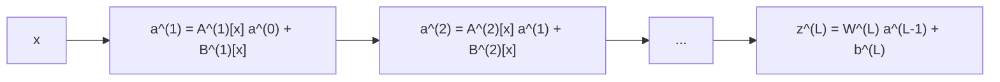

# Deep networks as splines

!!! abstract "In this chapter"
    - A continuous piecewise-affine network is, exactly, a *multivariate affine spline*: affine pieces glued on the cells of a partition $\Omega$.
    - Its layers are *max-affine spline operators* (MASOs); any network built from affine maps, piecewise-affine convex activations and convex pooling is a composition of MASOs and hence a global spline [@balestrieroSplineTheoryDeep2018].
    - Composing the layers collapses the network, for a fixed input, to a single signal-dependent affine map $z=A[x]x+B[x]$; the output is a bank of matched filters whose templates are rows of $W^{(L)}A[x]$.
    - The spline's *knots along a direction* — the crossings of a path through the regions — are the tractable observable: their expected density is linear in the number of neurons, not exponential in depth [@haninComplexityLinearRegions2019; @goujonNumberRegionsPiecewise2023].
    - SplineCam computes the exact partition and decision boundary of the spline over a 2-D slice, giving per-region volumes, region counts and boundary samples [@humayunSplineCamExactVisualization2024].
    - Prerequisites: [Polyhedra, arrangements and piecewise-linear maps](polyhedral-foundations.md), [The region complex of a ReLU network](relu-network-geometry.md).

The last chapter described a ReLU network as a decomposition: input space is cut into convex polyhedral *linear regions*, each carrying one affine map, and the whole map is affine wherever no unit switches. That description is correct, but it leaves the function itself in the background. This chapter puts the function back in front and gives it its classical name. A continuous piecewise-affine function on a partitioned domain *is* a spline — the multivariate affine spline of approximation theory — and naming it that turns a collection of geometric observations into a small, sharp algebraic calculus [@balestrieroSplineTheoryDeep2018, §1, p. 1].

The payoff is concrete and runs through the whole chapter. A spline can be written without an explicit partition as a *maximum of affine functions*, which makes every layer a *max-affine spline operator*; composing the operators collapses the whole network, at a given input, to a single signal-dependent affine map, so the classifier output is a bank of matched filters [@balestrieroSplineTheoryDeep2018, §4–§5]. The spline's *knots* along a curve — the points where the active affine piece changes — can be counted and bounded, and their expected density along any direction is linear in the number of neurons, not exponential in depth [@haninComplexityLinearRegions2019, §2.1; @goujonNumberRegionsPiecewise2023, §4]. Finally, the spline of a trained network can be computed *exactly* rather than sampled, at least over a 2-D slice, and the resulting statistics compare architectures quantitatively [@humayunSplineCamExactVisualization2024, §2.2].

This chapter is deliberately the *function-side* complement of the previous one: where [The region complex of a ReLU network](relu-network-geometry.md) asked what the pieces are and how they meet, here we ask what the spline computes on those pieces and how to read it [@balestrieroSplineTheoryDeep2018, §2, p. 2]. The tropical-geometry account of the same objects is [Tropical geometry of ReLU networks](tropical-geometry.md); the counts of how many pieces there can be are [Counting linear regions](counting-regions.md).

I keep the shared [notation](../notation.md): $L$ layers, widths $n_l$, weights $W^{(l)}$ and biases $b^{(l)}$, pre-activations $z^{(l)}=W^{(l)}a^{(l-1)}+b^{(l)}$ and activations $a^{(l)}=\sigma(z^{(l)})$ with $a^{(0)}=x$. One clash must be flagged at the outset: [@balestrieroSplineTheoryDeep2018] writes $z^{(\ell)}(x)$ for the *output* (feature map) of layer $\ell$, which is our $a^{(\ell)}$. Throughout this chapter I translate its equations into the shared notation and say so where the translation matters.

## Splines: affine pieces glued on a partition

A multivariate affine spline is defined exactly as the region picture suggests, and I follow the formulation of [@balestrieroSplineTheoryDeep2018, Eq. 3, p. 3]. Let $\Omega=\{\omega_1,\dots,\omega_R\}$ partition the domain into $R$ regions, let $\alpha\in\R^{R\times n_0}$ collect one slope row per region and $\beta\in\R^{R}$ one offset per region. The spline (Eq. 3, p. 3) is

$$
s[\alpha,\beta,\Omega](x)
=\sum_{r=1}^{R}\bigl(\langle[\alpha]_{r,\cdot},x\rangle+[\beta]_r\bigr)\,\mathbf{1}(x\in\omega_r)
=:\langle\alpha[x],x\rangle+\beta[x]
$$

where the bracket notation $\alpha[x],\beta[x]$ selects the row of the region containing $x$ [@balestrieroSplineTheoryDeep2018, Eq. 3, p. 3]. This is a *continuous* spline: the pieces must agree across the shared boundaries of the partition, otherwise the sum would jump. Feedforward ReLU networks satisfy this automatically, because they are compositions of continuous maps, so the CPWL functions of deep learning form a subclass of the continuous affine splines [@balestrieroSplineTheoryDeep2018, §2, p. 2]. The paper is careful that "piecewise-affine convex nonlinearities" is the operative class: (leaky-)ReLU, the absolute value, maxout and max-pooling all qualify, while sigmoid and tanh can only be *approximated* by such a spline, not represented by one [@balestrieroSplineTheoryDeep2018, §4.1, p. 4].

The difficulty of the spline view, and the reason it is not the end of the story, is that the partition $\Omega$ and the slopes $\alpha$ are coupled: fitting a spline from data means optimising both at once, and the partition is a combinatorial object [@balestrieroSplineTheoryDeep2018, §2, p. 2]. There is one escape, and it is the hinge on which the whole chapter turns. If the spline is constrained to be *globally convex*, the partition does not have to be written down at all (Eq. 4, p. 3):

$$
s[\alpha,\beta,\Omega](x)=\max_{r=1,\dots,R}\ \langle[\alpha]_{r,\cdot},x\rangle+[\beta]_r
$$

The maximum of finitely many affine functions is convex and piecewise affine, and its pieces — and hence its partition — are induced by the slopes and offsets, an *adaptive partitioning* [@balestrieroSplineTheoryDeep2018, Eq. 4, p. 3]. A network is not globally convex, but each of its (convex) nonlinearities is, and that is enough to make every layer a max of affines, which is where we go next.

!!! note "Background"
    In classical approximation theory a *spline* is a piecewise-polynomial function on an interval, glued at points called *knots* so that it is smooth to some order; a cubic spline, for instance, is continuous with continuous first and second derivatives. The object here is the affine (degree-one) and multivariate case: the pieces are affine functions on polyhedral cells rather than polynomials on intervals, the "knots" become the cell boundaries — the bent hyperplanes of the previous chapter — and continuity, not $C^2$, is what is imposed. The max-affine representation of a convex piecewise-linear function is standard convex analysis (a piecewise-linear convex function is the maximum of its affine pieces), and is imported here rather than taken from the collection.

## Every layer is a max-affine spline operator

The multivariate version of the max-affine form is what [@balestrieroSplineTheoryDeep2018] calls a *max-affine spline operator*. Fix an output dimension $K$, a number of pieces $R$, slopes $A\in\R^{K\times R\times n_0}$ and offsets $B\in\R^{K\times R}$. The operator (Eq. 5, p. 3) is

$$
S[A,B](x)=
\begin{bmatrix}
\max_{r=1,\dots,R}\bigl(\langle[A]_{1,r,\cdot},x\rangle+[B]_{1,r}\bigr)\\
\vdots\\
\max_{r=1,\dots,R}\bigl(\langle[A]_{K,r,\cdot},x\rangle+[B]_{K,r}\bigr)
\end{bmatrix}
=:A[x]\,x+B[x]
$$

where again $A[x]$ is the slope matrix selected by the winning piece index for each output [@balestrieroSplineTheoryDeep2018, Eq. 5, p. 3]. Each coordinate of $S[A,B]$ is a scalar convex spline in the sense of Eq. 4; the operator stacks $K$ of them, one per output unit.

Three facts turn this into a language for networks [@balestrieroSplineTheoryDeep2018, §4.1, pp. 4–5]:

- a fully connected or convolutional layer is a *degenerate* MASO with $R=1$, i.e. a single affine function (Prop. 1);
- a piecewise-affine convex activation is a MASO with $R=2$, the two pieces being the branches on either side of the kink — for ReLU the slope tensor is $[A_\sigma]_{k,1,\cdot}=0$ and $[A_\sigma]_{k,2,\cdot}=e_k$ (Prop. 2);
- a piecewise-affine convex pooling operator, such as max-pooling, is a MASO (Prop. 3).

Composing one affine layer with one activation therefore gives a layer that acts as a *signal-dependent affine map* (Eq. 6, p. 4),

$$
f^{(\ell)}\bigl(z^{(\ell-1)}(x)\bigr)=A^{(\ell)}[x]\,z^{(\ell-1)}(x)+B^{(\ell)}[x]
$$

with $A^{(\ell)}[x],B^{(\ell)}[x]$ the activation's MASO matrices pushed through the affine layer (Prop. 4) [@balestrieroSplineTheoryDeep2018, Eq. 6, p. 4]. The superscript $(\ell)$ here indexes the *layer's* MASO, not a region.

From here the two structural theorems follow. First, *any* network assembled from fully connected or convolutional layers, piecewise-affine convex activations and piecewise-affine convex pooling is a composition of MASOs, and a composition of MASOs is equivalent to a global affine spline operator (Thm. 1) [@balestrieroSplineTheoryDeep2018, Thm. 1, p. 4]. The composition is *not itself* a MASO in general — a max of maxes need not stay a single convex max — and that is precisely why the general object has to be a partition-based spline rather than a single max-affine form. Second, and as the special case that is genuinely convex, if all weight matrices have nonnegative entries and the activations and pooling are non-decreasing, piecewise-affine and convex, the *whole network* is a single MASO and is convex in every output coordinate (Thm. 2) [@balestrieroSplineTheoryDeep2018, Thm. 2, p. 4]. That is the input-convex-network regime, and in it the hierarchical selection we meet below becomes globally optimal (Cor. 1).

In the shared notation, then, a layer computes

$$
a^{(\ell)}(x)=A^{(\ell)}[x]\,a^{(\ell-1)}(x)+B^{(\ell)}[x],
$$

where the paper's $z^{(\ell)}(x)$ is our activation $a^{(\ell)}$ [@balestrieroSplineTheoryDeep2018, Eq. 5, p. 3]. The region indices that select $A^{(\ell)}[x]$ are exactly the activation bits $\mathbf{s}(x)$ of the region chapter: for a ReLU unit, the MASO branch $r\in\{1,2\}$ corresponds to the sign of its pre-activation, and the selected slope is either the weight row or zero [@balestrieroSplineTheoryDeep2018, Prop. 2, §4.1, p. 4]. The MASO bookkeeping and the activation-pattern bookkeeping are the same bookkeeping.

The signal-dependent affine collapse is worth a picture:

At each layer the matrices $A^{(\ell)}[x]$ are chosen by the region of the current input; only the choice, not the form of the map, changes with $x$ [@balestrieroSplineTheoryDeep2018, Eq. 5, p. 3].

## Collapsing the composition

Because every layer is a signal-dependent affine map, substituting the layer recursion into itself removes the intermediate compositions and leaves a single affine expression for the whole network at a fixed input. For a standard ReLU-plus-max-pooling convolutional network, with convolution matrices $C^{(\ell)}$, fully connected weights $W^{(\ell)}$ and biases $b_C^{(\ell)}$, the closed form (Eq. 7, p. 5) is

$$
\begin{aligned}
z^{(L)}_{\mathrm{CNN}}(x)
&=W^{(L)}\Bigl(\prod_{\ell=L-1}^{1}A^{(\ell)}_{\rho}[x]\,A^{(\ell)}_{\sigma}[x]\,C^{(\ell)}\Bigr)x\\
&\quad +W^{(L)}\sum_{\ell=1}^{L-1}\Bigl(\prod_{j=L-1}^{\ell+1}A^{(j)}_{\rho}[x]\,A^{(j)}_{\sigma}[x]\,C^{(j)}\Bigr)\bigl(A^{(\ell)}_{\rho}[x]\,A^{(\ell)}_{\sigma}[x]\,b^{(\ell)}_C\bigr)\\
&\quad +b^{(L)}_W
\end{aligned}
$$

where $A^{(\ell)}_{\sigma}$ is the activation's MASO matrix and $A^{(\ell)}_{\rho}$ the pooling operator's, and there is no offset from either because ReLU and max-pooling have none [@balestrieroSplineTheoryDeep2018, Eq. 7, p. 5; Eq. 8, p. 5]. The inner factor $A_{\mathrm{CNN}}[x]x+B_{\mathrm{CNN}}[x]$ is the featurisation that feeds the final linear classifier: the network is, at input $x$, a linear classifier applied to a feature vector that has been produced by the *composition of the chosen affine pieces*. Analogous collapse formulas for ResNets and recurrent networks are derived in the extended companion, outside this collection [@balestrieroSplineTheoryDeep2018, §4.2, pp. 4–5].

Two readings matter. First, this is the clean answer to "what does a deep network compute?": for each input, a single affine map, whose slope and offset depend on which region the input falls in. It is a linear model with a *signal-dependent* design matrix, and the local affine-map analysis of [@sattelbergLocallyLinearAttributes2023] studies exactly this object — the slope of the piece — treated as a point (see [The region complex of a ReLU network](relu-network-geometry.md), §6). Second, the product of per-layer MASO matrices in Eq. 7 is the same folded-weight construction that the region chapter builds directly from the activation pattern; the spline language and the pattern language compute the same slope two ways [@balestrieroSplineTheoryDeep2018, Eq. 7, p. 5].

## Templates: the spline read as matched filters

Once the network is a signal-dependent affine map, its final linear layer becomes interpretable as a bank of detectors. The $c$-th output entry is the inner product of the input with the $c$-th row of $W^{(L)}A[x]$ — the *template* of class $c$ at that input — so the network classifies by correlating $x$ with one template per class [@balestrieroSplineTheoryDeep2018, §5.1, p. 5]. Crucially, the templates are not fixed weights: they are rows of $W^{(L)}A[x]$, hence they change with the region the input lands in. The paper reads the cascade of per-layer maxima as a *hierarchical, greedy* maximisation over region indices, globally optimal only under the nonnegative-weights condition of Thm. 2 (Cor. 1) [@balestrieroSplineTheoryDeep2018, §5.1, p. 5].

The templates are cheap to obtain from a trained model: because $A[x]$ is exactly the Jacobian $\mathrm{d}[z^{(L)}(x)]_c/\mathrm{d}x$ for output $c$, computing it is one backward pass, and the offset follows from the affine identity $b[x]_c=z^{(L)}(x)_c-\langle A[x]_{c,\cdot},x\rangle$ [@balestrieroSplineTheoryDeep2018, §5.2, p. 5].

Under an idealised analysis of the cross-entropy optimum — reachable MASO matrices, unit-norm inputs, a norm constraint on the templates — the optimal templates are *collinear with the input itself*, large and positive for the correct class and small and negative for every other class [@balestrieroSplineTheoryDeep2018, Prop. 5, Eq. 12, p. 6]:

$$
[A^{\star}[x_n]]_{c,\cdot}=
\begin{cases}
+\sqrt{\dfrac{(C-1)\alpha}{C}}\;x_n, & c=y_n,\\[2mm]
-\sqrt{\dfrac{\alpha}{C(C-1)}}\;x_n, & c\neq y_n,
\end{cases}
$$

with $C$ the number of classes and $\alpha$ the constraint bound. This predicts a bimodal distribution of the inner products $\langle[A^{\star}[x_n]]_{c,\cdot},x_n\rangle$, and Figure 2 confirms it for a large CNN on MNIST and CIFAR10, more strongly on the easier problem [@balestrieroSplineTheoryDeep2018, Prop. 5, Fig. 2, p. 6]. The template picture is visible per input too: for an MNIST "0" the three classes $(0,3,7)$ give inner products $32.7$, $-27.7$, $-27.8$, and for a CIFAR10 "truck" the classes $(\text{truck},\text{bird},\text{dog})$ give $30.6$, $-12.5$, $-16.2$ [@balestrieroSplineTheoryDeep2018, Fig. 1, p. 6].

The paper's application is to push the classifier towards orthogonal templates by augmenting the cross-entropy loss (Eq. 13, p. 6),

$$
L_{CE}+\lambda\sum_{c_1\neq c_2}\bigl\lvert\langle[W^{(L)}]_{c_1,\cdot},[W^{(L)}]_{c_2,\cdot}\rangle\bigr\rvert^2
$$

motivated by the mismatch between the matched-filter model (which assumes additive white Gaussian noise) and real classification [@balestrieroSplineTheoryDeep2018, Eq. 13, §6, p. 6]. On CIFAR100 with largeCNN the paper reports that the benefit "emerges distinctly as soon as $\lambda>0$", with improved final accuracy, better generalisation and visibly less overfitting; the main text gives only the figure, over 15 runs, with no numeric accuracies, and defers the remaining architectures and datasets to the companion outside the collection [@balestrieroSplineTheoryDeep2018, Fig. 3, §6, p. 7].

!!! note "Background"
    A *matched filter* is the linear filter that maximises the output signal-to-noise ratio for a known deterministic signal in additive white Gaussian noise, so the optimal detector correlates the observation with a scaled copy of the candidate signal; a bank of matched filters, one per class, is then optimal for that noise model. This is textbook detection theory and is not taken from the collection; the paper imports it, and concedes the noise model is "overly simplistic" for most learning problems [@balestrieroSplineTheoryDeep2018, §6, p. 6].

As my own reading, one caveat should be attached. The penalty constrains $W^{(L)}$ to be orthogonal, which makes orthogonal templates *possible* but not guaranteed: templates are rows of $W^{(L)}A[x]$, so template orthogonality needs $W^{(L)}$ orthogonal *and* the region-dependent factor $A[x]$ to preserve it, which it need not. The penalty therefore enforces a necessary condition, and the paper reports no ablation isolating template orthogonality from an incidental shrinkage of $\lVert W^{(L)}\rVert$ or a change in the last layer's effective learning rate [@balestrieroSplineTheoryDeep2018, §6, p. 6]. Treat the accuracy gain as real but the mechanism as under-identified.

## Knots along a direction

A spline is not only its partition; it is also how many times a curve crosses the pieces. That count, the *knot density*, is the simplest quantitative handle on the spline and the concept the outline calls "knots along a direction". Fix a 1-D continuous piecewise-linear path $\gamma:[a,b]\to\R^{n_0}$; its length is $\mathrm{Len}(\gamma)=\int_a^b\lVert \mathrm{d}\gamma/\mathrm{d}t\rVert_2\,\mathrm{d}t$ [@goujonNumberRegionsPiecewise2023, §4.1, p. 13]. Let $\Omega_1,\dots,\Omega_K$ be the supports of the affine pieces and let

$$
\varphi_f^\gamma(t)=\bigl(\mathbf{1}_{\Omega_1}(\gamma(t)),\dots,\mathbf{1}_{\Omega_K}(\gamma(t))\bigr)
$$

be the characteristic function that records which piece supports the active affine function along the path. It is a step function, and the number of its jumps is the number of *knots* $kt_f^\gamma$; the knot density (Def. 6, Eq. 24, §4.1, p. 13) is

$$
\lambda_f^\gamma=\frac{kt_f^\gamma}{\mathrm{Len}(\gamma)}
$$

The definition is set up to avoid the ambiguity of a path running along a region boundary: the knots are the jumps of $\varphi_f^\gamma$, not literal geometric crossings [@goujonNumberRegionsPiecewise2023, Def. 6, Eq. 24, p. 13]. In practice $\varphi_f^\gamma$ is read off from $f(\gamma(t))$ and $\nabla f(\gamma(t))$, both computable in any deep-learning library [@goujonNumberRegionsPiecewise2023, §4.1, p. 13]. For a ReLU network along a path, a knot is exactly a point where some unit changes sign — a crossing of a bent hyperplane — so the knot count is the number of regions the path visits minus one [@goujonNumberRegionsPiecewise2023, §4.1, p. 13].

Why restrict to a curve? Because the *total* number of regions can be exponential in depth and is hard to compute, while along a direction the spline is a univariate piecewise-linear function whose knots are directly countable [@goujonNumberRegionsPiecewise2023, §4.1, p. 13]. The contrast between the two regimes is the chapter's quantitative payoff. The maximal region count of a CPWL network grows exponentially in depth and only polynomially in width and activation complexity: for a network with dimensions $(d_{\rm in},W,\dots,W,d_{\rm out})$ and uniform activation complexity $\kappa$, the count $\kappa_{\max}$ satisfies (Eq. 17, §3.3, p. 11)

$$
\bigl(\kappa^{\lfloor W/d^\ast\rfloor}\bigr)^{L d^\ast}\le\kappa_{\max}\le(\kappa W)^{L d^\ast},
\qquad d^\ast=\min(d_{\rm in},d_{\rm out})
$$

so depth is the only descriptor that can make the count grow exponentially [@goujonNumberRegionsPiecewise2023, Eq. 17, p. 11]. Along a single direction the picture is entirely different. Under two assumptions — the expected knot density of each layer is bounded by $\lambda_0$, and the expected directional derivative within the composition by $D_0$ — the expected knot density along *any* path is bounded linearly in depth (Eq. 35, §4.3, p. 15):

$$
\E\bigl[\lambda^\gamma_{f_{\theta_L}\circ\dots\circ f_{\theta_1}}\bigr]\le D_0^\ast\,(\lambda_0 W L),
\qquad D_0^\ast=\max(D_0,1)
$$

so on average depth buys only a linear factor, and depth, width and activation complexity play identical roles [@goujonNumberRegionsPiecewise2023, Eq. 35, §4.3, p. 15; Cor. 3]. The assumption on the per-layer knot density is verified for ReLU, Maxout and GroupSort layers with random weights and biases [@goujonNumberRegionsPiecewise2023, §4.2, pp. 14–15].

This is not a quirk of the general CPWL framework; it is the same phenomenon the average-case counting literature found for ReLU. For input–output dimension one and stimuli on an interval $I$, the expected number of regions along the interval is approximately $|I|\cdot T\cdot\#\{\text{neurons}\}$, where $T$ is the number of activation breakpoints ($T=1$ for ReLU): the average region count along a line is proportional to the number of neurons and *does not depend on depth* [@haninComplexityLinearRegions2019, Thm. 1, §2.1; §3.1]. So the two average-case results agree, from different directions: the number of knots a trained network shows along a curve is linear in its size, and the worst-case exponential construction is numerically fragile [@haninComplexityLinearRegions2019, §3.1, p. 4].

!!! tip "Practical reading"
    The knot density is what you can measure without enumerating the partition: walk a curve through input space, record $f$ and $\nabla f$ at each step, and count the jumps. A one-dimensional probe therefore turns "how complex is this trained network" into a number that scales with the neuron count, and it is cheap enough to run during training [@goujonNumberRegionsPiecewise2023, §4.1, p. 13; @haninComplexityLinearRegions2019, §3.1].

## Exact geometry of the spline: SplineCam

Measuring the spline along a curve is cheap but partial. The opposite extreme is to compute the spline's partition and decision boundary *exactly*, at least over a 2-D slice of input space, and that is what SplineCam does [@humayunSplineCamExactVisualization2024, §1, p. 2]. It rests on the same per-region affine representation as the previous section, stated as a lemma: for a network with $L$ CPWL layers, the composition of layers $1$ to $\ell$ is (Lemma 1, Eq. 2, p. 3)

$$
S^\ell(x)=\sum_{\omega\in\Omega}\bigl(A^\ell_\omega x+b^\ell_\omega\bigr)\,\mathbf{1}\{x\in\omega\}
$$

with per-region parameters built from the pointwise derivatives $q^\omega_i$ of the activation at each layer's pre-activation (Eqs. 3–4, p. 3),

$$
\begin{aligned}
A^\ell_\omega&=\prod_{i=1}^{\ell}\operatorname{diag}\bigl(q^\omega_i\bigr)W^i,\\
&\qquad b^\ell_\omega=\operatorname{diag}\bigl(q^\ell_\omega\bigr)b^\ell+\sum_{i=1}^{\ell-1}\Bigl(\prod_{j=i+1}^{\ell}\operatorname{diag}\bigl(q^\omega_j\bigr)W^j\Bigr)\operatorname{diag}\bigl(q^\omega_i\bigr)b^i
\end{aligned}
$$

and $q^\omega_i$ unique for each region, a fact inherited from the spline theory of [@balestrieroSplineTheoryDeep2018] [@humayunSplineCamExactVisualization2024, Lemma 1, Eqs. 2–4 and §2.1, p. 3]. Knowing $A^\ell_\omega,b^\ell_\omega$ for all regions $\omega$ *is* knowing the function, which is why the partition is the right object to compute.

The algorithm partitions a 2-polytope $P$ layer by layer [@humayunSplineCamExactVisualization2024, §2.2, pp. 3–4]:

1. the hyperplanes of layer 1, $h^1_i$, cut $P$ into the first partition; the cells are the cycles of the planar arrangement, found by solving for all intersections to get nodes, connecting consecutive nodes to get edges, and extracting cycles by breadth-first search (Alg. 1 and Alg. 2);
2. for each region $\omega$, the *deeper* layer hyperplanes are pulled back onto $\omega$'s tangent space. A layer-$\ell$ hyperplane $h^\ell_i=\{z:\langle w^\ell_i,z\rangle+b^\ell_i=0\}$ back-projects to (Lemma 2, Eq. 6, p. 3)

$$
\operatorname{proj}_\omega(h^\ell_i)=\bigl\{x\in\R^{S}:\langle w^\ell_i,\,A^{\ell-1}_\omega x+b^{\ell-1}_\omega\rangle+b^\ell_i=0\bigr\}
$$

3. the refined partition graph is recomputed and the process repeats to layer $L$.

Because the composition is affine within each region, back-projecting a final-layer hyperplane gives the decision boundary exactly: for a single-output classifier the boundary in input space is $\bigcup_{\omega\in\Omega}\{\operatorname{proj}_\omega(h^L_1)\cap\omega\}$, a repeated application of the back-projection lemma (Thm. 1) [@humayunSplineCamExactVisualization2024, Thm. 1, §2.2, p. 3]. Everything except the cycle search is vectorisable and runs on GPU; the arrangement of lines has $O(n^2)$ intersections, edges and cycles, the average number of edges per region converges to 4, and the average-case cost of the cycle search is $O(n^2)$ [@humayunSplineCamExactVisualization2024, §2.2, p. 4].

The exactness buys quantitative comparisons that sampling cannot. On a common 2-D slice, convolutional networks form far more regions of smaller volume than fully connected ones *even with fewer parameters*: for MLP (44,860 parameters) versus CONV (39,780 parameters), MNIST average region volume $3.144\times10^{-4}$ versus $1.134\times10^{-5}$ and region count 318 versus 8814; Fashion-MNIST $4.991\times10^{-4}$ versus $3.54\times10^{-5}$ and 1364 versus 28222, with the average number of vertices equal to 4 in every row [@humayunSplineCamExactVisualization2024, Tab. 1, p. 7]. The reading is that a convolution's circulant weight matrix repeats the same cuts across input dimensions, raising complexity for the same parameter count [@humayunSplineCamExactVisualization2024, §4.1, p. 7].

Three further exact observations. Task complexity shows up in the partition: two width-256 depth-6 MLPs trained on an easy and a convoluted signed-distance field from the same image develop different partitions, the harder task having the finer one and the higher region density [@humayunSplineCamExactVisualization2024, §3.1, p. 5]. Positional encoding leaves a fingerprint: a depth-5 ReLU MLP fit to an image with periodic position encoding shows per-neuron boundaries repeating periodically, increasing the number of regions and the weight sharing, which the authors offer as a candidate reason for its faster convergence [@humayunSplineCamExactVisualization2024, §3.2, pp. 5–6]. And boundary samples are genuine: points sampled on the boundary between Tabby and Egyptian Cat look like ambiguous blends of the anchor images, and some MNIST 2-versus-3 boundary samples clearly look like digit 3, which the authors call a possibly sub-optimal boundary [@humayunSplineCamExactVisualization2024, Fig. 6, §3.1, p. 6; §D.3, p. 18]. Data augmentation raises partition density at test points for VGG11 (much less so for VGG16), with both augmented models reaching about $51\%$ accuracy on tinyImageNet-200 [@humayunSplineCamExactVisualization2024, §4.2, Fig. 8, pp. 7–8].

!!! warning "Do not trust everything printed"
    Two items in [@humayunSplineCamExactVisualization2024] should be read with care. The "Ecc." column of Tab. 1 prints values $102\text{e}7, 36\text{e}7, 17\text{e}7, 14\text{e}7$, yet average region eccentricity is defined as a ratio of largest to smallest pairwise distance, which is at least 1 and cannot be of order $10^9$; either the exponents are garbled or the column is not eccentricity [@humayunSplineCamExactVisualization2024, §4.1, p. 7]. And the signed-distance thresholds disagree between the text and the figure caption (different pairs of numbers are given for the same MetFaces experiment), so the specific thresholds should not be quoted [@humayunSplineCamExactVisualization2024, §3.1, p. 5; Fig. 5, p. 5].

## The spline's pieces as a point cloud

The slope of the affine piece is itself an object worth analysing, and the natural thing to do with a family of slopes is to view them as points. Concatenate a row of a region's weight matrix with the matching bias entry: for the piece $(W_i,b_i)$ the $j$-th output direction contributes the point $(w_{i,j},b_{i,j})\in\R^{n_0+1}$, which [@sattelbergLocallyLinearAttributes2023] calls the *dual* of that region for that output; the XOR region $-x-y$ induces the dual point $(-1,-1,0)$ [@sattelbergLocallyLinearAttributes2023, Eq. 4, §2.1, p. 4]. Stack the sampled local maps of output $j$ into a matrix $C_j\in\R^{p\times(n_0+1)}$ and "the region structure" becomes a point cloud that can be clustered with $k$-means [@sattelbergLocallyLinearAttributes2023, Eqs. 5–7, §2.4, pp. 8–9].

In the spline language this is the study of the slopes $\alpha[x]$ of Eq. 3: a trained network realises only a small and redundant set of them, and how many are needed to reproduce its accuracy measures how non-linear it really is. Clustering the sampled local maps of MNIST networks recovers near-original accuracy from as few as 10 cluster centres for every architecture except ResNet, and a least-squares affine map between the slope clouds of two different networks preserves much of their accuracy [@sattelbergLocallyLinearAttributes2023, Tab. 1 and Tab. 2, §3.2–§3.3, pp. 14–16]. The details, and what the asymmetry between ResNet and Inception means, belong to [The region complex of a ReLU network](relu-network-geometry.md); the spline chapter's point is that these are exactly the slopes of the spline's pieces, so the redundancy is a statement about the trained spline, not about the network's parameters.

## Summary

- A continuous piecewise-affine network is a multivariate affine spline: one affine piece per region of a partition, glued continuously [@balestrieroSplineTheoryDeep2018, Eq. 3, p. 3].
- A convex spline needs no explicit partition; it is a maximum of affine functions, and that max-affine form is what makes layers tractable [@balestrieroSplineTheoryDeep2018, Eq. 4, p. 3].
- Every layer of a CPWL network is a max-affine spline operator, and any network built from them is a composition of MASOs equivalent to a global affine spline operator [@balestrieroSplineTheoryDeep2018, Thm. 1, p. 4].
- For a fixed input the composition collapses to a signal-dependent affine map $z=A[x]x+B[x]$, whose slope is the Jacobian of the network at that input [@balestrieroSplineTheoryDeep2018, Eq. 7, p. 5].
- The output is a bank of matched filters whose class templates are rows of $W^{(L)}A[x]$; the idealised optimum makes them collinear with the input [@balestrieroSplineTheoryDeep2018, Prop. 5, Eq. 12, p. 6].
- Along any direction the spline has a knot density — the jumps of the active piece — and its expected value is linear in the number of neurons, not exponential in depth [@haninComplexityLinearRegions2019, Thm. 1, §2.1; @goujonNumberRegionsPiecewise2023, Eq. 35, p. 15].
- SplineCam computes the exact partition and decision boundary of a CPWL network over a 2-D slice, layer by layer with back-projection, in $O(n^2)$ average-case work [@humayunSplineCamExactVisualization2024, §2.2, p. 4].
- Exact partition statistics separate architectures quantitatively: convolutional networks form far more, smaller regions than MLPs for a similar parameter count [@humayunSplineCamExactVisualization2024, Tab. 1, p. 7].

## Further reading

- [@balestrieroSplineTheoryDeep2018]: the spline and MASO formalism; read §2–§4 for the definitions and the composition theorems, §5 for matched filters and templates, and §7 for the partition-based signal distance.
- [@humayunSplineCamExactVisualization2024]: exact partition and boundary computation; read §2 for the algorithm and Theorem 1, and §3–§4 for the architecture and task-complexity statistics.
- [@sattelbergLocallyLinearAttributes2023]: the slopes of the pieces as a dual point cloud; read §2.1–§2.4 for the construction and §3.2–§3.3 for the clustering and cross-network results.
- [@goujonNumberRegionsPiecewise2023]: maximal region counts and the knot density; read §3 for the arrangement-of-convex-partitions bound and §4 for the stochastic knot-density bound.
- [@haninComplexityLinearRegions2019]: the average knot count along a line; read §2.1 and §3.1 for the linear-in-neurons result, and §2.2 for the boundary-volume measure.

## Exercises

**Exercise 1** ★ (check). Explain why the spline of a ReLU network is necessarily a *continuous* spline, and what would have to change for the pieces to be glued discontinuously.

??? success "Solution"
    A ReLU network is a composition of affine maps and the continuous function
    $\sigma(t)=\max(0,t)$, so the whole map is continuous; on each region it is affine,
    and continuity at a shared boundary forces the two affine pieces to agree there —
    exactly the gluing condition of a continuous affine spline
    [@balestrieroSplineTheoryDeep2018, Eq. 3, §2, p. 2]. To get a discontinuous spline
    one would need a discontinuous activation (a jump), which is excluded by the
    "piecewise-affine convex nonlinearity" class; sigmoid and tanh are not even in
    that class and can only be approximated [@balestrieroSplineTheoryDeep2018, §4.1,
    p. 4].

**Exercise 2** ★ (check). Give the MASO parameters $(A,B,R)$ for three layers: a plain affine layer, a ReLU activation, and a 2-element max-pooling. Say what $R$ is in each case.

??? success "Solution"
    An affine layer is a degenerate MASO with $R=1$: a single affine function, so
    $A$ holds one slope per output and $B$ one offset [@balestrieroSplineTheoryDeep2018,
    Prop. 1, §4.1, p. 4]. A ReLU activation is a MASO with $R=2$: by the paper's
    indexing $[A_\sigma]_{k,1,\cdot}=0$ and $[A_\sigma]_{k,2,\cdot}=e_k$ (the zero map
    below the kink, the identity above) [@balestrieroSplineTheoryDeep2018, Prop. 2,
    §4.1, p. 4]. A 2-element max of two affine forms is a MASO with $R=2$ as well;
    a piecewise-affine convex pooling operator is a MASO in the paper's Proposition 3
    [@balestrieroSplineTheoryDeep2018, Prop. 3, §4.1, p. 4].

**Exercise 3** ★★ (derive). Starting from the MASO definition, show that the $c$-th output of a trained network at input $x$ is an inner product of $x$ with a template plus an offset, and give a one-backward-pass recipe for the template and the offset.

??? success "Solution"
    By Theorem 1 the network is an affine spline operator, so its slope at $x$ is a
    signal-dependent matrix $A[x]$ and its output is $W^{(L)}A[x]\,x+\text{offset}$
    [@balestrieroSplineTheoryDeep2018, Thm. 1 and Eq. 7, p. 4–5]. The $c$-th entry is
    $\langle (W^{(L)}A[x])_{c,\cdot},x\rangle+(\text{offset})_c$, an inner product with
    the template in row $c$. Because $A[x]$ is the Jacobian of output $c$ with respect
    to $x$, one backward pass gives $A[x]_c=\mathrm{d}[z^{(L)}(x)]_c/\mathrm{d}x$, and
    the offset follows from the affine identity
    $b[x]_c=z^{(L)}(x)_c-\langle A[x]_{c,\cdot},x\rangle$
    [@balestrieroSplineTheoryDeep2018, §5.2, p. 5].

**Exercise 4** ★★ (derive). The whole network is a single MASO when all weight matrices have nonnegative entries and the activations and pooling are non-decreasing, piecewise-affine and convex. Argue why the resulting spline is convex in each output coordinate, and what fails when a weight matrix has negative entries.

??? success "Solution"
    A MASO with $R=1$ is affine and hence both convex and concave; a non-decreasing
    convex piecewise-affine activation preserves convexity, and a maximum of convex
    functions is convex [@balestrieroSplineTheoryDeep2018, Eq. 5, p. 3]. With
    nonnegative weights, an affine map composed with, or added to, a convex function
    of a nonnegatively-scaled argument stays convex, so composing all layers leaves a
    single convex MASO in each output coordinate (Thm. 2). If a weight matrix has a
    negative entry, the map can flip a convex function to concave before the next max,
    the composition no longer admits a single max-affine representation, and the network
    is only a partition-based spline, not a single MASO
    [@balestrieroSplineTheoryDeep2018, Thm. 2 and §4.1, p. 4]. That convex regime is
    exactly the input-convex-network case, where the hierarchical template selection is
    globally optimal (Cor. 1).

**Exercise 5** ★★ (compare). The maximal number of regions of a CPWL network grows exponentially in depth (Eq. 17 of [@goujonNumberRegionsPiecewise2023]), yet the expected knot density along any path grows only linearly in depth (Eq. 35 of the same paper). Reconcile the two statements, and say what each measures.

??? success "Solution"
    They measure different things. The maximal count is a *worst case over
    parameters*: for each depth there exist weight configurations attaining the
    exponential lower bound, so the count is a property of the architecture's best case
    [@goujonNumberRegionsPiecewise2023, Eq. 17, §3.3, p. 11]. The knot density is an
    *average over random weights and biases* along a fixed path: under the bounded
    per-layer knot density and bounded directional derivative assumptions, depth enters
    only as a linear factor, $D_0^\ast\lambda_0WL$ [@goujonNumberRegionsPiecewise2023,
    Eq. 35, §4.3, p. 15]. The reconciliation is that the exponential constructions are
    atypical; typical networks, and the average region count along a line for ReLU,
    scale with the neuron count, not exponentially with depth
    [@haninComplexityLinearRegions2019, Thm. 1, §2.1].

**Exercise 6** ★★ (compare). SplineCam computes the exact partition on a 2-D slice, while the counting literature bounds the number of regions analytically and the knot-density results bound the average along a path. For each of the three, state one question it answers that the other two cannot, without extra work.

??? success "Solution"
    SplineCam gives the *spatial* geometry: per-region volumes, region counts on the
    actual slice, and provably-on-boundary samples, plus the exact decision boundary as
    $\bigcup_\omega \operatorname{proj}_\omega(h^L_1)\cap\omega$
    [@humayunSplineCamExactVisualization2024, Thm. 1 and Tab. 1, pp. 3, 7]. The
    counting bounds give the *architecture-level ceiling*: how many regions *can* the
    depth and width produce, a function of the architecture alone
    [@goujonNumberRegionsPiecewise2023, Eq. 17, p. 11]. The knot-density bound gives a
    cheap *average-complexity probe* that needs only forward and backward passes along a
    curve, and applies during training [@goujonNumberRegionsPiecewise2023, Eq. 35, p. 15;
    @haninComplexityLinearRegions2019, §3.1]. SplineCam cannot answer the architectural
    ceiling; the bounds cannot localise a boundary; and neither bound gives the exact
    per-region volumes.

**Exercise 7** ★★★ (design / apply). You are handed a network trained as a 2-D implicit signed-distance field, with max-pooling layers, and you want its exact region structure and boundary. Which method from this chapter do you use, what will the output be, and what must you change about the network and the pipeline to make it work?

??? success "Solution"
    Use SplineCam: it is the exact method, and for a 2-D SDF the zero level set of the
    output plays the role of the decision boundary, so Theorem 1 returns it as the
    union of back-projected output hyperplanes [@humayunSplineCamExactVisualization2024,
    Thm. 1 and §3.1, p. 3, 5]. The output is the partition graph — nodes, edges and
    cycles per layer — plus per-region statistics (volume, region count, eccentricity)
    and samples on the boundary [@humayunSplineCamExactVisualization2024, §2.2 and
    Tab. 1, pp. 3–4, 7]. Max-pooling is CPWL and admissible, but the library replaces
    max-pooling by average pooling (and strided convolution) for its VGG experiments
    "for simplicity", and requires double precision with sparse storage for large
    convolutional layers [@humayunSplineCamExactVisualization2024, §B, p. 12]. So you
    either accept the average-pooling substitution, which changes the function, or keep
    max-pooling and pay the memory cost; you also restrict attention to a 2-polytope,
    since the method is defined on 2-D domains [@humayunSplineCamExactVisualization2024,
    §2.2, p. 3].

**Exercise 8** ★★ (critique). The orthogonality penalty of [@balestrieroSplineTheoryDeep2018] improves CIFAR100 accuracy, but the paper's evidence for *why* is thin. State the weakest link and one experiment that would settle it.

??? success "Solution"
    The weakest link is the mechanism. Templates are rows of $W^{(L)}A[x]$, so an
    orthogonal $W^{(L)}$ is necessary for orthogonal templates but not sufficient — the
    region-dependent factor $A[x]$ need not preserve orthogonality — and the paper
    reports no ablation separating template orthogonality from an incidental shrinkage
    of $\lVert W^{(L)}\rVert$ or a change in the last layer's effective learning rate
    [@balestrieroSplineTheoryDeep2018, Eq. 13 and §6, p. 6]. The printed evidence is a
    single architecture/dataset pair (CIFAR100, largeCNN), shown only as a figure with
    no numeric accuracies, the rest deferred to a companion outside the collection
    [@balestrieroSplineTheoryDeep2018, Fig. 3, §6, p. 7]. A settling experiment: repeat
    the $\lambda$-sweep with a norm-matched alternative regulariser that shrinks
    $\lVert W^{(L)}\rVert$ identically but does not enforce orthogonality, and compare
    the accuracy curves; if the gain persists, it is not mere shrinkage.
