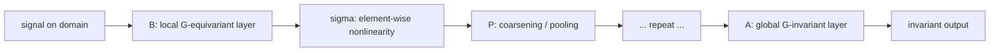

# Symmetry and geometric deep learning

!!! abstract "In this chapter"
    - A symmetry group $G$ acting on the data forces the learned map to be invariant or equivariant, and that single requirement pins the architecture down once $G$ is chosen.
    - The geometric deep learning blueprint builds every such model from four blocks — a local equivariant layer $B$, an element-wise nonlinearity $\sigma$, a coarsening $P$ and a global invariant layer $A$.
    - Translation symmetry yields convolution and the discrete Fourier transform; permutation symmetry yields message-passing graph networks; local frame freedom yields gauge-equivariant convolutions.
    - A dataset is written in coordinates and units that the investigator chose, and the resulting *passive* symmetries are exact and universal; ignoring them breaks the model's covariance.
    - The parameter space of a ReLU network carries its own symmetries — permutation $\Pi$ of units and positive per-layer scaling $(c_l)$ — so distinct parameter vectors compute the same function.
    - Permutation and scaling are the *only* symmetries for a positive-measure set of parameters when no layer is narrower than the input [@grigsbyHiddenSymmetriesReLU, Thm. 4.1], and for a specially constructed network under non-increasing widths [@phuongFunctionalVsParametric2019, Thm. 1].
    - Prerequisites: [The region complex of a ReLU network](relu-network-geometry.md) for the activation-pattern and bent-hyperplane vocabulary of the second half.

Every earlier chapter treated the network as a map with no preferred symmetry: the polyhedral complex, the region count, the tropical normal fan were all properties of $f$ regardless of what $f$ was trained on. This chapter adds the missing input. If the data carry a symmetry — images translate, point clouds rotate, graph nodes have no order — then asking the network to respect it is not a decoration but a prior that shrinks the hypothesis class from the impossible to the learnable. The same question, turned around, can be asked of the parameters: the map from parameter vectors to functions is itself many-to-one, and the redundancy has a group structure. The first half of this chapter derives architectures from a symmetry group, following the geometric deep learning programme [@bronsteinGeometricDeepLearning2017; @bronsteinGeometricDeepLearning]; the second half catalogues the symmetries of the *parameters* of a ReLU network and the functional equivalence classes they produce [@phuongFunctionalVsParametric2019; @grigsbyHiddenSymmetriesReLU].

The two halves are the same mathematics read in opposite directions. In the first half $G$ acts on the *input domain* and we require the learned function to commute with it; in the second the symmetry acts on *parameter space* and leaves the function fixed. Both are instances of the definition below, and separating them is what keeps the chapter from conflating "the physics of the data" with "the gauge freedom of the parametrisation" [@villarFullyCovariantMachine2023, §1].

## Symmetry, invariance and equivariance

Let a group $G$ act on a signal space $X$ through a representation $\rho_X$ and on an output space $Y$ through $\rho_Y$ [@bronsteinGeometricDeepLearning, §3.1, p. 16]. A map $f:X\to Y$ is **$G$-equivariant** when

$$
f\bigl(\rho_X(g)x\bigr) = \rho_Y(g)\,f(x) \qquad \text{for all } g\in G,\ x\in X,
$$

and **$G$-invariant** when the output action is trivial, $\rho_Y\equiv\mathrm{id}$, so that $f(\rho_X(g)x)=f(x)$ [@villarFullyCovariantMachine2023, §2, Eq. 1; @bronsteinGeometricDeepLearning, §3.1, p. 16]. Equivariance has a compact formulation: the actions induce an action on the space of maps, $\rho_{XY}(g)f = \rho_Y(g)\circ f\circ \rho_X(g)^{-1}$, and the equivariant maps are exactly the *fixed points* of that action [@villarFullyCovariantMachine2023, §2, p. 4]. A trained model that is not a fixed point is a model that answers a different question after a symmetry transformation; the whole design problem is to parameterise only the fixed points.

Following Klein's Erlangen Programme, geometry is then *the* study of invariants of a symmetry group, and adding structure to the domain — from a bare set to a topological, then smooth, then metric space — shrinks the symmetry group to a subgroup [@bronsteinGeometricDeepLearning, §3.2, pp. 18–19]. This hierarchy is what makes the identical blueprint produce different architectures on different domains, and it is the through-line of the next three sections.

Villar and coauthors sharpen the notion with a distinction the rest of the collection does not make. An **active** symmetry is an empirical regularity of the physical law — that protein folding is unchanged by the molecule's orientation is an observation, approximate and falsifiable. A **passive** symmetry comes from the arbitrariness of the description: a coordinate system, a unit system, a node ordering was chosen, and nothing physical changes when it is changed [@villarFullyCovariantMachine2023, §1, §3]. Passive symmetries are exact and true by definition; they are also, the authors argue, in play in essentially all data-analysis problems, while almost the entire equivariant-ML literature targets active ones [@villarFullyCovariantMachine2023, §3]. Formally, if every encoding $\Phi_i:X\to H$ records the same information, there is an invertible morphism $\beta_{ji}$ with $\Phi_j=\beta_{ji}\circ\Phi_i$, and the group $P$ generated by all such morphisms is the passive symmetry group; an active symmetry is instead a tuple $(G,F,\beta,\rho)$ with $F\circ\beta(g)\circ\Phi=\rho(g)\circ F\circ\Phi$ [@villarFullyCovariantMachine2023, §5]. Mathematically the two look alike; epistemologically they differ, one being a change of description and the other an intervention on the system [@villarFullyCovariantMachine2023, §3, §5].

!!! note "Background"
    A group $G$ is a set with an associative operation, an identity $e$, and inverses. An action $\rho:G\to\mathrm{Sym}(X)$ sends $g$ to a bijection of $X$ with $\rho(e)=\mathrm{id}$ and $\rho(a)\rho(b)=\rho(ab)$; a *representation* is the special case where $X$ is a vector space and the bijections are invertible linear maps, so group multiplication becomes matrix multiplication [@villarFullyCovariantMachine2023, §2]. Invariance/equivariance of a map is the fixed-point condition stated above; the standard examples in this textbook are translation of a grid, permutation of a node set, and rotation of a physical vector.

## Symmetry forces the architecture

The cleanest derivation is the one-dimensional grid. On a ring graph with nodes $0,\dots,n-1$, a shift-equivariant linear operator is exactly a convolution: writing the shift operator as $S$ and the convolution with filter $\theta$ as the circulant matrix $C(\theta)$, the two commute, $S\,C(\theta)x = C(\theta)\,S\,x$, and conversely a matrix is circulant if and only if it commutes with the shift [@bronsteinGeometricDeepLearning, §4.2, pp. 36–37]. Starting from the shift operator alone, jointly diagonalising the circulant family reproduces the discrete Fourier transform and the Convolution Theorem [@bronsteinGeometricDeepLearning, §4.2, pp. 37–39]. Translation symmetry, in other words, does not merely permit convolution; it is the reason the Fourier basis exists. The classical statement on the continuum is that a stationary target commutes with the translation operator $T_vf(x)=f(x-v)$, and that this plus locality and compositionality give architectures with $O(\log n)$ parameters for inputs of size $n$ [@bronsteinGeometricDeepLearning2017, §III, Eq. 2].

On a general domain the shift $x-x'$ that defines the Euclidean convolution does not exist — there is "no global parameterization, common system of coordinates … or shift-invariance" — so the convolution must be rebuilt from the group action [@bronsteinGeometricDeepLearning2017, §I]. **Group convolution** replaces the translation group by any group $G$ acting on the domain and matches the signal with a $g$-transformed filter (Eq. 14, §4.3, p. 41),

$$
(x\star\theta)(g) = \langle x,\rho(g)\theta\rangle = \int_\Omega x(u)\,\theta(g^{-1}u)\,\mathrm{d}u,
$$

where the inner product is taken with an invariant measure on $\Omega$ [@bronsteinGeometricDeepLearning, §4.3, Eq. 14, p. 41]. It is $G$-equivariant by a one-line computation: using $\langle x,\rho(g)\theta\rangle=\langle\rho(g^{-1})x,\theta\rangle$ and $\rho(h^{-1})\rho(g)=\rho(h^{-1}g)$,

$$
(\rho(h)x\star\theta)(g)=\langle\rho(h)x,\rho(g)\theta\rangle=\langle x,\rho(h^{-1}g)\theta\rangle=\rho(h)(x\star\theta)(g),
$$

so equivariance is inherited from the representation property and nothing else has to be checked [@bronsteinGeometricDeepLearning, §4.3, p. 41]. The output of a group convolution lives *on the group*, not on the domain: this is why a second convolution after a spherical one requires the regular representation on $SO(3)$ rather than the spherical one [@bronsteinGeometricDeepLearning, §4.3, pp. 41–43].

Two degenerate cases show why nonlinearity is mandatory. A purely linear $G$-invariant map sees only the group average,

$$
f(x)=\frac{1}{\mu(G)}\int_G f(g\cdot x)\,\mathrm{d}\mu(g)=f\!\left(\frac{1}{\mu(G)}\int_G (g\cdot x)\,\mathrm{d}\mu(g)\right),
$$

with $\mu$ the Haar measure, so for images and translations it uses only the mean RGB colour [@bronsteinGeometricDeepLearning, §3.5, p. 27]. The fix is not a different invariant but a *local equivariant* map composed with a pointwise nonlinearity: if $B$ is $G$-equivariant and $\sigma$ acts element-wise, then $\sigma\circ B$ is $G$-equivariant too, and richness comes from composing many of them [@bronsteinGeometricDeepLearning, §3.5, p. 27]. This yields the **geometric deep learning blueprint** (§3.5, p. 29):

$$
f = A\circ\sigma_J\circ B_J\circ P_{J-1}\circ\cdots\circ P_1\circ\sigma_1\circ B_1,
$$

composing a local $G$-equivariant layer $B$, a pointwise nonlinearity $\sigma$, a local pooling/coarsening $P:\Omega\to\Omega'$, and finally a global $G$-invariant layer $A$ — a group average [@bronsteinGeometricDeepLearning, §3.5, p. 29]. Coarsening implements the scale-separation prior: a function is locally stable at scale $j$ if it factorises as $f\approx f_j\circ P_j$ through a non-linear coarse graining, so long-range interactions are built by first resolving local ones and then propagating them towards coarse scales [@bronsteinGeometricDeepLearning, §3.4, pp. 25–26]. Depth enlarges the receptive field and coarsening performs multiresolution analysis, which is exactly the architectural skeleton of a convolutional network [@bronsteinGeometricDeepLearning, §3.5, pp. 29–30].

Exact symmetry is relaxed to **deformation stability**: a complexity cost $c(\tau)$ measures how far a deformation $\tau\in\mathrm{Diff}(\Omega)$ is from $G$, and the target must satisfy (Eq. 4, §3.3, p. 20):

$$
\lVert f(\tau\cdot x)-f(x)\rVert \le C\,c(\tau)\,\lVert x\rVert \qquad \text{for all } x\in X(\Omega),
$$

which reduces to exact invariance for $\tau\in G$ since then $c(\tau)=0$ [@bronsteinGeometricDeepLearning, §3.3, Eq. 4, p. 20]. Deformation stability is what a Fourier representation lacks: a Fourier modulus is exactly shift-invariant yet can move by $O(1)$ under an arbitrarily small non-rigid deformation, whereas a wavelet decomposition is stable with error $O(\epsilon)$ in the deformation gradient [@bronsteinGeometricDeepLearning, §3.3, pp. 24–25]. This is the quantitative reason the equivariant layers in the blueprint are localised rather than spectral.

## Graphs, permutations and message passing

For a graph the symmetry group is the permutation group $\Sigma_n$, whose elements reorder the node indices, and the two useful properties are invariance (same output for isomorphic graphs) and equivariance (a node's output must follow its node) [@bronsteinGeometricDeepLearning, §4.1, pp. 32–33]. Stacking node feature vectors into a matrix $X$, permutation invariance means $f(PX,A)=f(X,A)$ and permutation equivariance means $F(PX,PAP^\top)=PF(X,A)$ for every permutation matrix $P$, where $A$ is the adjacency matrix and permutation acts on its rows and columns simultaneously [@bronsteinGeometricDeepLearning, §4.1, Eqs. 8–10, p. 33]. The linear equivariants are few and architecture-free: on sets there are exactly two generators, the identity $F_1X=X$ and the average $F_2X=\tfrac1n\mathbf{1}\mathbf{1}^\top X$; on graphs with adjacency structure there are fifteen, and — remarkably — their number does not grow with $n$ [@bronsteinGeometricDeepLearning, §4.1, pp. 33–34].

The blueprint then selects the *local* generators. Defining the 1-hop neighbourhood $\mathcal{N}_u=\{v:(u,v)\in E\text{ or }(v,u)\in E\}$ and the neighbourhood-feature multiset $X_{\mathcal{N}_u}$ [@bronsteinGeometricDeepLearning, §4.1, Eqs. 11–12, p. 34], a permutation-equivariant function is built by applying one shared local function $\varphi$ to every node's neighbourhood in isolation (Eq. 13, §4.1, p. 34),

$$
F(X,A)=
\begin{bmatrix}
\varphi(x_1,X_{\mathcal{N}_1})\\
\vdots\\
\varphi(x_n,X_{\mathcal{N}_n})
\end{bmatrix}
$$

which is equivariant precisely because $\varphi$'s output does not depend on the ordering inside $\mathcal{N}_u$, so $\varphi$ is required only to be permutation-invariant [@bronsteinGeometricDeepLearning, §4.1, Eq. 13, p. 34]. This is the **graph neural network** (message passing) in blueprint form, and its expressive power is controlled by $\varphi$: when $\varphi$ is injective the scheme is equivalent to one step of the Weisfeiler–Lehman isomorphism test, the classical iterative colour refinement that gives a necessary condition for graph isomorphism [@bronsteinGeometricDeepLearning, §4.1, p. 34]. Unlike sets and grids, whose domain is fixed, a graph *carries its domain as part of the input*, so stability to domain deformation — invariance to topological perturbation — is the central requirement, and permutation-invariant functions automatically give equal outputs on isomorphic graphs [@bronsteinGeometricDeepLearning, §4.1, p. 35].

The 2017 survey organises the same territory by *how* the convolution is defined, before the blueprint frame existed: spectral methods diagonalise the graph Laplacian and apply a filter as a multiplier in its eigenbasis (Eq. 34, §IV),

$$
(f\star g)(x)=\sum_{i\ge0}\langle f,\phi_i\rangle_{L^2(X)}\langle g,\phi_i\rangle_{L^2(X)}\,\phi_i(x),
$$

which is the Convolution Theorem used as a definition and is *not* shift-invariant — the spatial filter is position-dependent, since $x-x'$ does not exist on a general domain [@bronsteinGeometricDeepLearning2017, §IV, Eq. 34]. A spectral convolutional layer takes the form $g^l=\xi\bigl(\sum_{l'}\Phi_k\Gamma_{l,l'}\Phi_k^\top f^{l'}\bigr)$ with $\Gamma_{l,l'}$ a diagonal matrix of spectral multipliers and $\Phi_k$ the first $k$ eigenvectors, the cutoff $k$ being chosen by the intrinsic regularity of the graph [@bronsteinGeometricDeepLearning2017, §V, Eq. 39]. Spectrum-free methods sidestep the eigendecomposition by writing the filter as a degree-$(r-1)$ polynomial of the Laplacian, $g(\Lambda)=\sum_{j=0}^{r-1}\theta_j\Lambda^j$, which acts within $r$ hops of each vertex and so is localised by construction [@bronsteinGeometricDeepLearning2017, §VI, Eq. 45]. Charting (spatial) methods instead extract intrinsic local patches with position-dependent weights $v_j(x,x')$ and apply a learned template, $(f\star g)(x)=\sum_j g_j\,D_j(x)f$ [@bronsteinGeometricDeepLearning2017, §VII, Eqs. 52–53].

The remaining two "Gs" of the blueprint extend the same recipe. On manifolds the group is the isometry group and the equivariant operator is a function $\hat p(\Delta)$ of the Laplace–Beltrami operator, acting on the eigenbasis of §IV [@bronsteinGeometricDeepLearning, §4.4; @bronsteinGeometricDeepLearning2017, §IV]. Where no canonical frame exists, a *gauge* is a choice of local frame for the tangent (or feature) space, the structure group acts by changing it, and a gauge-equivariant convolution parallel-transports each neighbour's features before applying the kernel [@bronsteinGeometricDeepLearning, §4.5, p. 56] (Eq. 37, §5, p. 89),

$$
h_u = \Theta_{\text{self}}\,x_u + \sum_{v\in\mathcal{N}_u}\Theta_{\text{neigh}}(\vartheta_{uv})\,\rho(g_{v\to u})\,x_v,
$$

with $\rho(g_{v\to u})$ the parallel transport from $v$ to $u$ and $g_{v\to u}\in SO(2)$ the structure-group element expressing it relative to the gauges at $u$ and $v$; the kernel $\Theta_{\text{neigh}}(\vartheta_{uv})$ depends on the angle of $v$ to the reference direction at $u$, so it is anisotropic [@bronsteinGeometricDeepLearning, §5, p. 89, Eq. 37]. Reasoning geometrically also disposes of a mystery from the sequence models: requiring an RNN class to be invariant to time-warping automorphisms $\tau:\R_+\to\R_+$ forces the gated form $h^{(t+1)}=\beta\,R+(1-\beta)h^{(t)}$ in which the gate fits the warping derivative $\mathrm{d}\tau/\mathrm{d}t$ — close to, but not identical with, an LSTM, whose gate is a vector rather than a scalar [@bronsteinGeometricDeepLearning, §5.8, pp. 97–101, Eq. 53].

## Passive symmetries in practice

The blueprint prescribes how to build an exactly equivariant model once the group and the inputs are known. Villar and coauthors point out that a large class of exact symmetries is usually left on the table: the ones induced by how the data were written down. Units covariance — "the left-hand side and the right-hand side of any equation must have the same units" — is an exact passive symmetry, and pure dimensional analysis already forces answers with no training data at all: dropping a mass from height $h$ under gravity $g$, the only combination with units of time is $T=\alpha\sqrt{h/g}$, and a projectile launched at speed $v$ and angle $\theta$ has range $L=\beta(\theta)v^2/g$, both independent of the mass $m$ [@villarFullyCovariantMachine2023, §4]. The historical payoff is the same move that produced general relativity, found by scanning generally covariant equations against the weak-field limit [@villarFullyCovariantMachine2023, §3].

A passive symmetry only becomes enforceable when *all* relevant objects are in the data. If the gravity vector or Planck's constant is missing from the feature list, the exact symmetry in play is only the subgroup fixing the missing object, and an $H$-equivariant model cannot generalise to regimes where that object changes; finding the missing element is structurally the problem of finding a confounder in causal inference [@villarFullyCovariantMachine2023, §3, §7, §11]. The demonstrations are two toy regressions. On synthetic black-body data generated from Planck's law, three 3-layer MLPs with 20 hidden units give test RMSE $6.35$ for a units-covariant model using only $(\lambda,T,c,k)$, $0.39$ for the same model with an extra learnable dimensional constant, and $0.64$ for a standard unconstrained MLP; the constant selected by low validation error has the units of $ckh^{-2}$ and a similar magnitude [@villarFullyCovariantMachine2023, §6, Fig. 2]. On a springy double pendulum the $O(3)$-equivariant models are built from invariant scalars by index contraction; the learned gravity vector comes out at an angle of $0.00016$ rad from the true one [@villarFullyCovariantMachine2023, §6, App. A].

The critical half of the paper is an audit of standard practice against covariance. Kernels written as exponentials of sums of squares over features with different units cannot be units covariant; an $O(3)$-covariant scalar objective may combine vector components only through Euclidean norms; $L_1$ and $L_\infty$ norms are generally non-covariant; and flat-minimum regularisers change value under weight transformations that leave the function unchanged [@villarFullyCovariantMachine2023, §9]. Naive feature normalisation (Eq. 5, §10):

$$
X'\leftarrow\sigma^{-1}(X-\mu)
$$

is "generally brutal" when applied component-wise, because components of a vector may not be scaled independently and features of different units may not be combined [@villarFullyCovariantMachine2023, §10, Eq. 5]. Nonlinearities such as sigmoid or tanh can act only on dimensionless scalars, which implicitly forces unit and geometric structure onto the first and last layers — with the notable exception of *homogeneous* nonlinearities, of which ReLU is one; the authors raise as an open question whether the success of ReLU is related to its homogeneity [@villarFullyCovariantMachine2023, §9]. The paper is explicit that it is conceptual — two toy problems, the symmetry known in advance, "no statistical" machinery, and the conjecture that enforcing passive symmetry helps stated as a conjecture [@villarFullyCovariantMachine2023, §5, §11].

## Parameter-space symmetries of ReLU networks

The second reading of symmetry is about the parameters. For a fixed feedforward ReLU architecture, two parameter vectors can compute the same function, and the class of such equivalences is a group — or at least a semigroup — acting on parameter space. Two families are classical and present in every architecture [@grigsbyHiddenSymmetriesReLU, §1]:

- **Permutation (P).** Reorder the neurons of a hidden layer together with their incoming weights, biases and outgoing weights. In the shared notation, with $\Pi$ a permutation matrix, $W^{(l)}\mapsto\Pi W^{(l)}$, $b^{(l)}\mapsto\Pi b^{(l)}$, $W^{(l+1)}\mapsto W^{(l+1)}\Pi^{-1}$ [@phuongFunctionalVsParametric2019, §1, Eq. 1].
- **Positive scaling (S).** For one neuron, multiply its incoming weights and bias by $c>0$ and divide its outgoing weights by $c$. Per layer, with a positive diagonal matrix $M$: $W^{(l)}\mapsto M W^{(l)}$, $b^{(l)}\mapsto M b^{(l)}$, and the next layer divided by $M$ on the left of its input; $c_l$ is the per-layer scaling of the notation table [@phuongFunctionalVsParametric2019, §1, Eq. 3; @grigsbyHiddenSymmetriesReLU, §1].

Both leave the computed function unchanged, because ReLU is positively homogeneous: $\sigma(c\,t)=c\,\sigma(t)$ for $c>0$. The question that organises the literature is *when these are the only ones*. A parameter $\theta$ is said to have **no hidden symmetries** when the semigroup generated by (P) and (S) acts transitively on the fibre $\{\tilde\theta: F_{\tilde\theta}=F_\theta\}$, i.e. when every parameter computing the same function is related to $\theta$ by a permutation and a positive rescaling [@grigsbyHiddenSymmetriesReLU, Def. F.4]. The complement — parameters with a symmetry *beyond* permutation and scaling — is a **functional equivalence** in the sense of the concept graph: two parametrisations agree on the data domain without being equal up to the architectural symmetries [@phuongFunctionalVsParametric2019, §1; @masdenAlgorithmicDeterminationCombinatorial2022].

Phuong and Lampert answer the question for a restricted architecture by reading the parameters off the function's **fold-set**, the set of points where a piece-wise linear $f$ is non-differentiable [@phuongFunctionalVsParametric2019, §4, p. 3]. For a *general* and *transparent* network — general excludes a measure-zero set of degeneracies, transparent means every layer has at least one active unit at every input — the fold-set is exactly the union of the hidden units' zero-level sets (Eq. 9, §4),

$$
F(h)=\bigcup_{l,i}\{\,z: h^{1:l}_i(z)=0\,\},
$$

so the end-to-end map exposes the hidden units' hyperplanes [@phuongFunctionalVsParametric2019, §4, Lemma 1, Eq. 9]. Organising those hyperplanes into a canonical piece-wise linear surface and a *dependency graph* — an edge $H^l_i\to H^k_j$ when $l<k$ and the relative interior of $H^l_i$ meets the closure of $H^k_j$, meaning $H^k_j$ bends at $H^l_i$ — supplies the missing information: a fold with a chain of $m$ descendants must originate at least $m$ layers below the last one, which assigns each hyperplane its layer [@phuongFunctionalVsParametric2019, §5, p. 6]. Their Theorem 1 constructs, for any architecture with non-increasing widths, one network whose fold-set is well connected enough that induction recovers every layer: any *general* network $\tilde h$ with the same function has parameters (Eq. 11, §6):

$$
W_1=M_1P_1W_1^0,\quad
W_l=M_lP_lW_l^0P_{l-1}^{-1}M_{l-1}^{-1},\quad
W_L=W_L^0P_{L-1}^{-1}M_{L-1}^{-1},
$$

and likewise for the biases, with permutation matrices $P_l$ and positive diagonal matrices $M_l$ [@phuongFunctionalVsParametric2019, §6, Thm. 1, Eq. 11]. The quantifier is existential over $h$: the theorem identifies *one* network of each architecture, not typical or trained ones, and the authors conjecture it fails for wider intermediate layers, which they could not handle because the region interiors used by the induction need not be non-empty [@phuongFunctionalVsParametric2019, §6, p. 8, §7, p. 9].

Grigsby, Lindsey and Rolnick close the opposite case. They prove that for any feedforward ReLU architecture with $n_0\le n_\ell$ for all layers — no hidden layer narrower than the input — a positive-measure subset of parameter space has no hidden symmetries [@grigsbyHiddenSymmetriesReLU, Thm. 4.1, p. 3]. The route is the transverse pairwise intersection condition (TPIC): a supertransversal parameter satisfies TPIC if every pair of bent hyperplanes in adjacent layers has non-empty transverse intersection, and a sharpened version of the reverse-engineering theorem says that any parameter satisfying TPIC *and* the Linear Regions Assumption near the pairwise intersections is recoverable from $F_\theta$ up to permutation and positive rescaling, hence has no hidden symmetries [@grigsbyHiddenSymmetriesReLU, §4, p. 3]. Both TPIC and the relevant cell condition are open, so exhibiting a single parameter suffices, and the conclusion propagates to an open neighbourhood minus a measure-zero algebraic set; the construction is an induction on depth whose base case uses *positive-axis hyperplanes* with all $w_i>0$, $b<0$, which meet every ray of the non-negative orthant [@grigsbyHiddenSymmetriesReLU, §4, pp. 4–5]. Taken with Phuong and Lampert's non-increasing-width result, the two theorems cover two opposite width regimes and still leave open architectures that are wide then narrow, such as $(n_0,n_1,n_2,n_3,n_4)$ with $n_0<n_1$ and $n_2<n_0$ [@grigsbyHiddenSymmetriesReLU, §2, p. 2].

!!! question "Open question"
    Reconciling the two width regimes is not just bookkeeping. Phuong and Lampert need non-increasing widths so that the truncated activation-region interiors stay non-empty; Grigsby and coauthors need every layer at least as wide as the input so that the TPIC construction goes through. Nothing in either proof suggests which regime is the "normal" one for a trained network, and the boundary architectures are untouched by both [@phuongFunctionalVsParametric2019, §6, p. 8; @grigsbyHiddenSymmetriesReLU, §2, p. 2].

## How often do hidden symmetries occur?

Existence at some parameter is weaker than existence at the parameters one trains, and hidden symmetries are hard to detect directly, so [@grigsbyHiddenSymmetriesReLU] measures them through the **functional dimension** $\dim_{\mathrm{fun}}(\theta)$ — the rank of the Jacobian of the unrolled evaluations as the sample points vary [@grigsbyHiddenSymmetriesReLU, §6, e.g. Eq. 4, p. 7]. Because the theoretical upper bound on $\dim_{\mathrm{fun}}$ is obtained by quotienting the parameter count by (P) and (S), the parameters have no hidden symmetries exactly when $\dim_{\mathrm{fun}}$ attains that bound [@grigsbyHiddenSymmetriesReLU, §6, Lemma F.6]. With He-initialised weights, $m=100\times$ the maximum possible functional dimension and 5000 draws per architecture, the fraction of networks at the maximum functional dimension is $25\%$, $48\%$, $66\%$ for depth $4$ and widths $5,10,15$, and drops to $1\%$, $3\%$, $5\%$ at depth $6$ [@grigsbyHiddenSymmetriesReLU, §6, Fig. 6, p. 7]. So at initialisation the probability of *no* hidden symmetries falls with depth and rises with width and input dimension together [@grigsbyHiddenSymmetriesReLU, §6, p. 7]. The authors stress that the estimator is a lower bound — a low value may reflect too few sample points rather than a genuine symmetry — and that the observed distribution of values can be strongly multimodal with peaks apparently spaced by the network width, a phenomenon neither of the two mechanisms with simple spacing predictions would produce [@grigsbyHiddenSymmetriesReLU, §6, p. 8].

They also catalogue *how* hidden symmetries arise: a **stably unactivated** neuron, whose positive half-space misses the image of the domain; two neurons in adjacent layers that are **never coactive**, making the weight between them free; a later ReLU collapsing linear regions built by earlier layers, violating the Linear Regions Assumption; and the relevant image lying in an affine subspace of positive codimension, which yields a one-parameter family of hyperplanes with the same map [@grigsbyHiddenSymmetriesReLU, §5, p. 5, Prop. 5.1]. The list is presented as partial, and the "collapse" mechanism is precisely the failure of the Linear Regions Assumption studied in [Counting linear regions](counting-regions.md) [@grigsbyHiddenSymmetriesReLU, §5, p. 5].

## What the symmetries cost, and what they break

Parameter-space symmetry has two practical consequences, one for optimisation and one for uncertainty. For optimisation, a symmetry means the loss is constant along the orbit of a parameter, so the loss landscape is flat in those directions and gradient descent cannot choose between symmetry-related points; this is why methods that optimise on the quotient by scaling and permutation have been developed, and why models trained from different initialisations can be far apart in parameter space while close after accounting for permutation [@grigsbyHiddenSymmetriesReLU, §1]. The authors conjecture that a lower functional dimension should induce local flatness of the loss landscape, explicitly labelling it a conjecture [@grigsbyHiddenSymmetriesReLU, §7, p. 8].

For uncertainty, the symmetry turns the parameter posterior into a quotient rather than a point. Any uncertainty statement attached to parameters — a Bayesian posterior, an ensemble spread, a flat-minimum regulariser — must be invariant under (P) and (S), or it will measure the arbitrary choice of representative rather than anything about the function: flat-minimum regularisers in particular change value under weight transformations that leave the function unchanged [@villarFullyCovariantMachine2023, §9]. The parametrisation therefore carries "architectural covariances" — degenerate directions of the parameter-to-function map — that a calibrated predictor must absorb. That meaningful uncertainty quantification with parametric models is still an open problem, and that a principled workaround is needed even in the well-behaved case, is stated plainly by the latent-space literature this textbook meets again in [Riemannian and Finsler geometry of latent spaces](latent-geometry.md) [@arvanitidisGeometricallyEnrichedLatent2020, §3.2, p. 5].

!!! warning "Common pitfall"
    "Symmetry" is used for two different groups in this chapter, and confusing them causes real errors. A group acting on the **data** must be respected by the *architecture*, and violating it costs approximation accuracy; a group acting on **parameters** must be respected by any *quantity computed from parameters* (a regulariser, a prior, a distance in weight space), and violating it makes that quantity meaningless. The first is active or passive data symmetry; the second is the intrinsic redundancy of the parametrisation. A single model generally possesses both [@villarFullyCovariantMachine2023, §3; @grigsbyHiddenSymmetriesReLU, §1].

## Summary

- A symmetry group $G$ acting on the data forces the learned map to be a fixed point of the induced action on maps; invariance is the special case of a trivial output action [@villarFullyCovariantMachine2023, §2, Eq. 1].
- Passive symmetries (coordinates, units, node orderings) are exact by construction, unlike empirical active symmetries, and require every relevant object, including unknown constants, to be present in the input [@villarFullyCovariantMachine2023, §3, §5, §11].
- The geometric deep learning blueprint composes a local equivariant layer, a pointwise nonlinearity, a coarsening and a global invariant layer; a purely linear invariant is degenerate, so nonlinearity between equivariant layers is what gives the model its power [@bronsteinGeometricDeepLearning, §3.5, pp. 27–29].
- Translation symmetry forces convolution and the discrete Fourier transform; permutation symmetry forces message-passing over neighbourhoods; local frame freedom forces gauge-equivariant parallel transport [@bronsteinGeometricDeepLearning, §4.2, §4.1, §4.5].
- ReLU networks have universal parameter-space symmetries (P) and (S); a parameter has no hidden symmetries when those exhaust the fibre of the function map [@grigsbyHiddenSymmetriesReLU, §1, Def. F.4].
- For non-increasing widths a specially constructed network is identifiable up to (P) and (S) [@phuongFunctionalVsParametric2019, Thm. 1]; for architectures with no layer narrower than the input a positive-measure set of parameters has no hidden symmetries [@grigsbyHiddenSymmetriesReLU, Thm. 4.1].
- At initialisation the probability of no hidden symmetries falls with depth and rises with width and input dimension, and the empirical picture is approximated by a lower-bound estimator [@grigsbyHiddenSymmetriesReLU, §6, p. 7].
- Because the parametrisation inherits (P) and (S), any parameter-space uncertainty must be quotiented by them; parameter-based calibration remains an open problem [@villarFullyCovariantMachine2023, §9; @arvanitidisGeometricallyEnrichedLatent2020, §3.2, p. 5].

## Further reading

- [@bronsteinGeometricDeepLearning]: the blueprint and the 5G. Read §3.1–§3.5 for the priors and the blueprint, §4.1–§4.3 for permutation and group convolution with the equivariance proofs, §4.4–§4.6 for manifolds, gauges and meshes, and §5 for the architecture families that instantiate them.
- [@bronsteinGeometricDeepLearning2017]: the earlier survey, valuable as the method-by-method taxonomy. Read §III for the geometric priors, §IV for spectral convolution via the Convolution Theorem, §V–§VII for the spectral / spectrum-free / charting families, and §X for the open problems.
- [@villarFullyCovariantMachine2023]: the active/passive distinction and the covariance checklist. Read §2 for the glossary, §3–§5 for the formal definitions, §6 for the two experiments, and §9–§10 for the audit of normalisation, kernels and regularisers.
- [@phuongFunctionalVsParametric2019]: fold-sets, dependency graphs and the non-increasing-width identifiability theorem. Read §4–§6 for the proof strategy, and §6–§7 for the authors' own caveats about the existential quantifier.
- [@grigsbyHiddenSymmetriesReLU]: hidden symmetries, TPIC and the functional-dimension experiments. Read §1 and §4 for the main theorem, §5 for the mechanisms, and §6 with Appendix G for the empirical study.
- [@arvanitidisGeometricallyEnrichedLatent2020]: read §3.2 for the statement that meaningful uncertainty quantification with parametric models is open, in the latent-space setting where identifiability is studied directly.

## Exercises

**Exercise 1** ★ (check). Explain why a purely linear $G$-invariant function $f:X\to Y$ cannot be expressive, and state what it depends on in the case of images under translation.

??? success "Solution"
    If $f$ is linear and $G$-invariant then for every $x$,
    $f(x)=\frac{1}{\mu(G)}\int_G f(g\cdot x)\,\mathrm{d}\mu(g)=f\!\left(\frac{1}{\mu(G)}\int_G (g\cdot x)\,\mathrm{d}\mu(g)\right)$,
    using linearity to pull $f$ inside the group average [@bronsteinGeometricDeepLearning, §3.5, p. 27]. So $f$ factors through the $G$-average $Ax=\frac{1}{\mu(G)}\int_G(g\cdot x)\,\mathrm{d}\mu(g)$: it sees nothing but $Ax$. For images under translation this is the mean RGB colour of the input [@bronsteinGeometricDeepLearning, §3.5, p. 27]. The remedy is to compose *local equivariant* maps with pointwise nonlinearities, since $\sigma\circ B$ is $G$-equivariant whenever $B$ is, and the composition of many such layers enlarges the invariant information the final average can access [@bronsteinGeometricDeepLearning, §3.5, p. 27].

**Exercise 2** ★ (check). Distinguish an active from a passive symmetry and give one example of each from the chapter. Why does the distinction matter for a model's generalisation?

??? success "Solution"
    An *active* symmetry is an empirical regularity of the physical law — for example, that protein folding is unchanged by the molecule's orientation — and is observation-based and approximate [@villarFullyCovariantMachine2023, §1, §3]. A *passive* symmetry arises from the arbitrariness of the description (coordinate system, units, node ordering) and is exact and true by definition [@villarFullyCovariantMachine2023, §1, §3]. It matters because a passive symmetry is only enforceable when *all* relevant objects are inputs: if a constant such as the gravity vector or Planck's constant is absent, the exact symmetry is only the subgroup fixing the missing object, and the model cannot generalise to regimes where that object changes [@villarFullyCovariantMachine2023, §11].

**Exercise 3** ★★ (derive). Starting from the definition of the group convolution in Eq. 14, prove that it is $G$-equivariant.

??? success "Solution"
    With $(x\star\theta)(g)=\langle x,\rho(g)\theta\rangle$ [@bronsteinGeometricDeepLearning, §4.3, Eq. 14, p. 41], apply the signal action:
    $(\rho(h)x\star\theta)(g)=\langle\rho(h)x,\rho(g)\theta\rangle$.
    Using the invariance of the inner product under the representation, $\langle\rho(h)x,\rho(g)\theta\rangle=\langle x,\rho(h^{-1})\rho(g)\theta\rangle$, and then the representation property $\rho(h^{-1})\rho(g)=\rho(h^{-1}g)$,
    $\langle x,\rho(h^{-1}g)\theta\rangle=(x\star\theta)(h^{-1}g)=\rho(h)(x\star\theta)(g)$,
    where the last step is the definition $\rho(h)x(u)=x(h^{-1}u)$ of the action on signals [@bronsteinGeometricDeepLearning, §4.3, p. 41]. Hence $\rho(h)x\star\theta=\rho(h)(x\star\theta)$, so the group convolution is $G$-equivariant, and the proof uses only the representation property — no property of the domain is needed [@bronsteinGeometricDeepLearning, §4.3, p. 41].

**Exercise 4** ★★ (derive). Show that the scaling transformation (S) leaves the function computed by a feedforward ReLU network unchanged, and write the transformation for layer $l$ in the shared notation.

??? success "Solution"
    Take a single hidden unit with pre-activation $z=\langle w,a\rangle+b$ and outgoing weights $u$. Replace $w\mapsto c\,w$, $b\mapsto c\,b$ for some $c>0$ and divide the outgoing weights by $c$. The new pre-activation is $c\,z$; because ReLU is positively homogeneous, $\sigma(c\,z)=c\,\sigma(z)$ for $c>0$ [@grigsbyHiddenSymmetriesReLU, §1]. The unit's contribution to the next layer is therefore $(u/c)\cdot c\,\sigma(z)=u\,\sigma(z)$, unchanged [@grigsbyHiddenSymmetriesReLU, §1]. Layer-wise, with a positive diagonal matrix $M$: $W^{(l)}\mapsto M W^{(l)}$, $b^{(l)}\mapsto M b^{(l)}$, and the next layer picks up $M^{-1}$ on the left of its input, $W^{(l+1)}\mapsto W^{(l+1)}M^{-1}$ [@phuongFunctionalVsParametric2019, §1, Eq. 3].

**Exercise 5** ★★ (compare). Phuong–Lampert prove identifiability up to (P) and (S) for non-increasing widths, Grigsby–Lindsey–Rolnick for architectures with no layer narrower than the input. What does each result actually give up, and when does each apply?

??? success "Solution"
    The two results cover opposite width regimes and are complementary [@grigsbyHiddenSymmetriesReLU, §2, p. 2]. Phuong–Lampert's Theorem 1 is existential over the network: for a non-increasing-width architecture there *exists* one network whose function determines its parameters up to permutation and positive scaling; it says nothing about typical or trained networks, and the authors conjecture it fails for wider intermediate layers, since the truncated activation-region interiors used by the induction need not be non-empty [@phuongFunctionalVsParametric2019, §6, p. 8, §7, p. 9]. Grigsby and coauthors prove that when $n_0\le n_\ell$ for all layers, a *positive-measure* subset of parameter space has no hidden symmetries, via TPIC plus the Linear Regions Assumption, with the open-ness of both properties upgrading a single example to a neighbourhood [@grigsbyHiddenSymmetriesReLU, §4, p. 3]. Neither covers wide-then-narrow architectures, e.g. $n_0<n_1$ with $n_2<n_0$ [@grigsbyHiddenSymmetriesReLU, §2, p. 2]. So pick Phuong–Lampert when you want a precise existential identifiability statement under nested widths, and Grigsby et al. when you want a measure-theoretic statement about a whole region of parameter space under wide layers.

**Exercise 6** ★★ (compare). The 2017 survey offers two families of graph/manifold convolution: spectral (a diagonal multiplier in the Laplacian eigenbasis) and spectrum-free (a polynomial of the Laplacian). What does each give up, and when would you choose which?

??? success "Solution"
    Spectral convolution is defined by the Convolution Theorem, $(f\star g)(x)=\sum_{i\ge0}\langle f,\phi_i\rangle\langle g,\phi_i\rangle\phi_i(x)$ [@bronsteinGeometricDeepLearning2017, §IV, Eq. 34]. It is *not* shift-invariant — the spatial filter is position-dependent — and its coefficients are basis-dependent, so filters do not transfer between domains; an eigen-decomposition is also needed [@bronsteinGeometricDeepLearning2017, §IV, §V]. A spectrum-free filter $g(\Lambda)=\sum_{j=0}^{r-1}\theta_j\Lambda^j$ avoids the eigendecomposition and is localised within $r$ hops by construction, at complexity $O(rn)$ [@bronsteinGeometricDeepLearning2017, §VI, Eq. 45]. Choose spectral methods when the graph is fixed and you can afford the decomposition and want a small number of frequency-domain parameters; choose spectrum-free methods for large or varying graphs, or when transferability matters, accepting the locality/degree trade-off.

**Exercise 7** ★★ (design). You must regress the trajectory of a springy double pendulum, and you suspect a hidden gravity vector is driving it but have not measured it. Following the chapter, what architecture and what extra feature would you build, and what would tell you it worked?

??? success "Solution"
    Use a model that is exactly $O(3)$-equivariant by construction, expressed in the space of invariant scalars by Ricci-calculus index contraction, since an $O(3)$-covariant scalar objective may combine vector components only through Euclidean norms [@villarFullyCovariantMachine2023, §6, §9]. Add a *learnable vector* feature (an unmeasured gravity vector) alongside the weights and train it jointly, so the model is covariant with respect to it [@villarFullyCovariantMachine2023, §6]. In the paper's demonstration the learned vector came out nearly parallel to the true gravity vector, at an angle of $0.00016$ rad, with only minimal impact on performance [@villarFullyCovariantMachine2023, §6, App. A]. Success is the recovered vector matching the true direction geometrically; note the paper's own caveat that the "minimal impact on performance" claim rests on a figure, and that the demonstrations are toy problems with the symmetry known in advance [@villarFullyCovariantMachine2023, §6, §11].

**Exercise 8** ★★★ (critique). Pick the claim in the chapter's sources that is least supported by its evidence, and describe the experiment that would settle it.

??? success "Solution"
    A strong candidate is the empirical "no hidden symmetries" probability of [@grigsbyHiddenSymmetriesReLU, §6]: functional dimension is only approximated by the Jacobian rank at finitely many points, so it is a lower bound — a reported percentage bounds the true probability of no hidden symmetries from above, and a low estimate may just reflect too few sample points [@grigsbyHiddenSymmetriesReLU, §6, p. 8]. The distribution is also strongly multimodal with peaks apparently spaced by the network width, which neither of the simple-spacing mechanisms would produce [@grigsbyHiddenSymmetriesReLU, §6, p. 8]. An experiment to settle it would compute $\dim_{\mathrm{fun}}$ exactly for small architectures (e.g. by symbolic or exact fibre enumeration) and compare against the rank estimator as the sample size grows, and independently realise the listed mechanisms to see which spacing the modes carry. A second candidate is the black-body RMSE comparison of [@villarFullyCovariantMachine2023, §6], a $0.64\to0.39$ gap read from a figure with a single unconstrained MLP as baseline and no error bars, multiple seeds or confidence intervals — repeated runs with seeds and intervals would test whether the gap is significant.
