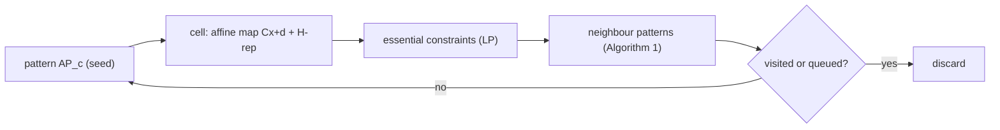

# Exact enumeration, preimages and verification

!!! abstract "In this chapter"
    - A ReLU network over a polyhedral input set can be *enumerated exactly*: its piecewise-affine representation, cell by cell, is computable.
    - Reachable polyhedral marching enumerates the cells a network reaches from an input polytope by stepping from one activation pattern to a neighbouring one, and, being pattern-based, it can answer a safety question before it has finished.
    - Forward and backward reachable sets are read off the enumerated cells, and these are exactly what a safety property asserts about.
    - The mixed-integer formulation of a rectifier network solves the complementary problem — counting, not merely bounding, the regions inside a box.
    - The preimage of a layer's activity is a piecewise-linear manifold built from the reciprocal (dual) basis of the layer's weight matrix.
    - Enumeration also verifies *structural* properties, such as convexity, by testing one nonnegativity condition per neighbouring-region pair.
    - Prerequisites: [The region complex of a ReLU network](relu-network-geometry.md), [Counting linear regions](counting-regions.md).

The [previous chapter](relu-network-geometry.md) established that a ReLU network is affine on each cell of a polyhedral decomposition of its input space, and that the whole complex can be extracted exactly [@serraBoundingCountingLinear2018, §2, p. 2; @berzinsPolyhedralComplexExtraction2023, §3.1, p. 3]. This chapter asks what that exactness is *for*. Two practical questions drive the algorithms here. The first is a safety question: given a set of inputs — a box of pixel values, a range of robot states — where does the network send them, and can any input in the set produce a forbidden output? The second is an inverse question: given a target activation vector at some layer, which inputs produce it, and what do those inputs look like as a set? Both are answered by the same object, the explicit piecewise-affine representation, and both are answered *exactly* rather than by relaxation. The algorithms differ in how they use it: reachable polyhedral marching walks the cells of the complex from a seed and projects them to the output; a mixed-integer program encodes the network once and lets a solver enumerate; and the preimage construction reads a linear piece off the weight matrix directly. I use the shared [notation](../notation.md) throughout — $f$ for the network, $L$ for its depth, $n_l$ the width of layer $l$, $W^{(l)},b^{(l)}$ its weights and biases, $z^{(l)}$ the pre-activation, $a^{(l)}=\sigma(z^{(l)})$ the activation, $\mathbf{s}(x)$ the activation pattern, $\mathcal{R}$ a linear region and $\mathcal{P}(f)$ the region complex — and translate each paper's symbols into it, saying so where I do.

## What exact reachability asks

Overapproximate verification replaces the network by a simpler set that contains its true image and checks the safety property on that. This is fast and conservative: it can prove a property safe but may fail to prove an unsafe one, because the overapproximation can contain spurious points. *Exact* reachability instead computes the precise image. For a network $F$ and an input set $X$, the forward reachable set is the image $Y=\{F(x)\mid x\in X\}$ and the backward reachable set is the preimage $X=\{x\mid F(x)\in Y\}$ [@vincentReachablePolyhedralMarching2021, §III, Eqs. 5–6, p. 2]. Because a ReLU network is continuous and piecewise affine, with a polyhedral complex $\mathcal{P}(f)$ whose cells each carry one affine map, the image of a polyhedral input region is a finite union of projected polyhedra — one per cell the region meets. Exactness therefore reduces to an *enumeration* problem: find every cell that intersects $X$, and project each through its affine map.

The classical way to do this is layer by layer, applying affine transformation, intersection and projection at each layer [@vincentReachablePolyhedralMarching2021, §II, p. 2]. That route has two costs the chapter's first algorithm was built to avoid. It must compute the entire reachable set before it can report anything, even when a single unsafe input would settle the question; and every intermediate polyhedron and affine map must be kept in memory, because later neurons may still split them, and the number of regions is hard to estimate in advance [@vincentReachablePolyhedralMarching2021, §II, p. 2]. The alternative is to enumerate the cells of the *input* space directly, which is possible because a cell and its affine map are determined by an activation pattern.

Reachable polyhedral marching (RPM) computes the explicit piecewise-affine representation of a ReLU network by enumerating its input-space cells from a seed [@vincentReachablePolyhedralMarching2021, §IV, p. 2]. It rests on the three-way correspondence of [relu-network-geometry.md](relu-network-geometry.md): a pattern gives the cell, the cell gives the affine map, and the map gives the image.

**Cell from pattern.** Put the network in bias-free augmented form, $F(\tilde x)$ with $\tilde x=[x_1,\dots,x_n,1]^\top$, so that each layer is a single matrix $\tilde W^{(l)}$ [@vincentReachablePolyhedralMarching2021, §III, Eqs. 3a–3c, p. 2]. Fix the activation pattern $\mathrm{AP}$ — for unit $j$ of layer $i$, $\mathrm{AP}_{ij}(x)=1$ if $\hat z_{ij}>0$ and $0$ otherwise [@vincentReachablePolyhedralMarching2021, Eq. 7a, §IV-A, p. 3]. On a fixed pattern every ReLU is replaced by zero or the identity, and the network collapses to one affine map. In the augmented coordinates, zeroing the rows of each hidden weight matrix whose unit is inactive,

$$
\tilde W^{(l)}_{\mathrm{AP}}(x)=\operatorname{diag}(\mathrm{AP}^{(l)}(x))\,\tilde W^{(l)},
$$

gives the map of the cell as $C x+d=\tilde W^{(n)}\prod_{l=1}^{n-1}\tilde W^{(l)}_{\mathrm{AP}}(x)$ [@vincentReachablePolyhedralMarching2021, Eqs. 8a–8b, §IV-A, p. 3]. The same folding, applied to a single row, gives the half-space that bounds the cell for one neuron: with $[a_{ij}\ {-}b_{ij}]=\tilde W^{(i)}[j,:]\prod_{l=1}^{i-1}\tilde W^{(l)}$, unit $ij$ contributes $a_{ij}^\top x\ge b_{ij}$ if it is active and $a_{ij}^\top x\le b_{ij}$ if not [@vincentReachablePolyhedralMarching2021, Eqs. 9–10, §IV-A, p. 3]. Stacking these rows yields an H-representation $PH=\{x\in\R^d\mid Ax\le b\}$ of the cell, so the pattern does double duty — it selects the affine map *and* defines the polyhedron [@vincentReachablePolyhedralMarching2021, Def. 2, Eq. 11, §IV-A, p. 3]. This is the same PWA compact form used for the region complex in [relu-network-geometry.md](relu-network-geometry.md).

**Minimal representation.** A pattern's H-representation usually carries redundant rows. Two rows are duplicates if they are positive scalar multiples of one another, and a constraint is *redundant* if removing it does not change the feasible set (a duplicate is redundant by definition); the rest are *essential* [@vincentReachablePolyhedralMarching2021, Defs. 3–4, §IV-B, p. 3]. Whether row $i$ is essential is decided by the linear program

$$
\max_x\ a_i^\top x\quad\text{subject to }\tilde A x\le\tilde b,
$$

over the other constraints: if the optimum is at most $b_i$, row $i$ was already implied by the rest [@vincentReachablePolyhedralMarching2021, Eq. 13, §IV-B, p. 3]. Solving one LP per row is the worst case; a bounding-box heuristic finds a subset of the redundant rows cheaply and, the authors report, identifies about 90% of them, with other heuristics not improving on it [@vincentReachablePolyhedralMarching2021, §IV-B, p. 3]. Only the essential rows index the facets across which the cell can be left.

**Neighbouring pattern.** The step that makes marching possible is a rule for the pattern of the cell on the far side of an essential facet. Write $c$ for the current cell and $c'$ for the neighbour sharing the facet $c\cap c'$, whose defining row is the *neighbor constraint* [@vincentReachablePolyhedralMarching2021, §IV-C, p. 3]. The naive rule — flip the unit that owns that constraint — is wrong, because the constraint parameters $a_{ij}(x),b_{ij}(x)$ are *nonlinear functions of the input*: a constraint that reads $0^\top x\le0$ everywhere on $c$ (a *degenerate* constraint) may become non-degenerate on $c'$, and vice versa. RPM therefore classifies each unit: **Type 1** if its constraint defines $c\cap c'$, **Type 2** if its constraint is degenerate on $c$, and **Type 3** otherwise [@vincentReachablePolyhedralMarching2021, Def. 5, §IV-C, p. 4]. Type 3 units are strictly satisfied on the interior of $c$ and, by continuity of the pre-activation, stay strictly satisfied on $c'$, so they never flip [@vincentReachablePolyhedralMarching2021, Eq. 14c, §IV-C, p. 4]. Type 1 and Type 2 units are handled by the local rule of Algorithm 1: walk the network layer by layer, recompute each such unit's constraint, and set its activation to zero if the new constraint is $0^\top x\le0$, flipping it otherwise [@vincentReachablePolyhedralMarching2021, Algorithm 1, §IV-C, p. 4]. This is one logical check per neuron and is fast even for networks with tens of thousands of neurons.

**The march.** Algorithm 2 keeps a working set of patterns, starts from the pattern of an arbitrary input point, and, for each essential constraint of the popped cell, generates the neighbour's pattern, pushing it onto the working set unless it has already been visited or queued [@vincentReachablePolyhedralMarching2021, Algorithm 2, §IV-D, p. 5]. Because neighbouring cells share a facet, the working set eventually covers every cell the input set meets; when it is empty, the enumeration is complete and the list of (cell, affine map, H-representation) triples is the explicit PWA representation [@vincentReachablePolyhedralMarching2021, §IV-D, p. 5]. This is a pattern-space variant of the one-bit-flip traversal of [@liuIntegratingGeometriesReLU2023a, §2.4, p. 4], extended to an unbounded marching front and to the neighbour rule that makes the flips correct in the presence of degenerate constraints.

## Forward and backward reachability, and anytime verification

Once the cells are enumerated, reachability is a per-cell operation. The image of a polyhedron $PH=\{x\mid Ax\le b\}$ under the affine map $Cx+d$ is $P_{\text{out}}=\{y\mid y=Cx+d,\ Ax\le b\}$; when $C$ is invertible its H-representation is $P_{\text{out}}=\{y\mid AC^{-1}y\le b+AC^{-1}d\}$, and when it is not, a general projection such as block elimination is used [@vincentReachablePolyhedralMarching2021, §V-A, Eqs. 15–16, p. 5]. Backward reachability applies the map to the output set instead: the preimage of $\{y\mid Ay\le b\}$ is $P_{\text{in}}=\{x\mid ACx\le b-Ad\}$, which is then intersected with the cell [@vincentReachablePolyhedralMarching2021, §V-B, Eqs. 18a–18b, p. 5]. Several backward sets can be handled at the cost of one extra intersection each [@vincentReachablePolyhedralMarching2021, §V-B, p. 5].

To reach over several time steps, note that the iterated system $x_{t+1}=F(x_t)$ is the same function as the concatenated network $F^T=F\circ\dots\circ F$: a network with $N$ neurons and $L$ layers becomes one with $TN$ neurons and $TL$ layers, and RPM runs on that [@vincentReachablePolyhedralMarching2021, §V, p. 5]. The cost is paid once, in a larger input-space enumeration.

The pattern-based march gives verification its *anytime* character. If an enumerated cell contains an unsafe input, RPM can return that witness immediately, without computing the rest of the reachable set; layer-by-layer methods must solve the whole problem whether the answer is safe or unsafe [@vincentReachablePolyhedralMarching2021, §VI-B, p. 6]. The memory argument is the same: once a cell–map pair is computed it can be written out, and only a binary pattern vector needs to be kept to continue [@vincentReachablePolyhedralMarching2021, §II, p. 2].

The reported numbers bear this out. On the ACAS Xu advisory networks — five inputs, five outputs, 300 neurons — the backward reachable set for Property 3 is empty exactly when the property holds, so a nonempty set witnesses a violation [@vincentReachablePolyhedralMarching2021, §VI-B, p. 6]. For the two unsafe networks the paper tests, RPM returns a witness in $0.01$ s against $6.66$ s and $5.45$ s for the fastest exact baseline (the face-lattice method), while Reluplex and Marabou need seconds longer still; for the two safe networks RPM costs about twice the face-lattice time, $19.72$ s and $31.92$ s, but remains several times faster than Reluplex and about twice as fast as Marabou [@vincentReachablePolyhedralMarching2021, Tab. I, §VI-B, p. 6]. The asymmetry is the point of the method: the anytime advantage pays off precisely when a violation exists. In the dynamical-systems example, a one-hidden-layer network of 12 neurons approximates the discrete-time damped pendulum, and composing it 50 times gives a 600-neuron network for $x_{t+50}$; forward reachability from $|\theta|\le90^\circ$, $|\dot\theta|\le90^\circ/\text{s}$ enumerates **2781 regions in 87 s** and shows the reachable set contained in the initial set, proving forward invariance over 50 steps [@vincentReachablePolyhedralMarching2021, §VI-A, Eq. 20, p. 5; Fig. 4, p. 6].

!!! warning "The anytime trade-off"
    RPM's speed advantage is one-sided. When a property *is* satisfied, the paper reports it is about $2\times$ slower than the face-lattice method, because the anytime shortcut never fires and the full enumeration must be finished [@vincentReachablePolyhedralMarching2021, §VI-B, p. 6]. It is also single-threaded in the reported experiments; a parallelised face-lattice implementation exists and a parallel RPM is left to future work [@vincentReachablePolyhedralMarching2021, §VI-B, p. 6].

## Exact counting as enumeration: the mixed-integer route

Enumeration of the region complex is one exact algorithm; a completely different one encodes the network as a mixed-integer linear program. When the input $x$ is bounded and polyhedral — a box, as when every pixel lies in $[0,1]$ — each ReLU can be written with a continuous complementary variable $\bar h^l_i=\max\{0,-W^l_i h^{l-1}-b^l_i\}$ and a binary activation variable $z^l_i$ [@serraBoundingCountingLinear2018, §5, p. 7]. The big-$M$ disjunction

$$
W^l_i h^{l-1}+b^l_i=h^l_i-\bar h^l_i,\quad h^l_i\le M z^l_i,\quad \bar h^l_i\le M(1-z^l_i),\quad h^l_i,\bar h^l_i\ge0,\quad z^l_i\in\{0,1\}
$$

reproduces the ReLU exactly whenever $|W^l_i h^{l-1}+b^l_i|\le M$ for every reachable $h^{l-1}$; Theorem 11 states that a feasible solution with $x$ fixed then yields the network's output $y$ [@serraBoundingCountingLinear2018, §5, Eqs. (1)–(6) and Thm. 11, p. 7]. Counting *regions* rather than evaluating *one* input needs the complementary programme (P), which maximises the minimum output of an active unit so that neurons lying exactly on an activation boundary are not double-counted [@serraBoundingCountingLinear2018, §5, p. 7]. With the network so encoded, all integer solutions of (P) are enumerated by the one-tree approach, which resumes the branch-and-bound search after an optimum has been found [@serraBoundingCountingLinear2018, §5, p. 7].

The two exact routes answer different questions and have different costs. RPM enumerates the cells of an *unbounded* input space and hands back each cell's geometry and affine map, but it cannot report a total count any faster than it enumerates. The mixed-integer programme fixes a bounded region and returns the number of activation patterns inside it, at the price of a solver, a big-$M$ choice, and search that is exponential in the neuron count. On small MNIST networks with two hidden layers summing to 22 neurons, trained 10 times per configuration for 20 epochs, the paper counts all regions within $0\le x\le1$; the median counting time per configuration is between $1.1$ s and $9.9$ s [@serraBoundingCountingLinear2018, §6, p. 8; Tab. 1, p. 19]. The counts themselves are plotted rather than tabulated. What the experiment buys is a way to test the worst-case bounds of [counting-regions.md](counting-regions.md): the paper reports that its Theorem 1 bound is the tightest of those compared, and finds "initial evidence" that accuracy correlates with the region count for configurations where no layer is very thin [@serraBoundingCountingLinear2018, §6–§7, pp. 8–9]. The exactness is what makes the bound testable at all: without a ground-truth count, one cannot say whether $2^N$ or $\sum_j\binom{n_1}{j}$ is loose.

## Preimages of layer activities

The other inverse question is local. Fix a target activity vector $x^{(l+1)}$ at some layer of a fully connected rectifier network, and ask which inputs at layer $l$ produce it. The papers call this the *preimage* $P(x^{(l+1)})$ of the activity [@carlssonPREIMAGERECTIFIERNETWORK2017, §1, p. 1]. Earlier work recovered single such inputs by optimisation and regularisation, with no guarantee of completeness [@carlssonPREIMAGERECTIFIERNETWORK2017, Abstract]. The construction here is closed-form and reads the whole set off the layer's weight matrix.

The layer map is $x^{(l+1)}=[Wx^{(l)}+b]^+$, and the preimage of a target is the set of $x$ with $w_i^\top x+b_i=x_i^{(l+1)}$ for the target's positive coordinates and $w_i^\top x+b_i\le0$ for its zero coordinates [@carlssonPREIMAGERECTIFIERNETWORK2017, §1, p. 1]. This is exactly the sign condition of an activation pattern at that layer, so the preimage of a layer activity is the input-space region — a cone, as it will turn out — carrying that pattern.

To solve it, the paper builds a basis adapted to $W$. Let the target have $p$ zero coordinates $i_1,\dots,i_p$ and $q=n-p$ positive ones $j_1,\dots,j_q$ [@carlssonPREIMAGERECTIFIERNETWORK2017, §1, p. 1]. For each kernel $w_i$ define its nullspace hyperplane $\Pi_i=\{x:w_i^\top x+b_i=0\}$, and intersect the complementary set to get the one-dimensional subspace

$$
\pi_i=\Pi_1\cap\dots\cap\Pi_{i-1}\cap\Pi_{i+1}\cap\dots\cap\Pi_n,
$$

spanned by a vector $e_i$ normalised so that $w_i^\top e_i=1$ [@carlssonPREIMAGERECTIFIERNETWORK2017, §1, pp. 1–2]. Each additional hyperplane lowers the dimension by one, so intersecting $n-1$ of them leaves a line; the assumed full rank of $W$ makes $\{e_1,\dots,e_n\}$ a basis of the input space, and the matrix $(e_1,\dots,e_n)$ is the inverse of $W$ [@carlssonPREIMAGERECTIFIERNETWORK2017, §1, p. 2]. Because $e_i$ lies in every other kernel's nullspace, the coordinates of $x=\sum_i\alpha_i e_i$ are just the pre-activations: $w_j^\top x=\alpha_j$ [@carlssonPREIMAGERECTIFIERNETWORK2017, §1, p. 2]. The sign conditions of the pattern therefore become simple bounds on one coordinate each — the *reciprocal basis* makes the layer's sign pattern a coordinate-sign condition.

Reading the constraints in this basis gives the preimage as a piecewise-linear manifold: assign the active coordinates their target values and let the rectified coordinates range over the allowed half-line,

$$
x=\alpha_{i_1}e_{i_1}+\dots+\alpha_{i_p}e_{i_p}-\alpha_{j_1}e_{j_1}-\dots-\alpha_{j_q}e_{j_q},\qquad \alpha_i\ge0 .
$$

The paper states this in a slightly garbled printed form — the sign of the rectified coordinates and the swap of the two index lists in the prose are inconsistent, and a second display on p. 3 has lost its left-hand side — but the intended set is unambiguous: the active units fix their coordinates at the target value, and the rectified units are free in the allowed half-space, so the preimage is the target point plus the nonnegative cone generated by the $e_i$ of the rectified units [@carlssonPREIMAGERECTIFIERNETWORK2017, §1, pp. 2–3]. For the worked three-unit, two-input example the picture is the one you would draw: the all-positive octant inverts to a single point; a point with exactly one coordinate rectified has a ray along the corresponding $e_i$ as preimage; a point with two coordinates rectified has a two-dimensional cone as preimage [@carlssonPREIMAGERECTIFIERNETWORK2017, Fig. 1, §1, p. 2]. The all-rectified case is degenerate: the inputs that all map to output $(0,0)$ form a region that is "irreversibly mixed", the map failing to be injective there [@carlssonPREIMAGERECTIFIERNETWORK2017, Fig. 1, §1, p. 2].

For a deeper layer the same argument is applied layer by layer: a preimage at one level is a piece of a linear manifold of dimension equal to the number of units with positive output, and mapping it back through the earlier layers gives a piecewise-linear manifold in the input space, possibly with several branches [@carlssonPREIMAGERECTIFIERNETWORK2017, §1, p. 3]. The paper presents these manifolds as building blocks for mapping input distributions to node outputs at any level [@carlssonPREIMAGERECTIFIERNETWORK2017, §1, p. 3].

This preimage is the *local* inverse of one layer, and it should not be confused with RPM's backward reachable set, which is the preimage of an output set under the *whole* network. The two agree in spirit but differ in scope: RPM intersects each enumerated cell with the output set's preimage and unions the results [@vincentReachablePolyhedralMarching2021, §V-B, Eqs. 18–19, p. 5], whereas Carlsson's construction solves the layer's linear system directly and never enumerates cells. The picture is the same in both: an inverse image of a ReLU layer is a piecewise-linear set, linear on each pattern and glued along the bent hyperplanes of [relu-network-geometry.md](relu-network-geometry.md).

!!! question "Open question"
    The word "complete" in the preimage construction is asserted, not proved: nothing in the note shows that the union over activation patterns covers a full neighbourhood, and the full-rank hypothesis on $W$ is invoked once without treating the rank-deficient case in which the construction breaks down [@carlssonPREIMAGERECTIFIERNETWORK2017, Abstract; §1, p. 2]. Since individual ReLU layers are routinely rank-deficient, a version of the construction valid at any rank — for instance via the projection machinery RPM uses when its affine map is not invertible [@vincentReachablePolyhedralMarching2021, §V-A, p. 5] — is still missing.

## Verifying a structural property by enumeration

Enumeration verifies not only pointwise safety but *structural* properties of the function, and convexity is the cleanest example. Learning a convex function is standard in inverse problems and optimal transport, and the usual architecture, an input convex neural network (ICNN), guarantees convexity by imposing nonnegative hidden weights — a design that, the paper argues, is crude and hurts expressivity [@gagneuxHowImproveExpressivity2025, §1, §2.1]. The question is whether that nonnegativity is the *only* way to enforce convexity, and answering it requires deciding convexity of a given ReLU network exactly.

The enabling fact is local. A continuous piecewise-linear function is convex if and only if, for every pair of *neighbouring* regions $R_1\sim R_2$ — regions sharing a boundary of affine dimension $d-1$ — there are interior points $x_1,x_2$ with $\langle\nabla f(x_1)-\nabla f(x_2),\,x_1-x_2\rangle\ge0$ [@gagneuxHowImproveExpressivity2025, Eq. 1, §2.3, p. 3]. This is a *minimal* set of conditions: convexity need only be checked across the boundaries, not at every pair of points. For a ReLU network the gradients on the two regions are read off the path-activations, and the condition becomes, for every hidden neuron $\nu$,

$$
\min_{a\in\mathfrak{a}^{\nu\to}}\ \langle a,\ \Phi^{\nu\to}(\theta)\rangle\ \ge\ 0 ,
$$

where $\Phi^{\nu\to}(\theta)$ is the *path-lifting* — the product of weights along each path from $\nu$ to the output — and $\mathfrak{a}^{\nu\to}$ collects the activation patterns realised at the points $X_\nu$ where only $\nu$ switches [@gagneuxHowImproveExpressivity2025, Eq. 4, Thm. 2.3, §2.4.3, p. 4]. A neuron with $X_\nu$ nonempty is *isolated* [@gagneuxHowImproveExpressivity2025, Def. 2.1, §2.4, p. 3]. When every elementary vector is present among the $\mathfrak{a}^{\nu\to}$, each scalar product has a single term and the condition collapses to the ICNN nonnegativity constraints; when elementary vectors are *missing*, the condition is strictly weaker — and that gap is exactly the extra convex networks ICNNs exclude [@gagneuxHowImproveExpressivity2025, §2.4.3, p. 4]. One hidden layer: convex ReLU networks and ICNNs implement the same functions, with the same width [@gagneuxHowImproveExpressivity2025, Prop. 2.2, §2.4.1, p. 3]. Two hidden layers: the equivalence already fails, and the companion work exhibits a convex two-layer network not implementable by any ICNN of the same architecture [@gagneuxHowImproveExpressivity2025, §2.4.2, p. 3].

Verifying convexity this way is an enumeration problem, because the condition needs the sets $\mathfrak{a}^{\nu\to}$, i.e. the frontiers and regions of the piecewise-linear function, whose number grows exponentially in the neurons [@gagneuxHowImproveExpressivity2025, §3, p. 4]. The paper computes them with the edge-subdivision algorithm of [@berzinsPolyhedralComplexExtraction2023, §3–§4], the frontier extractor from [relu-network-geometry.md](relu-network-geometry.md), and evaluates each scalar product by a forward pass on a modified network rather than storing the exponentially long path-lifting vector [@gagneuxHowImproveExpressivity2025, §3, p. 4]. The same enumeration turns into a training tool: penalising the negative values of the convexity condition, $R(\theta)=\lambda\sum_{\nu\in H}\sum_{a\in\mathfrak{a}^{\nu\to}}\max(0,-\langle a,\Phi^{\nu\to}(\theta)\rangle)$, softly enforces convexity [@gagneuxHowImproveExpressivity2025, Eq. 5, §4.2, p. 5]. On a two-dimensional synthetic target, the convex-regularised ReLU network attains a lower mean square error ($0.84\pm0.73$) than the unconstrained network ($0.90\pm0.53$) and much lower than the ICNN ($1.71\pm0.90$) [@gagneuxHowImproveExpressivity2025, Tab. 1, §4.2, p. 5]. The scaling caveat is candid: the frontiers must be recomputed at every optimisation step, and the paper says plainly that scaling the approach to practical networks remains a computational challenge [@gagneuxHowImproveExpressivity2025, §5, p. 5].

!!! tip "Why the frontier is the right object"
    The convexity test needs one condition per *neighbouring* region pair, not per pair of points, and the pairs are exactly indexed by the isolated-neuron switches — the relative interiors of the $(d-1)$-dimensional frontiers [@gagneuxHowImproveExpressivity2025, §2.4, p. 3]. Enumerating the frontier set is therefore the minimal exact computation that decides convexity, which is why an edge-subdivision extractor, rather than a region counter, is the right tool here [@gagneuxHowImproveExpressivity2025, §3, p. 4; @berzinsPolyhedralComplexExtraction2023, §4, p. 5].

!!! note "Background"
    The arrangement count that underlies the region bounds discussed in [counting-regions.md](counting-regions.md) — an arrangement of $m$ hyperplanes in $\R^d$ cutting space into at most $\sum_{j=0}^{d}\binom{m}{j}$ regions, with equality in general position — is Zaslavsky's theorem. That paper is not in this collection (it has no readable attachment), so it is quoted here as outside background; Serra et al. cite it for the base case of their bound [@serraBoundingCountingLinear2018, §2, p. 3].

## Summary

- Exact reachability computes the precise image or preimage of a set under a ReLU network, unlike overapproximate methods that can fail to witness an unsafe input [@vincentReachablePolyhedralMarching2021, §III, Eqs. 5–6, p. 2].
- RPM enumerates the input-space cells of the explicit piecewise-affine representation by stepping from each cell to a neighbour across an essential constraint, with a Type 1/2/3 rule that handles degenerate constraints correctly [@vincentReachablePolyhedralMarching2021, Def. 5, Algorithm 1, §IV-C, p. 4].
- Forward reachability projects each cell's polyhedron through its affine map; backward reachability intersects each cell with the output set's preimage; a multi-step system is made one network by concatenation [@vincentReachablePolyhedralMarching2021, §V, Eqs. 16 and 18b, p. 5].
- The pattern-based march is anytime: it can return a violating cell before finishing, which is why it is up to three orders of magnitude faster than exact baselines on unsafe ACAS Xu properties, but roughly twice as slow when the property holds [@vincentReachablePolyhedralMarching2021, §VI-B, Tab. I, p. 6].
- The mixed-integer encoding with a big-$M$ disjunction per ReLU turns a network into a linear programme whose integer solutions count regions exactly; its cost is a bound on the practical size of networks it can handle [@serraBoundingCountingLinear2018, §5, p. 7].
- The preimage of a layer's activity is a piecewise-linear manifold: the target's active units fix coordinates in the reciprocal basis of $W$, and its rectified units contribute a nonnegative cone [@carlssonPREIMAGERECTIFIERNETWORK2017, §1, pp. 2–3].
- The same enumeration decides structural properties: a ReLU network is convex if and only if one nonnegativity condition holds across every neighbouring-region boundary, and computing those boundaries needs the frontiers of the function [@gagneuxHowImproveExpressivity2025, Thm. 2.3, §2.4.3, p. 4; §3, p. 4].
- Taken together, these algorithms make the region complex operational: the same enumeration that counts or extracts the complex also certifies reachability, inverts layer activities and verifies convexity.

## Further reading

- [@vincentReachablePolyhedralMarching2021]: the marching algorithm, the Type 1/2/3 neighbour rule, and the ACAS Xu and pendulum experiments; read §IV for the machinery and §V–§VI for the reachability results.
- [@serraBoundingCountingLinear2018]: the mixed-integer encoding of a ReLU network and exact region counting; read §5 for the constraints (1)–(6) and the counting programme, and §6 for the MNIST experiment.
- [@carlssonPREIMAGERECTIFIERNETWORK2017]: the reciprocal-basis construction of the preimage of layer activities; read §1 for the construction and Fig. 1 for the three-unit example.
- [@gagneuxHowImproveExpressivity2025]: the convexity characterization and its use as a regulariser; read §2.3–§2.4 for the neighbouring-region conditions and §3–§4 for the algorithm and experiments.
- [@berzinsPolyhedralComplexExtraction2023]: the edge-subdivision frontier extractor that supplies the enumeration to the convexity test; read §3–§4.
- [@liuIntegratingGeometriesReLU2023a]: the seed-and-flip traversal that RPM generalises to an unbounded marching front; read §2.4.

## Exercises

**Exercise 1** ★ (check). RPM enumerates cells by marching from a seed across essential constraints. Why must the duplicate and redundant rows be removed before the neighbour step, and what goes wrong if a degenerate constraint is treated as if it were an ordinary one?

??? success "Solution"
    The neighbour step generates one candidate cell per essential constraint, since
    those are exactly the facets of the cell; a redundant row corresponds to a
    constraint that is implied by the others and so has no facet to cross, and
    generating a neighbour from it either duplicates an existing cell or produces an
    infeasible one [@vincentReachablePolyhedralMarching2021, Defs. 3–4, §IV-B, p. 3].
    A degenerate constraint, which reads $0^\top x\le0$ everywhere on the cell, is
    satisfied on the whole cell and has no genuine facet either; RPM's Type 2 class
    handles it by recomputing the constraint in the neighbouring cell instead of
    flipping blindly [@vincentReachablePolyhedralMarching2021, Def. 5, Eqs. 14a–14b,
    §IV-C, p. 4]. Treating it as ordinary would flip a unit that need not switch and
    would miss the cell where the constraint becomes non-degenerate — the exact case
    the Type 1/2/3 taxonomy exists to cover.

**Exercise 2** ★★ (derive). For a fixed activation pattern with all units active and $C$ invertible, derive the H-representation of the forward image of the cell $PH=\{x\mid Ax\le b\}$ under $y=Cx+d$, and explain what changes when $C$ is singular.

??? success "Solution"
    Substituting $y=Cx+d$ into the inequalities gives $A C^{-1}(y-d)\le b$, i.e.
    $AC^{-1}y\le b+AC^{-1}d$; this is exactly RPM's Eq. (16)
    [@vincentReachablePolyhedralMarching2021, Eq. 16, §V-A, p. 5]. The step uses that
    $C^{-1}$ exists, so the image has the same dimension as the cell and its
    H-representation can be written down directly. When $C$ is singular the image is a
    lower-dimensional set and inverting is impossible; a general projection such as
    block elimination or Fourier–Motzkin elimination is then required to eliminate the
    variables and recover the H-representation in $y$
    [@vincentReachablePolyhedralMarching2021, §V-A, p. 5].

**Exercise 3** ★ (check). RPM's answer for an unsafe ACAS Xu property costs $0.01$ s while its answer for a safe network costs $19.72$ s, about twice the face-lattice baseline. Explain both numbers in terms of the algorithm.

??? success "Solution"
    The unsafe cases terminate early: as soon as an enumerated cell contains an input
    that violates the property, RPM returns that witness and stops, so it never
    finishes the enumeration — the anytime property
    [@vincentReachablePolyhedralMarching2021, §VI-B, p. 6]. The safe cases have no
    witness, so the full reachable set must be enumerated before the answer "safe" can
    be given; there is no shortcut, and the per-cell overhead leaves RPM about twice as
    slow as the face-lattice method [@vincentReachablePolyhedralMarching2021, Tab. I,
    §VI-B, p. 6]. The asymmetry is the whole motivation for marching instead of
    propagating layer by layer.

**Exercise 4** ★★ (compare). RPM and the mixed-integer formulation both compute the exact region structure. State precisely what each returns, what input it needs, and one question each answers that the other does not.

??? success "Solution"
    RPM returns the explicit PWA representation — a list of cells, each with its affine
    map and H-representation — over an input set that need not be bounded, so it can
    also project cells forward or intersect them with an output set
    [@vincentReachablePolyhedralMarching2021, §IV-D, Algorithm 2, p. 5; §V, p. 5]. The
    mixed-integer programme needs a bounded, polyhedral input box and a sufficiently
    large $M$, and returns the *number* of activation patterns inside it by enumerating
    integer solutions [@serraBoundingCountingLinear2018, §5, pp. 7–8]. RPM alone can
    return a witness input and stop early; the MIP alone gives a ground-truth total
    count against which worst-case bounds can be tested
    [@serraBoundingCountingLinear2018, §6, p. 8]. Neither is uniformly faster; the MIP
    is limited to small networks because exact counting is exponential in the neurons.

**Exercise 5** ★★ (derive). Carlsson's construction writes $x=\sum_i\alpha_i e_i$ with $w_i^\top e_i=1$ and $w_j^\top e_i=0$ for $i\ne j$. Show that $\alpha_j=w_j^\top x$, and use it to explain why the preimage of a target activity with one rectified unit is a ray.

??? success "Solution"
    Applying $w_j^\top$ to $x=\sum_i\alpha_i e_i$ gives
    $w_j^\top x=\sum_i\alpha_i w_j^\top e_i=\alpha_j$, since every term with $i\ne j$
    vanishes and the $i=j$ term is $\alpha_j$
    [@carlssonPREIMAGERECTIFIERNETWORK2017, §1, p. 2]. The pre-activation of unit $j$ is
    therefore its subspace coordinate, so the pattern's sign conditions become bounds on
    single coordinates: the active units fix $\alpha_j$ at the target value, and each
    rectified unit is free over $\alpha_i\ge0$ [@carlssonPREIMAGERECTIFIERNETWORK2017,
    §1, pp. 2–3]. With exactly one rectified unit, only one coordinate ranges over a
    half-line while all others are pinned, so the preimage is a ray along that unit's
    $e_i$ — the arrow picture of Fig. 1 [@carlssonPREIMAGERECTIFIERNETWORK2017, Fig. 1,
    §1, p. 2].

**Exercise 6** ★★ (compare). RPM's backward reachability and Carlsson's preimage both compute inverse images of a ReLU network. Contrast their scopes, and say why a whole-network backward preimage cannot be a single linear manifold.

??? success "Solution"
    Carlsson's construction inverts *one layer*: it solves the layer's linear system on
    the target's pattern and returns a cone (or a point) in the layer's input space
    [@carlssonPREIMAGERECTIFIERNETWORK2017, §1, pp. 2–3]. RPM's backward reachability
    inverts the *whole network* by intersecting each enumerated input-space cell with
    the preimage of the output set and unioning the pieces
    [@vincentReachablePolyhedralMarching2021, §V-B, Eqs. 18–19, p. 5]. A whole-network
    preimage crosses many activation patterns; on each pattern it is linear, but the
    linear pieces are glued along the bent hyperplanes where units switch, so the union
    is piecewise-linear with many branches, not a single linear manifold
    [@carlssonPREIMAGERECTIFIERNETWORK2017, §1, p. 3]. Carlsson says as much for
    multi-level networks: mapping the layer-level pieces back to the input space yields
    piecewise-linear manifolds [@carlssonPREIMAGERECTIFIERNETWORK2017, §1, p. 3].

**Exercise 7** ★★★ (design). You have trained a ReLU network as a learned convex regulariser and must certify that it is convex on its domain. Which objects must you enumerate, and how would you keep the cost finite?

??? success "Solution"
    Convexity of a piecewise-linear function need only be checked across neighbouring
    regions, so the required object is the set of *frontiers* — the relative interiors of
    the $(d-1)$-dimensional boundaries — split by which single neuron switches, i.e. the
    sets $X_\nu$ of isolated neurons [@gagneuxHowImproveExpressivity2025, Eq. 1, §2.3,
    p. 3; §2.4, p. 3]. Checking the condition
    $\min_{a\in\mathfrak{a}^{\nu\to}}\langle a,\Phi^{\nu\to}(\theta)\rangle\ge0$ for
    every hidden neuron then decides convexity exactly
    [@gagneuxHowImproveExpressivity2025, Thm. 2.3, §2.4.3, p. 4]. To keep it finite: use
    the edge-subdivision extractor to get the frontiers rather than enumerating all
    regions, and evaluate each scalar product by a forward pass on a modified network
    instead of materialising the exponential path-lifting vector
    [@gagneuxHowImproveExpressivity2025, §3, p. 4; @berzinsPolyhedralComplexExtraction2023,
    §4, p. 5]. The remaining cost is the number of frontiers, which is why the paper
    flags scaling to practical networks as open
    [@gagneuxHowImproveExpressivity2025, §5, p. 5].

**Exercise 8** ★★ (critique). The preimage paper calls its construction "complete" and assumes $W$ has full rank. Identify the gap and describe what an experiment would have to show to close it.

??? success "Solution"
    Completeness is asserted rather than proved: the note gives a construction on a
    single activation pattern and a multi-level statement, but does not show that the
    union over patterns covers a full neighbourhood of the target, nor does it treat
    rank-deficient layers — precisely where the nullspace intersections become
    positive-dimensional and the reciprocal-basis construction fails
    [@carlssonPREIMAGERECTIFIERNETWORK2017, Abstract; §1, p. 2]. The paper also states
    that the empirical evaluation of completeness was in progress
    [@carlssonPREIMAGERECTIFIERNETWORK2017, Abstract]. A closing experiment would draw a
    target activity, recover its preimage, and verify by independent enumeration — for
    instance RPM's cell enumeration or the mixed-integer count — that every input mapping
    to the target lies in the recovered set, with at least one rank-deficient layer in the
    test network [@vincentReachablePolyhedralMarching2021, §IV-D, p. 5;
    @serraBoundingCountingLinear2018, §5, p. 7].
